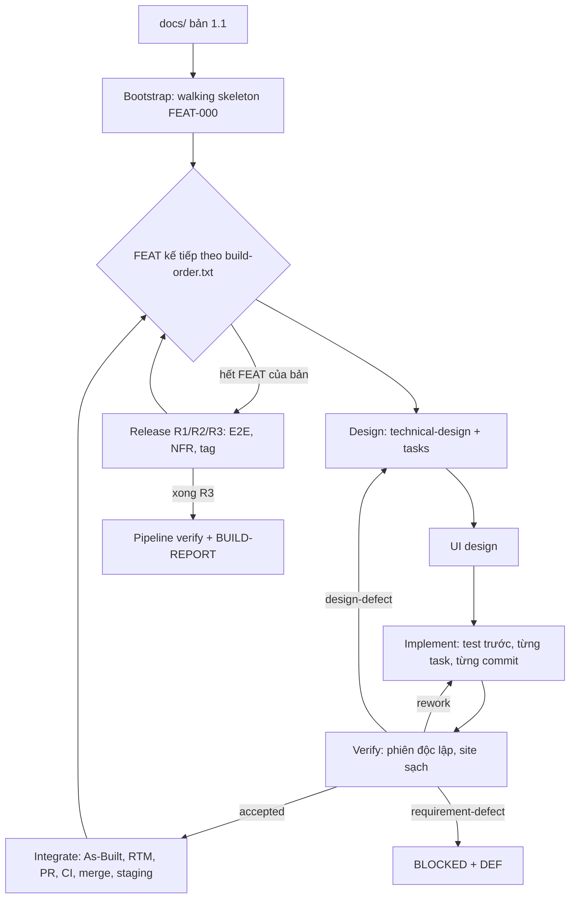

# PLAYBOOK — Xây Normcore bằng Claude Opus 5.5 chạy tự động

> Đầu vào: bộ tài liệu nghiệp vụ `docs/` bản 1.1. Đầu ra: app `normcore` (Frappe v15) trên GitHub, đã kiểm thử, chạy trên staging, kèm As-Built và báo cáo.
> Luật làm việc của agent ở `CLAUDE.md`. Tệp này mô tả **hệ thống chạy thế nào** và **người vận hành làm gì**.

## 1. Mô hình



Nguyên tắc thiết kế:

- **Mỗi giai đoạn là một phiên Claude mới** (`claude -p`). Phiên không nhớ gì; trạng thái nằm trong git (`docs/features/FEAT-NNN/`). Dừng ở đâu chạy lại tiếp từ đó.
- **Người viết không tự chấm.** Giai đoạn verify là phiên khác, dựng site sạch, đọc yêu cầu gốc và soát diff test.
- **Máy thay người ở các cổng duyệt** (mục 4). Những gì máy không chắc thì không tự đoán: chặn FEAT đó (BLOCKED), ghi lý do, làm tiếp FEAT khác.
- **Hàng rào cứng bằng hook**, không chỉ bằng lời dặn: agent không sửa được tài liệu yêu cầu, golden, luật của chính nó, không force-push, không chạm production.

## 2. Cấu trúc bộ autopilot trong kho

```
CLAUDE.md                         luật của agent
PLAYBOOK.md                       tệp này
.claude/settings.json             model, quyền, đăng ký hook
.claude/hooks/guard.py            chặn hành vi nguy hiểm
.autopilot/build-order.txt        39 FEAT, bản phát hành, phụ thuộc (từ implementation-plan mục 4)
.autopilot/prompts/*.md           lời nhắc cho từng giai đoạn
scripts/autopilot.sh              bộ điều phối
.github/workflows/ci.yml          CI: golden, lint, unit, độ phủ, quy ước, test trên site
.github/workflows/deploy-staging.yml  tự cập nhật staging khi develop xanh
docs/                             bộ tài liệu nghiệp vụ (đầu vào)
```

## 3. Chuẩn bị một lần (người vận hành, khoảng nửa ngày)

Đây là phần duy nhất cần người. Sau bước 3.6 hệ thống tự chạy.

**3.1. Máy chạy autopilot** — một máy Ubuntu 22.04/24.04 **riêng**, không phải server production. Gợi ý: 8 CPU, 16 GB RAM, 100 GB SSD, mạng ổn định (chạy liên tục nhiều ngày).

```bash
sudo apt update && sudo apt install -y git python3-dev python3-venv python3-pip redis-server \
  mariadb-server mariadb-client libmariadb-dev pkg-config tmux jq curl wkhtmltopdf
curl -fsSL https://deb.nodesource.com/setup_18.x | sudo -E bash - && sudo apt install -y nodejs
sudo npm install -g yarn
pip install --user frappe-bench
# MariaDB: utf8mb4, đặt mật khẩu root (theo hướng dẫn cài Frappe v15)
bench init --frappe-branch version-15 ~/frappe-bench
```

**3.2. Claude Code và GitHub CLI**

```bash
npm install -g @anthropic-ai/claude-code
export ANTHROPIC_API_KEY=...        # khóa API tổ chức; đặt vào ~/.bashrc của user chạy autopilot
sudo apt install -y gh && gh auth login   # token có quyền repo, workflow
claude --version && claude -p "trả lời OK" --model claude-opus-5-5
```

Tùy chọn: cài plugin `agentic-sdlc-kit` cho Claude Code trên máy này. Có plugin thì các giai đoạn dùng skill tương ứng; không có thì lời nhắc tự đủ để làm.

**3.3. Kho GitHub**

```bash
gh repo create mvl26/normcore --private --clone && cd normcore
# chép bộ autopilot (tệp này, CLAUDE.md, .claude/, .autopilot/, scripts/, .github/) vào gốc kho
# chép bộ tài liệu Normcore vào docs/ (giữ nguyên cấu trúc: docs/srs.md, docs/golden/, docs/tools/ ...)
chmod +x scripts/autopilot.sh .claude/hooks/guard.py
git checkout -b develop && git add -A && git commit -m "Normcore: tài liệu 1.1 + autopilot" && git push -u origin develop
git branch main develop && git push -u origin main
gh repo edit --default-branch develop
```

Bật bảo vệ nhánh `main` và `develop`: bắt buộc CI xanh trước khi merge, cấm force-push.

**3.4. Site staging** — một server Frappe v15 có site staging (ví dụ `normcore-staging.<miền>`), đã `bench get-app` kho này ở nhánh `develop` và `install-app normcore`. Tạo người dùng `smoke@...` có vai trò quản trị Normcore cho smoke test.

**3.5. Secrets trên GitHub** (Settings → Secrets → Actions): `STAGING_HOST`, `STAGING_USER`, `STAGING_SSH_KEY`, `STAGING_SITE`, `STAGING_BENCH_DIR`. Trên máy autopilot, đặt `SMOKE_URL`, `SMOKE_API_KEY`, `SMOKE_API_SECRET` vào môi trường để smoke test gọi REST.

**3.6. Chạy thử khô**

```bash
python3 docs/golden/golden_engine.py && python3 docs/golden/golden_cls.py && python3 docs/tools/build_rtm.py docs
./scripts/autopilot.sh status
```

## 4. Chạy

```bash
tmux new -s normcore
cd ~/normcore
MODEL=claude-opus-5-5 MAX_RUNS=400 ./scripts/autopilot.sh
# tách khỏi tmux: Ctrl-b d ; quay lại: tmux attach -t normcore
```

| Biến | Mặc định | Ý nghĩa |
| :-- | :-- | :-- |
| `MODEL` | `claude-opus-5-5` | Model cho mọi phiên |
| `MAX_RUNS` | 400 | Trần tổng số phiên; chạm trần thì HALT — đây là van chặn chi phí |
| `MAX_TURNS` | 300 | Số lượt tối đa trong một phiên |
| `STAGE_TIMEOUT` | 4h | Thời gian tối đa một phiên |
| `MAX_CYCLES` | 4 | Số lần làm lại tối đa của một FEAT trước khi BLOCKED |
| `VERIFY_EVERY` | 5 | Chạy kiểm toàn kho sau mỗi 5 FEAT xong |
| `RELEASES` | `R1 R2 R3` | Chỉ chạy R1: `RELEASES=R1` |
| `BENCH_DIR` | `~/frappe-bench` | Bench dev |
| `AUTO_DEPLOY_PROD` | `false` | `true` thì giai đoạn release tự đẩy production |
| `PROD_HOST` | trống | Tên máy production; hook chặn mọi lệnh chạm nó ngoài release |

Ước lượng: khoảng 4–6 phiên cho một FEAT (design, ui, implement, verify, integrate, cộng làm lại), tức 180–250 phiên cho 39 FEAT cộng bootstrap, release, báo cáo. Đặt `MAX_RUNS` và hạn mức chi tiêu ở Anthropic Console trước khi chạy.

## 5. Cổng tự động thay người duyệt

| Cổng | Trước đây ai duyệt | Nay kiểm bằng gì | Đạt khi |
| :-- | :-- | :-- | :-- |
| Đúng số | Chuyên gia định giá | `normcore/tests/golden/` so với `docs/golden/*.py` | Tiền khớp theo cách làm tròn của golden, k khớp 6 chữ số |
| Đúng yêu cầu | BA, chủ dự án | Phiên verify độc lập + test mang mã TC | Mọi FR, TC của FEAT có test đạt; verdict `accepted` |
| Không gian lận test | Trưởng nhóm dev | Verify soát diff test; hook; CI chặn sửa tài liệu chỉ đọc | Không test nào bị xóa, skip, nới |
| Chất lượng mã | Review PR | CI: ruff, độ phủ ≥ 90% ở `costing/`, quét quy ước, toàn bộ test trên site | CI xanh |
| Truy vết | Kiểm thử | `build_rtm.py` + pipeline-verify định kỳ | 0 vấn đề |
| Chạy thật | UAT | Deploy staging tự động + smoke test | Smoke đạt |
| Phát hành | Chủ dự án | Giai đoạn release: E2E, NFR, sao lưu–khôi phục | Báo cáo release không có lỗi chặn |

## 6. Khi hệ thống dừng hoặc chặn

| Dấu hiệu | Nghĩa | Việc của người vận hành |
| :-- | :-- | :-- |
| `.autopilot/HALT` | Lỗi môi trường, thiếu bí mật, chạm trần phiên, tài liệu chỉ đọc bị đổi | Đọc lý do trong tệp và `.autopilot/run.log`, xử lý, chạy `./scripts/autopilot.sh unhalt` rồi chạy lại |
| `docs/features/FEAT-NNN/BLOCKED` | FEAT không làm được tự động | Không cần can thiệp ngay; hệ thống làm tiếp FEAT khác. Xem trong báo cáo cuối |
| `docs/decisions/defects/DEF-*.md` | Tài liệu yêu cầu tự mâu thuẫn | BA sửa tài liệu (tăng phiên bản), xóa `BLOCKED` của FEAT liên quan, chạy lại |
| Phiên treo | Phiên vượt `STAGE_TIMEOUT` | Tự bị dừng; runner chạy lại giai đoạn đó |

Theo dõi: `./scripts/autopilot.sh status`, `tail -f .autopilot/run.log`, log từng phiên ở `.autopilot/logs/`.

Gỡ chặn một FEAT sau khi đã xử lý nguyên nhân: xóa `docs/features/FEAT-NNN/BLOCKED` trên `develop`, xóa `.autopilot/cycles/FEAT-NNN`, chạy lại. Các FEAT bị chặn dây chuyền ("chờ FEAT-xxx") cũng xóa `BLOCKED` tương tự.

## 7. Đầu ra cuối cùng

- Kho `mvl26/normcore`: nhánh `main` có tag `v1.0.0`, `v2.0.0`, `v3.0.0`; `develop` là bản mới nhất.
- App chạy trên staging; production chỉ khi `AUTO_DEPLOY_PROD=true`.
- `docs/as-built/FEAT-*.md` cho từng tính năng; `docs/releases/R*.md`; `docs/BUILD-REPORT.md`.
- `docs/decisions/assumptions.md`: danh sách giả định tự chọn — **đây là danh sách việc bệnh viện và chuyên gia phải xác nhận** trước khi dùng giá do Normcore tính.

## 8. Giới hạn cần biết

- Hệ thống chứng minh app **khớp tài liệu và golden**, không chứng minh tài liệu đúng nghiệp vụ. `docs/README.md` ghi rõ BR-COST, BR-CLS chưa được chuyên gia nào rà. Giá ra từ Normcore chỉ đáng tin bằng mức các quy tắc đó đáng tin.
- Các mục TBD chưa chốt được thay bằng giả định (CLAUDE.md mục 6). Mỗi giả định có mã ASM để truy.
- Chất lượng AI soạn dự thảo (R2) chỉ được kiểm bằng provider giả lập và bộ mẫu tự tạo; chất lượng thật cần bác sĩ thử.
- Câu lệnh Claude Code CLI (`--dangerously-skip-permissions`, `--output-format stream-json`, hook PreToolUse) theo bản hiện hành lúc soạn; kiểm `claude --help` trên máy chạy và chỉnh `scripts/autopilot.sh` nếu khác.
