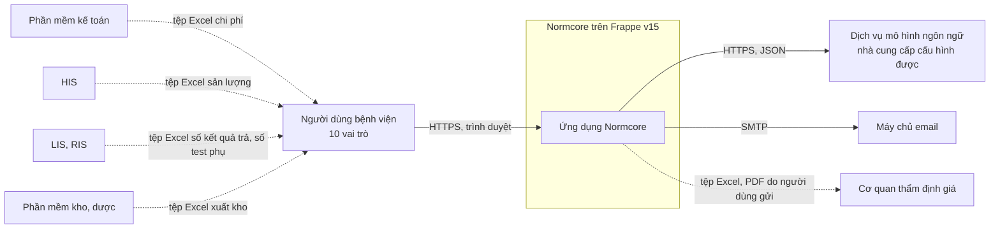
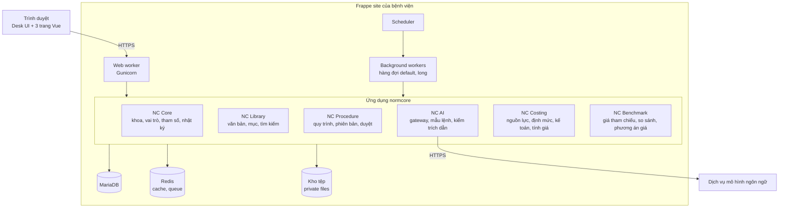
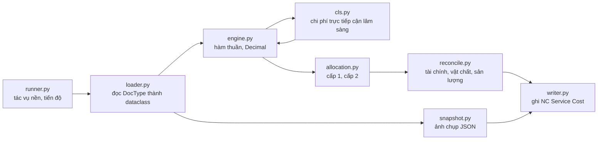
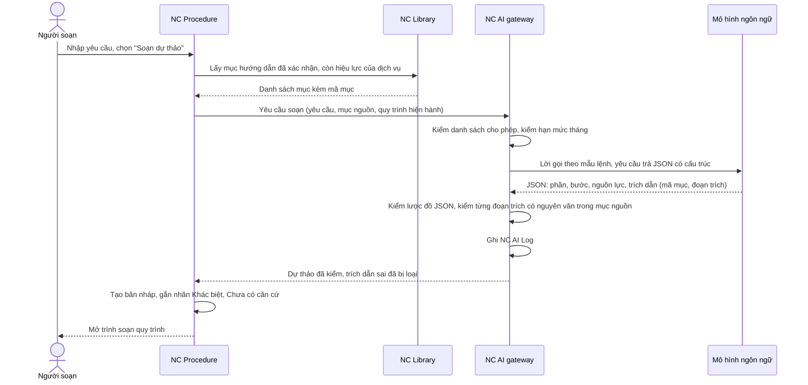
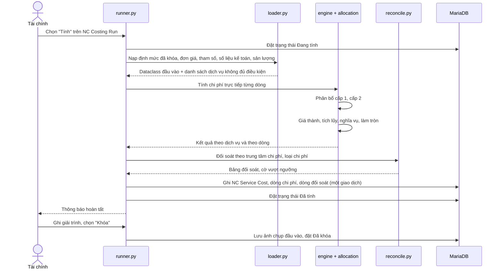

# Architecture: Normcore

> Status: Draft · Version: 1.1 · Last updated: 2026-11-13 · Author: BA (Claude)
> Nguồn yêu cầu: `docs/srs.md` v1.1, `docs/use-cases.md` v1.1. Đặc tả DocType chi tiết: `docs/data-model.md`.
> Bản 1.1 gộp phần kiến trúc của `docs/sua-doi-1.1/architecture-ux.md`: thêm ADR-017 và ADR-018 (phân hệ E, cận lâm sàng), sửa ADR-007, ghi chú cho ADR-004, ADR-011, ADR-012, ADR-014. Phần thêm mang nhãn **[1.1]**.

## 1. Introduction and Goals

Normcore là ứng dụng Frappe v15 giúp bệnh viện công đi từ quy trình kỹ thuật được phê duyệt đến giá dịch vụ có định mức và hồ sơ giải trình. Yêu cầu đầy đủ ở `docs/srs.md`; tài liệu này chỉ trả lời câu hỏi "xây thế nào".

**Mục tiêu chất lượng, theo thứ tự ưu tiên**

1. **Đúng và tái lập được** [NFR-REL-001, NFR-REL-002, NFR-CPL-001]. Cùng đầu vào luôn ra cùng giá đến từng đồng; mọi dòng chi phí truy được về nguồn. **[1.1]** Với cận lâm sàng: hệ số k tái lập đến 6 chữ số thập phân và mọi dòng chi phí hiện mẫu số đã dùng [NFR-REL-003, NFR-CPL-003].
2. **Kiểm soát được AI** [FR-AI-005, FR-AI-008, FR-AI-011, NFR-SEC-005]. AI chỉ đề xuất; nguồn gửi đi bị giới hạn; trích dẫn được kiểm bằng máy.
3. **Bảo trì được bởi nhóm nhỏ** [NFR-MNT-001, NFR-MNT-002, NFR-MNT-003]. Bám chuẩn Frappe, ít thành phần hạ tầng, có As-Built cho từng tính năng.

Hiệu năng [NFR-PERF-001, NFR-PERF-002] và sức chứa [NFR-SCAL-001] ở mức một bệnh viện, không phải yếu tố định hình kiến trúc.

## 2. Constraints

| Ràng buộc | Hệ quả thiết kế |
| :-- | :-- |
| C-01 Frappe Framework v15 | Python 3.10 trở lên, MariaDB, Redis, giao diện Desk; xác nhận lại phiên bản phụ thuộc theo tài liệu Frappe khi dựng môi trường |
| C-02 Không cần ERPNext | Normcore tự có DocType cho mặt hàng, thiết bị, phòng, trung tâm chi phí |
| C-03 Bệnh viện công trước | Bảng ánh xạ tài khoản theo chế độ hành chính, sự nghiệp là dữ liệu mặc định; chế độ khác thêm bằng dữ liệu, không sửa mã |
| C-04 AI để mở | Một lớp trung gian với các bộ chuyển đổi theo giao thức |
| C-05 fieldname tiếng Anh, label tiếng Việt | Áp cho mọi DocType; kiểm bằng script trong CI |
| C-06 DoD và As-Built | Mỗi tính năng có tệp `docs/as-built/FEAT-NNN.md` |
| C-07 Không kết nối trực tuyến HIS, kế toán | Nhập bằng tệp Excel mẫu |
| C-08 AI không phê duyệt, không tính giá | Bộ máy tính giá và bộ quy tắc gợi ý là mã tất định |
| C-09 **[1.1]** Phân hệ E dùng chung mô hình dữ liệu, vai trò, bộ máy tính giá, ảnh chụp, luồng duyệt | Không có bộ máy tính giá thứ hai, không có DocType tiền tố `CLS` (ADR-017) |
| C-10 **[1.1]** Phân hệ E cho hóa sinh, miễn dịch đi cùng R1; máy mua và máy đặt kiểm thử ngang nhau | Bộ dữ liệu vàng cận lâm sàng có cả hai hình thức có máy |

## 3. Context and Scope



Đường nét đứt là trao đổi bằng tệp qua người dùng, không phải kết nối hệ thống. **[1.1]** Thêm LIS, RIS và phần mềm kho; sơ đồ bản 1.0 ghi "8 vai trò", nay là 10 vai trò theo FR-ACC-002.

Giao diện ngoài: IF-01 đến IF-08 ở `docs/srs.md` mục 3.2 (IF-07, IF-08 thêm ở bản 1.1).

## 4. Solution Strategy

| Quyết định | ADR |
| :-- | :-- |
| Một ứng dụng Frappe độc lập, chia 6 module theo nghiệp vụ | ADR-001 |
| Quy trình lưu dạng có cấu trúc, mỗi bước có mã bất biến | ADR-002 |
| Bộ máy tính giá là thư viện Python thuần, tất định, dùng số thập phân | ADR-003 |
| Khóa lần tính giá bằng ảnh chụp toàn bộ đầu vào | ADR-004 |
| Lớp trung gian AI độc lập nhà cung cấp | ADR-005 |
| Truy xuất nguồn theo ánh xạ dịch vụ và tìm kiếm toàn văn; chưa dùng cơ sở dữ liệu vector | ADR-006 |
| Kiểm trích dẫn nguyên văn; danh sách cho phép nguồn gửi AI | ADR-007 |
| Gợi ý điều chỉnh bằng quy tắc tất định | ADR-008 |
| Việc nặng chạy bằng hàng đợi nền của Frappe | ADR-009 |
| Form chuẩn của Desk cộng 3 trang tùy biến | ADR-010 |
| Phê duyệt bằng Frappe Workflow cộng bản ghi ý kiến | ADR-011 |
| Nhập liệu bằng tệp Excel mẫu | ADR-012 |
| Bảng ánh xạ tài khoản là dữ liệu, tách theo chế độ kế toán | ADR-013 |
| Nhật ký hai lớp: lịch sử thay đổi của Frappe và sự kiện nghiệp vụ không sửa được | ADR-014 |
| Xuất tệp bằng openpyxl, Print Format, python-docx | ADR-015 |
| Mỗi bệnh viện một site; staging trước production | ADR-016 |
| **[1.1]** Cận lâm sàng là một bước mở rộng của bộ máy tính giá, không phải bộ máy thứ hai | ADR-017 |
| **[1.1]** Sản lượng cận lâm sàng, phút khai thác và xuất kho là dữ liệu nhập theo kịch bản, tách khỏi sản lượng HIS | ADR-018 |

## 5. Building Block View



| Khối | Trách nhiệm | Phụ thuộc |
| :-- | :-- | :-- |
| NC Core | Khoa, trung tâm chi phí, vai trò và phạm vi khoa, tham số vận hành, sự kiện nhật ký, thông báo, trang chủ | Không |
| NC Library | Văn bản pháp lý, tách mục, trạng thái hiệu lực, quan hệ thay thế, tìm kiếm toàn văn. **[1.1]** Tài liệu của hãng gắn với mặt hàng, thiết bị | NC Core |
| NC Procedure | Dịch vụ kỹ thuật, quy trình có cấu trúc, trích dẫn, phiên bản, luồng duyệt, in ấn | NC Core, NC Library |
| NC AI | Gọi mô hình, mẫu lệnh, dựng nội dung gửi đi, kiểm trích dẫn, nhật ký AI, hạn mức | NC Core, NC Library |
| NC Costing | Mặt hàng, đơn giá, thiết bị, phòng, chức danh, bộ tham số, bộ định mức, bấm giờ, số liệu kế toán, phân bổ, bộ máy tính giá, đối soát, bảng giải trình. **[1.1]** Hệ thống xét nghiệm, kế hoạch chất lượng, chương trình ngoại kiểm, hồ sơ tuân thủ, sản lượng cận lâm sàng, xuất kho, đối soát vật chất và sản lượng | NC Core, NC Procedure |
| NC Benchmark | Đơn vị và giá tham chiếu, thống kê so sánh, bộ quy tắc gợi ý, kịch bản, phương án giá, xuất biểu | NC Costing |

Quy tắc phụ thuộc: mũi tên một chiều theo bảng trên. NC Procedure và NC Costing gọi NC AI qua một giao diện dịch vụ; NC AI không gọi ngược.

**Bên trong NC Costing: bộ máy tính giá**



`engine.py`, `allocation.py`, `reconcile.py` không import `frappe`. Đầu vào và đầu ra là dataclass. Đây là điều kiện để đạt NFR-MNT-001 và chạy bộ dữ liệu vàng mà không cần site. **[1.1]** `cls.py` theo cùng quy tắc: `engine.py` gọi nó ở bước chi phí trực tiếp khi dịch vụ có hệ thống xét nghiệm (ADR-017).

**Bố cục mã nguồn**

```
normcore/
  nc_core/ nc_library/ nc_procedure/ nc_ai/ nc_costing/ nc_benchmark/   # module, chứa doctype/
  core/        importer.py permissions.py audit.py notify.py
  library/     extract.py sections.py search.py validity.py
  procedure/   validation.py versioning.py diff.py
  ai/          gateway.py providers/ prompts.py guard.py citation.py
  norm/        init_from_procedure.py validation.py time_study.py
  costing/     models.py loader.py engine.py cls.py allocation.py reconcile.py snapshot.py runner.py writer.py compliance.py   # **[AMD-015-02]** `loader.py`, `writer.py` đặt ở `nc_costing/doctype/nc_costing_run/` để `costing/` giữ thuần; `rates.py` thuần mới
  benchmark/   stats.py rules.py scenario.py
  exports/     tt21_pl1.py tt21_pl2.py tt21_pl3.py tt21_pl4.py tt21_pl5.py cost_sheet.py norm_set.py
  api/         procedure.py norm.py costing.py benchmark.py library.py export.py
  public/js/   procedure_editor/ norm_grid/ price_compare/ sensitivity/
  fixtures/    roles, workflows, account mapping, prompt templates, print formats, norm templates
  tests/       unit/ integration/ golden/
```

**[1.1]** Thêm so với bản 1.0: `costing/cls.py`, `costing/compliance.py` (tác vụ ngày cho hồ sơ tuân thủ), `public/js/sensitivity/` (trang phân tích độ nhạy, SCR-DSK-040), fixtures mẫu định mức.

## 6. Runtime View

### 6.1 Soạn dự thảo quy trình với AI [UC-004]



Lời gọi chạy trong hàng đợi `long`; trình duyệt nhận tiến độ qua kênh realtime của Frappe. Khi quá thời hạn hoặc lỗi, gateway trả mã lỗi và không tạo dữ liệu dở dang [FR-AI-010].

### 6.2 Chạy tính giá [UC-012]



Lỗi ở một dịch vụ (thiếu đơn giá) được ghi vào kết quả của dịch vụ đó và không dừng cả lần chạy [FR-COST-016]. Lỗi hệ thống giữa chừng: hủy giao dịch, trạng thái "Tính lỗi", không để kết quả nửa vời.

**[1.1]** Với lần tính có dịch vụ cận lâm sàng, trình tự trên thay đổi ở ba điểm, phần còn lại giữ nguyên:

1. `loader.py` nạp thêm hệ thống xét nghiệm, kế hoạch chất lượng, chương trình ngoại kiểm, hồ sơ tuân thủ, sản lượng cận lâm sàng của kịch bản được chọn, phút khai thác và xuất kho.
2. Ở bước "Tính chi phí trực tiếp từng dòng", `engine.py` gọi `cls.py` cho dịch vụ có hệ thống xét nghiệm, theo thứ tự của ADR-017: hệ số k, chi phí thiết bị năm, dòng theo cấp phát sinh, dòng từ kế hoạch chất lượng, bình quân gia quyền và ngoại kiểm. Lỗi thiếu sản lượng hoặc thiếu cỡ mẻ được ghi vào kết quả của dịch vụ đó và không dừng cả lần chạy [FR-COST-023].
3. `reconcile.py` lập thêm bảng đối soát vật chất và bảng đối soát sản lượng; dòng vật chất vượt ngưỡng hoặc chưa đối soát phải có giải trình trước khi khóa [FR-COST-026..029].

### 6.3 Điều chỉnh chạm vào quy trình [UC-014, UC-007]

Khi người dùng chấp nhận một gợi ý có cờ "cần sửa quy trình", NC Benchmark không sửa bộ định mức. Nó tạo bản ghi yêu cầu sửa đổi gắn với quy trình và thông báo trưởng khoa. Vòng lặp chỉ khép lại sau khi phiên bản quy trình mới được ban hành, bộ định mức mới được khóa và lần tính giá mới được chạy [FR-ADJ-007, FR-WF-011, FR-NORM-015].

## 7. Deployment View

Môi trường: **staging (UAT)** rồi **production**, mỗi bệnh viện một site riêng trên bench. Thứ tự triển khai: staging trước, nghiệm thu, rồi production.

| Thành phần | Số lượng tối thiểu | Ghi chú |
| :-- | :-- | :-- |
| Web worker | 2 tiến trình | Sau reverse proxy có TLS |
| Background worker | 1 cho `default`, 1 cho `long` | `long` chạy AI, tách văn bản, tính giá, xuất gói |
| Scheduler | 1 | Cập nhật hiệu lực văn bản hằng ngày, nhắc duyệt. **[1.1]** Cập nhật trạng thái và nhắc hạn hồ sơ tuân thủ hằng ngày [FR-CMP-005] |
| MariaDB | 1 | Sao lưu hằng ngày [NFR-AVL-002] |
| Redis | 1 | Cache và hàng đợi |
| Kho tệp | Đĩa cục bộ của site | Tệp văn bản, tệp xuất; nằm trong phạm vi sao lưu |

Đường ra internet chỉ cần tới địa chỉ của dịch vụ AI. Nếu bệnh viện tự host mô hình, địa chỉ đó là máy chủ nội bộ và không cần đường ra internet.

## 8. Cross-cutting Concepts

**Bảo mật.** Xác thực và phiên của Frappe [FR-ACC-001, NFR-SEC-002]. Phân quyền theo vai trò trên từng DocType; phạm vi khoa bằng User Permission trên `NC Department` kết hợp `permission_query_conditions` cho quy trình, bộ định mức, phiếu bấm giờ [FR-ACC-003]. Số liệu kế toán, kết quả phân bổ, đối soát chỉ mở cho NC Finance, NC Director, NC Admin [FR-ACC-004]. Khóa AI lưu bằng trường Password của Frappe [NFR-SEC-004]. Tệp đính kèm là tệp private. **[1.1]** Phạm vi khoa áp thêm cho hệ thống xét nghiệm và kế hoạch chất lượng [FR-ACC-008]. NC Auditor đọc được mọi DocType, kể cả số liệu kế toán, đối soát, nhật ký, và không có quyền ghi ở đâu [FR-ACC-004 sửa, FR-ACC-007].

**Dữ liệu.** MariaDB là nơi lưu duy nhất. Tiền lưu kiểu Currency với độ chính xác đủ cho 2 chữ số thập phân ở dòng chi phí; đơn giá lưu Float 4 chữ số thập phân nhưng bộ máy tính giá đổi sang `Decimal` từ chuỗi trước khi tính [NFR-REL-002]. Bản ghi đã khóa không sửa; thay đổi tạo phiên bản mới. Ảnh chụp đầu vào lưu dạng JSON nén trong tệp private gắn với lần tính giá [ADR-004]. **[1.1]** Hệ số k lưu Float 6 chữ số thập phân [NFR-REL-003].

**Xử lý lỗi và độ bền.** Mọi lời gọi AI có thời hạn, không tự thử lại quá 1 lần, và luôn có đường thủ công [FR-AI-010, FR-AI-015]. Tác vụ nền ghi trạng thái vào bản ghi nghiệp vụ; lỗi hiển thị cho người dùng và cho NC Admin [NFR-OBS-001]. Tác vụ tính giá ghi kết quả trong một giao dịch.

**Quan sát.** Error Log và RQ Job của Frappe cho lỗi và tác vụ nền. `NC AI Log` cho từng lời gọi AI. `NC Audit Event` cho chuyển trạng thái, khóa, xuất tệp [FR-AUD-001, FR-AUD-004].

**Hiệu năng.** Bộ máy tính giá nạp dữ liệu theo lô bằng truy vấn tập hợp, không truy vấn theo từng dòng; mục tiêu 50.000 dòng định mức trong 5 phút [NFR-PERF-002]. Tìm kiếm văn bản dùng chỉ mục FULLTEXT trên văn bản thuần của mục [NFR-PERF-005].

**Kiểm thử.**

| Tầng | Công cụ | Phạm vi |
| :-- | :-- | :-- |
| Đơn vị | `pytest` cho mã thuần; `bench run-tests` với `FrappeTestCase` cho mã phụ thuộc site | Bộ máy tính giá, phân bổ, đối soát, quy tắc gợi ý, kiểm trích dẫn, bộ dựng nội dung gửi AI |
| Bộ dữ liệu vàng | `tests/golden/` chạy bằng `pytest` | Ví dụ ở `docs/test-cases.md` mục 2; so khớp đến từng đồng. **[1.1]** Thêm bộ cận lâm sàng `docs/golden/golden_cls.py` (mục 2A của test case) |
| Tích hợp | `FrappeTestCase` | Luồng duyệt, chuyển trạng thái, phân quyền theo khoa, nhập tệp |
| Đầu cuối | Cypress (bộ công cụ kiểm thử giao diện đi kèm Frappe) | Ba luồng: soạn và ban hành quy trình [UC-004, UC-006]; định mức đến tính giá [UC-009, UC-012]; so sánh đến phương án giá [UC-014, UC-015]. **[1.1]** Thêm luồng thứ tư: hệ thống xét nghiệm đến giá một kết quả [UC-019, UC-021, UC-022, UC-012, UC-023] |

Độ phủ: ngưỡng bắt buộc 90% số dòng cho `normcore/costing/` và `normcore/benchmark/rules.py`, đo bằng `coverage.py` trong CI [NFR-MNT-001]. Phần còn lại báo cáo, chưa đặt ngưỡng.

## 9. Architecture Decisions

### ADR-001: Một ứng dụng Frappe độc lập, chia module theo nghiệp vụ

**Status:** Accepted
**Date:** 2026-11-13
**Requirements addressed:** NFR-CMP-001, NFR-MNT-003, ràng buộc C-01, C-02

**Context**
Chủ dự án chốt Frappe v15 và chốt không phụ thuộc ERPNext. Nhóm phát triển nhỏ, quen Frappe. Tải ở mức một bệnh viện.

**Decision**
Xây một app `normcore` gồm 6 Module Def: NC Core, NC Library, NC Procedure, NC AI, NC Costing, NC Benchmark. Mọi DocType mang tiền tố `NC `.

**Options considered**
- **App độc lập (chọn)** — cài được trên site trống; không vướng thay đổi của ERPNext. Mất: phải tự làm danh mục mặt hàng, tài sản, trung tâm chi phí.
- **Cài trên ERPNext** — dùng lại Item, Asset, Cost Center. Mất: bệnh viện công hiếm khi có ERPNext; mô hình Item và Asset của ERPNext mang nhiều trường không cần và ràng buộc kế toán doanh nghiệp.
- **Tách dịch vụ AI và dịch vụ tính giá thành tiến trình riêng** — không cần ở quy mô này; tăng việc vận hành.

**Consequences**
Triển khai đơn giản, một thứ để vận hành. Nếu sau này cần chạy cùng ERPNext, cần một lớp đồng bộ danh mục; tiền tố `NC ` giữ cho hai bên không đụng tên.

**[1.1]** Phân hệ E không thêm module: 9 DocType mới và 10 bảng con mới đều thuộc NC Costing.

### ADR-002: Quy trình lưu dạng có cấu trúc, mỗi bước có mã bất biến

**Status:** Accepted
**Date:** 2026-11-13
**Requirements addressed:** FR-PROC-003, FR-PROC-004, FR-PROC-006, FR-NORM-001, FR-NORM-015, FR-WF-011, NFR-CPL-001; UC-007, UC-009

**Context**
Định mức phải bóc từ từng bước và phải sống sót qua các lần sửa quy trình. Nếu quy trình là văn bản tự do thì mỗi lần sửa phải đọc lại và bóc lại từ đầu.

**Decision**
Quy trình là một bản ghi cha với các bảng con: bước, nguồn lực theo bước, trích dẫn. Mỗi bước có `step_id` cấp một lần, không đổi khi sắp lại và khi tạo phiên bản mới. Dòng định mức tham chiếu `step_id`. Bản PDF và DOCX là bản in từ dữ liệu.

**Options considered**
- **Có cấu trúc, mã bước bất biến (chọn)** — định mức và so sánh phiên bản làm được bằng máy. Mất: trình soạn phức tạp hơn một ô văn bản.
- **Văn bản tự do, AI bóc lại mỗi lần** — soạn nhanh. Mất: không tất định, không truy vết được, trái C-08.
- **Mã bước theo số thứ tự** — đơn giản. Mất: sắp lại bước làm hỏng mọi tham chiếu.

**Consequences**
Truy vết từ giá về bước là quan hệ dữ liệu. Phải xây trình soạn riêng (ADR-010). Nội dung dài của một bước vẫn là văn bản; chỉ cấu trúc bước và nguồn lực là dữ liệu.

### ADR-003: Bộ máy tính giá là thư viện Python thuần, tất định, dùng Decimal

**Status:** Accepted
**Date:** 2026-11-13
**Requirements addressed:** NFR-REL-001, NFR-REL-002, NFR-MNT-001, NFR-PERF-002, FR-COST-003, FR-COST-004, FR-COST-005, FR-COST-006

**Context**
Giá phải trùng đến từng đồng khi chạy lại, và phải kiểm thử được bằng bộ dữ liệu vàng. Mã tính toán trộn với truy vấn Frappe thì khó kiểm thử và dễ lệch.

**Decision**
Tách `engine.py`, `allocation.py`, `reconcile.py` thành mã không phụ thuộc `frappe`, nhận và trả dataclass, tính bằng `decimal.Decimal` với ngữ cảnh làm tròn cố định (`ROUND_HALF_UP`). `loader.py` và `writer.py` là hai lớp duy nhất chạm cơ sở dữ liệu. Thứ tự duyệt dịch vụ và dòng được sắp cố định.

**Options considered**
- **Thư viện thuần (chọn)** — kiểm thử nhanh, tái lập được. Mất: thêm một lớp chuyển đổi dữ liệu.
- **Tính trong controller của DocType** — ít mã ban đầu. Mất: phụ thuộc site khi kiểm thử; dễ có hiệu ứng phụ.
- **Tính bằng SQL** — nhanh. Mất: khó giải trình từng dòng, khó kiểm thử quy tắc Điều 7.

**Consequences**
Bộ dữ liệu vàng chạy trong vài giây ở CI. Mọi thay đổi công thức đi qua một nơi. `Decimal` chậm hơn số thực nhưng 50.000 dòng vẫn trong mục tiêu.

**[1.1]** `cls.py` là một phần của thư viện thuần này và theo cùng quy tắc (ADR-017).

### ADR-004: Khóa lần tính giá bằng ảnh chụp đầu vào

**Status:** Accepted
**Date:** 2026-11-13
**Requirements addressed:** FR-COST-011, FR-COST-012, NFR-REL-001, **[1.1]** FR-COST-032

**Context**
Đơn giá, tham số, danh mục tiếp tục thay đổi sau khi một lần tính giá được dùng để trình duyệt. Hồ sơ đã trình phải tái lập được nhiều năm sau.

**Decision**
Khi khóa, `snapshot.py` ghi toàn bộ dataclass đầu vào thành một tệp JSON nén, kèm mã băm, gắn vào `NC Costing Run`. Chạy lại để kiểm tra dùng ảnh chụp, không dùng dữ liệu sống.

**Options considered**
- **Ảnh chụp JSON (chọn)** — tái lập chắc chắn; không cấm sửa danh mục. Mất: tốn dung lượng lưu trữ.
- **Cấm sửa mọi bản ghi đã được dùng** — không cần lưu thêm. Mất: khóa cứng danh mục, không vận hành được.
- **Dựa vào lịch sử thay đổi** — không tốn chỗ. Mất: dựng lại trạng thái quá khứ phức tạp và dễ sai.

**Consequences**
Mỗi lần tính giá khóa tốn thêm vài MB. Ảnh chụp là bằng chứng khi thanh tra, kiểm toán.

**[1.1]** Ảnh chụp thêm các nhóm dữ liệu của FR-COST-032: hệ thống xét nghiệm, kế hoạch chất lượng, chương trình ngoại kiểm, hồ sơ tuân thủ, thiết bị và linh kiện, sản lượng cận lâm sàng, phút khai thác, xuất kho. Tăng số phiên bản lược đồ ảnh chụp; ảnh chụp theo lược đồ cũ vẫn đọc được.

### ADR-005: Lớp trung gian AI độc lập nhà cung cấp

**Status:** Accepted
**Date:** 2026-11-13
**Requirements addressed:** FR-AI-009, FR-AI-010, FR-AI-012, FR-AI-013, FR-AI-015, NFR-SEC-004; ràng buộc C-04

**Context**
Chủ dự án chưa chọn giữa API đám mây và tự host; lựa chọn có thể khác nhau theo từng bệnh viện.

**Decision**
Mọi lời gọi mô hình đi qua `ai/gateway.py` với một giao diện duy nhất: `complete(purpose, template_code, variables, sources) -> AIResult`. Có hai bộ chuyển đổi ở v1: giao thức tương thích OpenAI Chat Completions (dùng được với nhiều máy chủ tự host và nhiều dịch vụ đám mây) và giao thức Anthropic Messages. Nhà cung cấp, địa chỉ, mô hình, khóa nằm trong `NC AI Settings`.

**Options considered**
- **Gateway với bộ chuyển đổi (chọn)** — đổi nhà cung cấp bằng cấu hình; một chỗ để ghi nhật ký, kiểm hạn mức, kiểm nguồn. Mất: chỉ dùng được phần tính năng chung của các nhà cung cấp.
- **Gọi thẳng SDK của một nhà cung cấp** — nhanh nhất. Mất: trái C-04.
- **Dùng một thư viện điều phối bên thứ ba** — nhiều tính năng. Mất: thêm phụ thuộc lớn cho nhu cầu nhỏ.

**Consequences**
Mẫu lệnh phải viết sao cho chạy được trên nhiều mô hình; đầu ra yêu cầu JSON và luôn được kiểm lược đồ. Chất lượng dự thảo phụ thuộc mô hình được chọn; cần bộ ca thử chất lượng khi đổi mô hình.

### ADR-006: Truy xuất nguồn theo ánh xạ dịch vụ và tìm kiếm toàn văn

**Status:** Accepted
**Date:** 2026-11-13
**Requirements addressed:** FR-AI-001, FR-SVC-005, FR-SVC-006, FR-SVC-007, FR-LIB-010, NFR-PERF-005

**Context**
Văn bản hướng dẫn của Bộ Y tế được tổ chức theo từng quy trình, mỗi quy trình ứng với một kỹ thuật. Nguồn chính cho một dịch vụ vì vậy xác định được bằng ánh xạ, không cần tìm theo ngữ nghĩa.

**Decision**
Nguồn chính lấy theo ánh xạ đã xác nhận giữa mục văn bản và dịch vụ kỹ thuật. Nguồn bổ sung do người soạn chọn qua tìm kiếm toàn văn (chỉ mục FULLTEXT của MariaDB). Không dùng cơ sở dữ liệu vector ở v1; `library/search.py` có giao diện để thêm sau.

**Options considered**
- **Ánh xạ cộng toàn văn (chọn)** — nguồn do con người xác nhận, truy vết rõ; không thêm hạ tầng. Mất: tìm kiếm nguồn bổ sung phụ thuộc từ khóa.
- **Cơ sở dữ liệu vector** — tìm theo ngữ nghĩa tốt. Mất: thêm thành phần vận hành, thêm lời gọi tạo embedding, kết quả khó giải trình.

**Consequences**
Chất lượng dự thảo phụ thuộc việc ánh xạ được xác nhận trước (UC-003). Xem xét lại khi thư viện vượt quy mô ở NFR-SCAL-002 hoặc người dùng phản ánh tìm kiếm kém.

### ADR-007: Kiểm trích dẫn nguyên văn và danh sách cho phép nguồn gửi AI

**Status:** Accepted; **[1.1]** sửa đổi ngày 2026-11-13 (điểm X-11 của `docs/phan-he-e-hop-nhat.md`)
**Date:** 2026-11-13
**Requirements addressed:** FR-AI-002, FR-AI-005, FR-AI-008, FR-AI-011, NFR-SEC-005, **[1.1]** FR-LIB-013, FR-AI-016, FR-AI-017

**Context**
Mô hình ngôn ngữ có thể tạo trích dẫn không có thật. Bệnh viện không chấp nhận số liệu tài chính và dữ liệu người bệnh rời khỏi hệ thống.

**Decision**
`ai/citation.py` yêu cầu mỗi trích dẫn gồm mã mục và đoạn trích; đoạn trích phải xuất hiện nguyên văn trong văn bản thuần của mục sau khi chuẩn hóa khoảng trắng, nếu không trích dẫn bị loại. `ai/guard.py` chỉ cho phép dựng nội dung gửi đi từ danh sách DocType và trường được khai báo: mục văn bản, nội dung quy trình, danh mục nguồn lực (tên, đơn vị), tệp bảng giá công khai. Mọi DocType kế toán và tính giá nằm ngoài danh sách.

**[1.1] Sửa đổi.** `ai/guard.py` thêm một nguồn được phép: mục (`NC Legal Section`) của văn bản có `doc_type` = "Tài liệu của hãng", và chỉ những mục thuộc tài liệu đã gắn với mặt hàng hoặc thiết bị của hệ thống xét nghiệm đang được đề xuất. Kèm theo đó là tên, đơn vị của mặt hàng và tên thiết bị (đã thuộc danh sách cho phép). Vẫn cấm: đơn giá, sản lượng, xuất kho, số liệu kế toán, kết quả tính giá. Kiểm trích dẫn nguyên văn áp dụng không đổi. Kiểm thử tự động của NFR-SEC-005 thêm ca cho mục đích `SUGGEST_CLS_NORM`.

**Options considered**
- **Kiểm bằng máy và danh sách cho phép (chọn)** — chặn được ở mức mã, kiểm thử tự động được. Mất: trích dẫn diễn đạt lại bị loại dù đúng ý.
- **Tin vào mẫu lệnh** — ít mã. Mất: không có gì bảo đảm.

**Consequences**
Tỷ lệ "Chưa có căn cứ" phản ánh trung thực chất lượng nguồn. Thêm một loại dữ liệu gửi AI là thay đổi mã có kiểm thử, không phải cấu hình.

### ADR-008: Gợi ý điều chỉnh bằng quy tắc tất định

**Status:** Accepted
**Date:** 2026-11-13
**Requirements addressed:** FR-ADJ-005, FR-ADJ-006, FR-ADJ-007, FR-AI-011; ràng buộc C-08

**Context**
Gợi ý tăng, giảm phải "phù hợp và logic" và giải trình được. Gửi kết quả tính giá cho AI trái FR-AI-011.

**Decision**
`benchmark/rules.py` cài các quy tắc BR-ADJ-001 đến BR-ADJ-007. Mỗi quy tắc là một hàm thuần nhận kết quả tính giá và trả danh sách gợi ý có tác động ước tính. Câu chữ gợi ý sinh từ mẫu cố định.

**Options considered**
- **Quy tắc (chọn)** — lặp lại được, kiểm thử được, không lộ số liệu. Mất: chỉ phát hiện những gì đã có quy tắc.
- **AI phân tích cơ cấu giá** — linh hoạt. Mất: trái FR-AI-011 và C-08.

**Consequences**
Thêm quy tắc mới là thêm một hàm và một dòng trong SRS mục 3.4.2.

### ADR-009: Việc nặng chạy bằng hàng đợi nền của Frappe

**Status:** Accepted
**Date:** 2026-11-13
**Requirements addressed:** FR-LIB-003, FR-COST-015, FR-OUT-009, NFR-PERF-002, NFR-PERF-004, NFR-OBS-001

**Context**
Tách văn bản, gọi AI, tính giá và xuất gói đều vượt thời gian một yêu cầu web.

**Decision**
Dùng `frappe.enqueue` với hàng đợi `long` cho bốn loại việc trên. Tiến độ đẩy về trình duyệt bằng `frappe.publish_realtime`. Trạng thái và lỗi ghi vào bản ghi nghiệp vụ.

**Options considered**
- **Hàng đợi của Frappe (chọn)** — có sẵn, không thêm hạ tầng.
- **Celery hoặc hàng đợi riêng** — không cần thiết ở quy mô này.

**Consequences**
Cần ít nhất một worker cho hàng đợi `long`. Tác vụ phải viết sao cho chạy lại được an toàn.

### ADR-010: Form chuẩn của Desk cộng ba trang tùy biến

**Status:** Accepted
**Date:** 2026-11-13
**Requirements addressed:** NFR-USE-001, NFR-USE-002, NFR-USE-003, FR-NORM-016, FR-PROC-007, FR-ADJ-010

**Context**
Phần lớn màn hình là danh mục và form. Ba chỗ không vừa form chuẩn: trình soạn quy trình với bảng trích dẫn bên cạnh, lưới định mức theo bước với chi phí tạm tính, và bàn làm việc so sánh giá.

**Decision**
Dùng form, list view, report của Desk cho mọi DocType. Xây ba Desk Page bằng Vue 3 (đi kèm Frappe v15): `procedure-editor`, `norm-grid`, `price-compare`. Ba trang đọc và ghi qua API whitelisted, không ghi thẳng cơ sở dữ liệu.

**Options considered**
- **Desk cộng ba trang (chọn)** — ít mã giao diện nhất mà vẫn đạt mục tiêu dùng được.
- **SPA riêng toàn bộ** — trải nghiệm đồng nhất. Mất: khối lượng lớn, tự làm lại phân quyền và form.
- **Chỉ form chuẩn** — rẻ nhất. Mất: trình soạn và lưới định mức quá khó dùng với bác sĩ.

**Consequences**
Người dùng thấy hai kiểu giao diện; ba trang tùy biến phải theo phong cách Desk (`docs/design.md`).

**[1.1]** Phân hệ E thêm một trang tùy biến nhẹ, `sensitivity` (SCR-DSK-040), theo cùng quy tắc: chỉ đọc qua API whitelisted và không ghi dữ liệu. Lưới định mức `norm-grid` thêm cột cấp phát sinh và ô chọn nhân k.

### ADR-011: Phê duyệt bằng Frappe Workflow cộng bản ghi ý kiến

**Status:** Accepted
**Date:** 2026-11-13
**Requirements addressed:** FR-WF-001, FR-WF-002, FR-WF-003, FR-WF-004, FR-WF-005, FR-WF-007, FR-PRICE-004, FR-PRICE-005, FR-PRICE-009, FR-NOTI-001

**Context**
Ba đối tượng có luồng duyệt: quy trình, bộ định mức, phương án giá. Hội đồng cần ghi ý kiến gắn vào từng bước.

**Decision**
Dùng Frappe Workflow cho chuyển trạng thái và phân quyền theo vai trò. Ý kiến thẩm định lưu ở DocType `NC Review Comment` có tham chiếu đến phần hoặc `step_id`. Điều kiện chuyển trạng thái phức tạp (mọi khoa đã xác nhận) kiểm trong controller.

**Options considered**
- **Workflow chuẩn cộng DocType ý kiến (chọn)** — cấu hình được, có sẵn nhật ký chuyển trạng thái.
- **Tự viết máy trạng thái** — linh hoạt. Mất: làm lại thứ đã có.

**Consequences**
Luồng duyệt xuất thành fixture để cài cùng app [FR-ADM-001]. Bệnh viện đổi được tên trạng thái và vai trò duyệt mà không sửa mã, trong giới hạn các kiểm tra của controller.

**[1.1]** Không thêm workflow cho phân hệ E; bộ định mức của hệ thống xét nghiệm dùng luồng sẵn có của bộ định mức.

### ADR-012: Nhập liệu bằng tệp Excel mẫu

**Status:** Accepted
**Date:** 2026-11-13
**Requirements addressed:** FR-ACCT-001, FR-ACCT-002, FR-ACCT-007, FR-RES-012, FR-SVC-001, FR-BM-002, FR-ADM-002; ràng buộc C-07; **[1.1]** FR-CLS-008, FR-ACCT-013, FR-ACCT-015

**Context**
Mỗi bệnh viện dùng phần mềm kế toán và HIS khác nhau. Kết nối trực tuyến là việc riêng cho từng nơi.

**Decision**
Mỗi loại dữ liệu có một tệp Excel mẫu và một bộ nhập có kiểm tra từng dòng, trả báo cáo lỗi. Bộ nhập viết theo một khung chung (`core/importer.py`).

**Options considered**
- **Tệp mẫu (chọn)** — dùng được ở mọi bệnh viện ngay.
- **API kết nối** — tự động. Mất: phải làm riêng từng nơi; để giai đoạn sau.
- **Data Import chuẩn của Frappe** — có sẵn. Mất: báo lỗi và kiểm tra nghiệp vụ không đủ cho số liệu kế toán.

**Consequences**
Người dùng phải chuyển dữ liệu về mẫu. Khung nhập chung là nơi gắn bộ kết nối sau này.

**[1.1]** Thêm sáu mẫu nhập: hệ thống xét nghiệm, kế hoạch chất lượng, hồ sơ tuân thủ, sản lượng cận lâm sàng, phút khai thác, xuất kho.

### ADR-013: Bảng ánh xạ tài khoản là dữ liệu, tách theo chế độ kế toán

**Status:** Accepted
**Date:** 2026-11-13
**Requirements addressed:** FR-ACCT-003, FR-ACCT-004, FR-ACCT-009; ràng buộc C-03

**Context**
Bệnh viện công dùng chế độ kế toán hành chính, sự nghiệp; bệnh viện tư dùng kế toán doanh nghiệp. Bộ máy tính giá chỉ cần 6 loại chi phí.

**Decision**
`NC Account Mapping` lưu các dòng: chế độ kế toán, mẫu mã tài khoản (tiền tố), loại chi phí. Bộ mặc định cho chế độ hành chính, sự nghiệp cài kèm app. Bộ máy tính giá chỉ đọc loại chi phí.

**Options considered**
- **Ánh xạ bằng dữ liệu (chọn)** — thêm chế độ kế toán không cần sửa mã.
- **Mã hóa cứng tài khoản** — nhanh. Mất: mỗi thay đổi hệ thống tài khoản là một lần phát hành.

**Consequences**
Nội dung bảng mặc định cần chuyên gia kế toán xây (TBD-03). Bệnh viện tư sau này chỉ cần thêm một bộ dữ liệu.

### ADR-014: Nhật ký hai lớp

**Status:** Accepted
**Date:** 2026-11-13
**Requirements addressed:** FR-AUD-001, FR-AUD-002, FR-AUD-003, FR-AUD-004, FR-PROC-009, NFR-SEC-006

**Context**
Cần biết ai đổi gì ở mức trường, và cần một sổ sự kiện nghiệp vụ không ai sửa được.

**Decision**
Bật `track_changes` trên mọi DocType nghiệp vụ để có lịch sử theo trường. Thêm `NC Audit Event` cho chuyển trạng thái, khóa, mở khóa, xuất tệp, đổi cấu hình AI, xóa bản ghi **[AMD-006]**; DocType này không cấp quyền sửa, xóa cho vai trò nào và chỉ ghi qua mã máy chủ.

**Options considered**
- **Hai lớp (chọn)** — chi tiết theo trường cộng sổ sự kiện gọn để tra cứu.
- **Chỉ `track_changes`** — có sẵn. Mất: khó tra cứu theo sự kiện nghiệp vụ; không ghi được việc xuất tệp.

**Consequences**
Quản trị cơ sở dữ liệu vẫn sửa được ở mức thấp; chống sửa ở mức đó nằm ngoài phạm vi v1 và được ghi ở mục 11.

**[1.1]** NC Auditor đọc được sổ sự kiện và nhật ký AI [FR-AUD-003 sửa, FR-ACC-007].

### ADR-015: Xuất tệp bằng openpyxl, Print Format và python-docx

**Status:** Accepted
**Date:** 2026-11-13
**Requirements addressed:** FR-OUT-001, FR-OUT-002, FR-OUT-003, FR-OUT-004, FR-OUT-005, FR-OUT-006, FR-OUT-007, FR-OUT-008, FR-PROC-010, FR-PROC-011, NFR-CPL-002

**Context**
Biểu theo Thông tư 21 là bảng Excel có cấu trúc cố định. Quy trình ban hành cần PDF theo mẫu của bệnh viện.

**Decision**
Biểu Excel: mỗi phụ lục một tệp mẫu `.xlsx` trong app; mã xuất điền số vào mẫu bằng openpyxl. PDF: Print Format bằng Jinja, sinh bằng bộ sinh PDF của Frappe. DOCX: python-docx với tệp mẫu.

**Options considered**
- **Mẫu Excel cộng openpyxl (chọn)** — cấu trúc cột do tệp mẫu quyết định, đối chiếu được với mẫu chính thức.
- **Sinh Excel hoàn toàn bằng mã** — không cần tệp mẫu. Mất: sửa bố cục phải sửa mã.

**Consequences**
Tệp mẫu phải dựng từ phụ lục chính thức (TBD-01). Thêm phụ thuộc `python-docx`.

### ADR-016: Mỗi bệnh viện một site; staging trước production

**Status:** Accepted
**Date:** 2026-11-13
**Requirements addressed:** NFR-AVL-001, NFR-AVL-002, NFR-SEC-001, NFR-SEC-003; giả định A-06

**Context**
Số liệu tài chính của bệnh viện không được lẫn giữa các đơn vị. Chủ dự án yêu cầu có môi trường UAT trước khi đưa lên máy chủ chính.

**Decision**
Mỗi bệnh viện một site Frappe với cơ sở dữ liệu riêng. Mọi bản phát hành cài lên site staging, nghiệm thu, rồi mới cài lên production. Sao lưu hằng ngày bằng cơ chế của bench.

**Options considered**
- **Site riêng (chọn)** — cách ly ở mức cơ sở dữ liệu; đơn giản.
- **Một site nhiều bệnh viện, tách bằng trường Company** — tiết kiệm. Mất: rủi ro lộ dữ liệu chéo; mọi truy vấn phải lọc.

**Consequences**
Chi phí vận hành tăng theo số bệnh viện. Kho giá tham chiếu không dùng chung giữa các site ở v1.

### ADR-017: Cận lâm sàng là một bước mở rộng của bộ máy tính giá, không phải bộ máy thứ hai **[1.1]**

**Status:** Accepted
**Date:** 2026-11-13
**Requirements addressed:** FR-COST-018, FR-COST-019, FR-COST-020, FR-COST-021, FR-COST-022, FR-COST-023, FR-COST-024, FR-COST-031, FR-QC-004, FR-QC-006, FR-CMP-002, FR-CMP-003, FR-CMP-004, NFR-REL-003, NFR-CPL-003; quy tắc BR-CLS-001 đến BR-CLS-013, BR-CLS-017; ràng buộc C-09

**Context**
Bộ nháp phân hệ E mô tả một chuỗi tính riêng với năm cấp chi phí và cách làm tròn riêng. SRS 1.1 hợp nhất nó vào chuỗi B–C: dịch vụ cận lâm sàng chỉ khác ở cách tính chi phí trực tiếp; phân bổ cấp 1, cấp 2, tích lũy, làm tròn, đối soát tài chính giữ nguyên.

**Decision**
Thêm module thuần `normcore/costing/cls.py` bên cạnh `normcore/costing/engine.py`. `cls.py` chỉ chứa hàm thuần, nhận cấu trúc dữ liệu đã nạp và trả về danh sách dòng chi phí trực tiếp cùng kết quả theo hệ thống xét nghiệm. `engine.py` gọi `cls.py` ở bước tính chi phí trực tiếp khi dịch vụ có hệ thống xét nghiệm, rồi đi tiếp các bước sẵn có. Thứ tự trong `cls.py`:

1. Hệ số k của từng hệ thống (BR-CLS-001), ghi rõ số nào là ước tính.
2. Chi phí thiết bị năm theo khoa: hình thức có máy, bảo trì, linh kiện theo tháng, kiểm định theo cách phân bổ của lần tính (BR-CLS-009, BR-CLS-010, BR-CLS-011). Bước này chạy một lần cho mỗi thiết bị và mỗi khoa, áp cho mọi thiết bị, kể cả thiết bị lâm sàng dùng BR-COST-004.
3. Chi phí từng dòng định mức theo cấp phát sinh (BR-CLS-002 đến BR-CLS-005).
4. Dòng sinh từ kế hoạch chất lượng và thiết bị: nội kiểm, chất chuẩn, linh kiện theo số kết quả, điện (BR-CLS-006, BR-CLS-007, BR-CLS-010, BR-CLS-012).
5. Bình quân gia quyền theo hệ thống, rồi cộng ngoại kiểm ở cấp dịch vụ (BR-CLS-008, BR-CLS-013).

Quy ước số: đơn giá 4 chữ số thập phân, thành tiền dòng 2 chữ số, k 6 chữ số, phép chia trung gian không làm tròn. Chuẩn đối chiếu là `docs/golden/golden_cls.py`.

**Options considered**
- **Bước mở rộng trong cùng bộ máy (chọn)** — một ảnh chụp, một bảng giải trình, một bảng đối soát tài chính; kiểm thử tái dùng. Mất: `engine.py` phải tách rõ bước "chi phí trực tiếp" để cắm `cls.py`.
- **Bộ máy riêng cho cận lâm sàng** — tách biệt, làm nhanh lúc đầu. Mất: hai cách làm tròn, hai ảnh chụp, phân bổ chi phí chung bị lặp; trái C-09.

**Consequences**
FEAT-015 phải dựng `engine.py` với điểm cắm cho chi phí trực tiếp trước khi FEAT-036 bắt đầu. Chi phí kiểm định, hiệu chuẩn năm của một thiết bị nay là kết quả của bước 2, không còn là số đọc thẳng từ bản ghi thiết bị. Bộ dữ liệu vàng 1.0 không đổi kết quả, vì khoa K01 chỉ có một thiết bị và thiết bị đó không có hồ sơ tuân thủ (dùng số nhập tay); ca kiểm cho hai thiết bị trong một khoa nằm ở `golden_cls.py` (TC-CLS-07, TC-CLS-08).

### ADR-018: Sản lượng cận lâm sàng, phút khai thác và xuất kho là dữ liệu nhập theo kịch bản, tách khỏi sản lượng HIS **[1.1]**

**Status:** Accepted
**Date:** 2026-11-13
**Requirements addressed:** FR-ACCT-012, FR-ACCT-013, FR-ACCT-014, FR-ACCT-015, FR-COST-017, FR-COST-024, FR-COST-026, FR-COST-027, FR-COST-028, FR-COST-029, FR-CLS-004; quy tắc BR-CLS-014, BR-CLS-015

**Context**
Chi phí một kết quả phụ thuộc mẫu số: số kết quả trả, số test phụ, cỡ mẻ, phút khai thác. Các số này đến từ LIS, RIS, khác nguồn và khác khóa với sản lượng dịch vụ từ HIS. Cần ba kịch bản sản lượng và cần giữ số HIS để đối soát.

**Decision**
Ba DocType nhập riêng: `NC Test System Volume`, `NC Equipment Usage`, `NC Stock Issue Actual`, đều có năm tài chính; hai DocType đầu có thêm kịch bản. `NC Service Volume` (HIS) thêm trường kịch bản. Kịch bản là một tham số của lần tính giá; mỗi lần tính dùng đúng một kịch bản và so sánh kịch bản bằng so sánh hai lần tính (FR-COST-013). Tổng số kết quả của thiết bị (Qtb) không lưu mà được tính từ `NC Test System Volume`.

**Options considered**
- **DocType riêng theo kịch bản (chọn)** — khóa duy nhất rõ, đối soát sản lượng làm được, ảnh chụp đơn giản.
- **Nhét vào NC Service Volume** — ít DocType hơn. Mất: khóa duy nhất phải thêm hệ thống xét nghiệm tùy chọn, lẫn số HIS với số LIS.
- **Một lần tính chạy cả ba kịch bản** — tiện xem. Mất: ba bộ kết quả trong một bản ghi, ảnh chụp và khóa phức tạp.

**Consequences**
Thêm ba mẫu Excel nhập (ADR-012). Phân bổ cấp 2 của khoa cận lâm sàng thay đổi theo kịch bản vì sản lượng đổi.

## 10. Quality Requirements

| Kịch bản | Cách kiểm |
| :-- | :-- |
| [NFR-REL-001] Chạy lại lần tính giá từ ảnh chụp, kết quả trùng đến từng đồng ở mọi dịch vụ | Kiểm thử tự động: tính, khóa, tính lại từ ảnh chụp, so từng trường |
| [NFR-PERF-002] 500 dịch vụ, 50.000 dòng định mức, hoàn tất trong 5 phút | Kiểm thử tải với dữ liệu sinh tự động trên máy chủ staging |
| [NFR-SEC-005] Bộ dựng nội dung gửi AI không bao giờ chứa trường của DocType kế toán, tính giá | Kiểm thử đơn vị: thử dựng nội dung với mọi DocType; chỉ danh sách cho phép đi qua |
| [NFR-CPL-001] Mọi dòng chi phí có liên kết bước hoặc quy tắc phân bổ và nguồn đơn giá | Kiểm thử trên bộ dữ liệu vàng: không dòng nào thiếu liên kết |
| [NFR-AVL-002] Khôi phục site từ bản sao lưu trong 8 giờ | Diễn tập khôi phục trên staging trước khi go-live |
| [NFR-SEC-003] Không DocType nghiệp vụ nào mở quyền cho vai trò `All` | Script trong CI quét khai báo quyền |
| **[1.1]** [NFR-REL-003] Hệ số k trùng đến 6 chữ số thập phân khi chạy lại từ ảnh chụp | Kiểm thử tự động trên `golden_cls.py`: TC-CLS-01, TC-CLS-02, TC-CLS-38 |
| **[1.1]** [NFR-CPL-003] Mọi dòng chi phí cận lâm sàng có cấp phát sinh, mẫu số và nguồn mẫu số | Kiểm thử trên bộ dữ liệu vàng cận lâm sàng: không dòng nào thiếu ba trường này (TC-CLS-38) |

## 11. Risks and Technical Debt

| Rủi ro | Mức | Cách xử lý |
| :-- | :-- | :-- |
| Công thức tích lũy, nghĩa vụ tài chính và cấu trúc phụ lục chưa đối chiếu toàn văn Thông tư 21 (TBD-01, TBD-02) | Cao | Chốt trước khi làm FEAT-012 và FEAT-015; công thức nằm ở một chỗ (ADR-003) nên sửa rẻ |
| Tách mục từ văn bản quét kém chính xác (TBD-09) | Trung bình | Người dùng sửa được văn bản thuần của mục [FR-LIB-012]; ánh xạ phải được xác nhận |
| Chất lượng dự thảo phụ thuộc mô hình được cấu hình | Trung bình | Bộ ca thử chất lượng mẫu lệnh; kiểm trích dẫn bằng máy; luôn có đường thủ công |
| Số liệu kế toán không tách theo khoa | Trung bình | Phân bổ cấp 1 theo tiêu chí; đối soát chỉ ra mức sai lệch |
| Phân bổ cấp 1 một lần, không phân bổ vòng | Thấp | Chấp nhận ở v1; ghi rõ trong bảng giải trình |
| Quản trị cơ sở dữ liệu sửa được nhật ký ở mức thấp | Thấp | Ngoài phạm vi v1; ảnh chụp có mã băm giúp phát hiện |
| Ba trang Vue tùy biến là phần dễ hỏng khi nâng cấp Frappe | Trung bình | Chỉ gọi API whitelisted; kiểm thử đầu cuối cho ba luồng chính |
| Kho giá tham chiếu không dùng chung giữa các site | Thấp | Xuất, nhập bằng tệp Excel mẫu giữa các site |
| **[1.1]** Quy tắc BR-CLS chưa được chuyên gia định giá và khoa xét nghiệm rà soát; loại chi phí kế toán của ngoại kiểm và thuê máy chưa chốt (TBD-14) | Cao | Rà soát với `golden_cls.py` trước FEAT-036; ba loại chi phí tạm nằm ở bộ tham số nên đổi không sửa mã |
| **[1.1]** LIS không xuất được số test nội kiểm, chuẩn máy, chạy lại (TBD-16) | Trung bình | Đường ước tính từ kế hoạch chất lượng là đường chính thức [FR-QC-006]; kết quả mang nhãn "Ước tính từ kế hoạch" |
| **[1.1]** Số liệu xuất kho không tách theo khoa | Trung bình | Lần tính ghi "Chưa đối soát vật chất" và khóa được sau khi tài chính xác nhận [FR-COST-029] |

## 12. Glossary

Dùng chung Phụ lục A của `docs/srs.md`. Thuật ngữ kỹ thuật bổ sung:

| Thuật ngữ | Nghĩa |
| :-- | :-- |
| Gateway | Lớp trung gian duy nhất gọi mô hình ngôn ngữ |
| Ảnh chụp | Tệp JSON chứa toàn bộ đầu vào của một lần tính giá đã khóa |
| Danh sách cho phép | Tập DocType và trường được phép đưa vào nội dung gửi AI |
| Bộ dữ liệu vàng | Bộ đầu vào và kết quả mong đợi dùng để kiểm bộ máy tính giá |
| Điểm cắm chi phí trực tiếp **[1.1]** | Chỗ trong `engine.py` gọi `cls.py` để tính chi phí trực tiếp của dịch vụ có hệ thống xét nghiệm |
