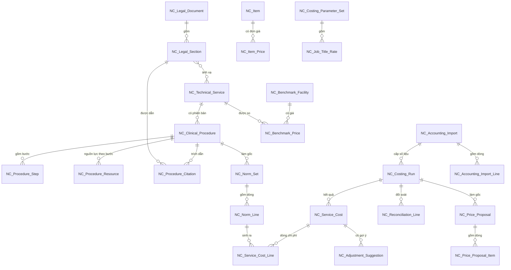
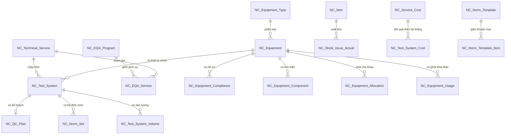

# Data Model: Normcore (đặc tả DocType)

> Version: 1.1 · Last updated: 2026-11-13
> Nguồn: `docs/srs.md` v1.1, `docs/architecture.md` (ADR-001, ADR-002, ADR-004, ADR-011, ADR-013, ADR-014) và ADR-017, ADR-018 ở `docs/sua-doi-1.1/architecture-ux.md`
> Tài liệu này là phần thiết kế dữ liệu ở mức khái niệm và logic. Thiết kế vật lý từng tính năng (chỉ mục, migration, hợp đồng API) do bước thiết kế chi tiết của từng FEAT bổ sung; mọi DocType mới ngoài danh sách này phải cập nhật tài liệu này trước.

**Lịch sử sửa đổi**

| Version | Date | Changes |
| :-- | :-- | :-- |
| 1.0 | 2026-11-13 | Bản đầu, phân hệ A đến D |
| 1.1 | 2026-11-13 | Gộp `docs/sua-doi-1.1/data-model.md` (hợp nhất phân hệ E theo SRS 1.1). Thêm 9 DocType: NC Equipment Type, NC Equipment Compliance, NC Test System, NC QC Plan, NC EQA Program, NC Norm Template, NC Test System Volume, NC Equipment Usage, NC Stock Issue Actual. Thêm 10 bảng con: NC Service Code Map, NC Panel Component, NC Document Resource Link, NC Equipment Component, NC Equipment Allocation, NC QC IQC Line, NC QC Calibration Line, NC EQA Service, NC Norm Template Item, NC Test System Cost. Mở rộng 15 DocType: NC Settings, NC Legal Document, NC Technical Service, NC Prompt Template, NC Costing Parameter Set, NC Item, NC Item Price, NC Equipment, NC Norm Set, NC Norm Line, NC Service Volume, NC Costing Run, NC Service Cost, NC Service Cost Line, NC Reconciliation Line. Thêm vai trò NC Auditor. Sửa DI-03; thêm DI-09 đến DI-17. Trường và DocType thêm ở bản này mang nhãn **[1.1]** |

## 1. Quy ước

- Tên DocType: tiền tố `NC `, tiếng Anh. Tên trường: tiếng Anh, snake_case. Nhãn: tiếng Việt [NFR-MNT-003].
- Mọi DocType nghiệp vụ bật `track_changes` [ADR-014].
- Bảng con (child table) ghi rõ "Bảng con của …".
- Cột **BB**: bắt buộc. Kiểu trường là kiểu của Frappe.
- Bản ghi đã khóa hoặc đã ban hành: `docstatus` giữ 0; việc khóa do trường trạng thái và controller kiểm soát, để tạo phiên bản mới không cần cơ chế amend.
- **[1.1]** Phân hệ E dùng chung DocType của phân hệ A đến D; không có DocType tiền tố `CLS` (ràng buộc C-09). Mọi DocType thêm ở bản 1.1 thuộc module NC Costing; không thêm module (ADR-001).

## 2. Sơ đồ quan hệ

**[1.1]** Quan hệ thêm cho khối cận lâm sàng:

## 3. DocType theo module

### 3.1 NC Core

**NC Department** — Khoa, phòng. Naming: `department_code`.

| Trường | Nhãn | Kiểu | BB | Ghi chú |
| :-- | :-- | :-- | :-- | :-- |
| department_code | Mã khoa | Data | Có | Duy nhất |
| department_name | Tên khoa | Data | Có | |
| department_type | Loại | Select | Có | Lâm sàng / Cận lâm sàng / Hỗ trợ |
| cost_center | Trung tâm chi phí | Link NC Cost Center | Có | |
| head_user | Trưởng khoa | Link User | | Nhận thông báo duyệt |
| is_active | Đang hoạt động | Check | | |

**NC Cost Center** — Trung tâm chi phí. Naming: `cost_center_code`.

| Trường | Nhãn | Kiểu | BB | Ghi chú |
| :-- | :-- | :-- | :-- | :-- |
| cost_center_code | Mã | Data | Có | Khớp mã trong tệp kế toán |
| cost_center_name | Tên | Data | Có | |
| center_type | Loại | Select | Có | Lâm sàng / Hỗ trợ. "Lâm sàng" gồm cả cận lâm sàng: nơi có dịch vụ |

**NC Cost Center Driver** — Tiêu chí của trung tâm chi phí theo năm [FR-ACCT-010]. Naming: tự động.

| Trường | Nhãn | Kiểu | BB | Ghi chú |
| :-- | :-- | :-- | :-- | :-- |
| fiscal_year | Năm tài chính | Int | Có | |
| cost_center | Trung tâm chi phí | Link NC Cost Center | Có | Duy nhất theo (năm, trung tâm) |
| headcount | Số nhân lực | Float | | |
| area_m2 | Diện tích (m²) | Float | | |
| revenue | Doanh thu | Currency | | |

**NC Settings** (Single) — Tham số vận hành [FR-ADM-003, FR-ADM-006].

| Trường | Nhãn | Kiểu | Mặc định |
| :-- | :-- | :-- | :-- |
| min_time_study_cases | Số ca bấm giờ tối thiểu | Int | 5 |
| approval_reminder_days | Số ngày nhắc duyệt | Int | 7 |
| price_valid_months | Hạn tham chiếu đơn giá (tháng) | Int | 24 |
| benchmark_window_months | Cửa sổ giá tham chiếu (tháng) | Int | 24 |
| min_benchmark_facilities | Số đơn vị tham chiếu tối thiểu | Int | 3 |
| accounting_regime | Chế độ kế toán | Select | Hành chính sự nghiệp |
| compliance_reminder_days **[1.1]** | Số ngày nhắc hạn hồ sơ tuân thủ | Int | 30 [FR-CMP-005] |
| council_secretary **[AMD-007-01]** | Thư ký hội đồng | Link User | — | Người dùng có vai trò NC Council Member; thực hiện Thông qua, Từ chối ở cấp hội đồng [FR-WF-004] |

**NC Audit Event** — Sổ sự kiện nghiệp vụ, chỉ ghi qua mã máy chủ, không vai trò nào có quyền sửa, xóa [FR-AUD-002]. Naming: tự động.

| Trường | Nhãn | Kiểu | Ghi chú |
| :-- | :-- | :-- | :-- |
| event_time | Thời điểm | Datetime | |
| user | Người thực hiện | Link User | |
| event_type | Loại sự kiện | Select | Chuyển trạng thái / Khóa / Xuất tệp / Đổi cấu hình / Gọi AI / Nhập tệp / Xóa **[AMD-006]** |
| ref_doctype, ref_name | Bản ghi | Link DocType, Dynamic Link | |
| from_state, to_state | Trạng thái trước, sau | Data | |
| detail | Chi tiết | Small Text | Lý do từ chối, tên tệp xuất |
| before_value **[AMD-006]** | Giá trị trước | Long Text | JSON, chỉ đọc; chỉ sự kiện "Xóa": bản ghi, bảng con, owner, creation, các Version |

**NC Review Comment** — Ý kiến thẩm định [FR-WF-003]. Naming: tự động.

| Trường | Nhãn | Kiểu | BB | Ghi chú |
| :-- | :-- | :-- | :-- | :-- |
| ref_doctype, ref_name | Bản ghi | Link DocType, Dynamic Link | Có | Quy trình hoặc phương án giá |
| target_section | Phần | Select | | Đại cương / Chỉ định / … |
| target_step_id | Mã bước | Data | | |
| comment | Ý kiến | Text | Có | |
| resolved | Đã xử lý | Check | | |

### 3.2 NC Library

**NC Legal Document** — Văn bản. Naming: `LD-.#####`.

| Trường | Nhãn | Kiểu | BB | Ghi chú |
| :-- | :-- | :-- | :-- | :-- |
| doc_number | Số hiệu | Data | Có | Duy nhất sau chuẩn hóa [FR-LIB-002] |
| title | Tên văn bản | Data | Có | |
| doc_type | Loại | Select | Có | Luật / Nghị định / Thông tư / Quyết định / Công văn / Tài liệu nội bộ / Tài liệu của hãng **[1.1]** [FR-LIB-013] |
| issuer | Cơ quan ban hành | Data | Có | |
| issue_date | Ngày ban hành | Date | Có | |
| effective_date | Ngày hiệu lực | Date | Có | |
| expiry_date | Ngày hết hiệu lực | Date | | Đặt khi bị thay thế |
| validity_status | Hiệu lực | Select | | Chưa hiệu lực / Còn hiệu lực / Hết hiệu lực; tính tự động [FR-LIB-006] |
| is_procedure_guideline | Là hướng dẫn QTKT | Check | | Bật màn hình ánh xạ |
| file | Tệp | Attach | Có | Private |
| index_status | Lập chỉ mục | Select | | Chưa lập / Đang lập / Đã lập / Lỗi |
| index_error | Lỗi lập chỉ mục | Small Text | | |
| supersessions | Thay thế | Table NC Legal Supersession | | |
| related_resources **[1.1]** | Mặt hàng, thiết bị liên quan | Table NC Document Resource Link | | BB khi loại là "Tài liệu của hãng" [FR-LIB-013] |

**NC Legal Supersession** — Bảng con của NC Legal Document [FR-LIB-007, FR-LIB-008].

| Trường | Nhãn | Kiểu | BB |
| :-- | :-- | :-- | :-- |
| superseded_document | Văn bản bị thay thế | Link NC Legal Document | Có |
| scope | Phạm vi | Select: Toàn bộ / Một phần | Có |
| superseded_sections | Các mục bị thay thế | Small Text (danh sách mã mục) | |
| from_date | Từ ngày | Date | Có |

**NC Document Resource Link** **[1.1]** — Bảng con của NC Legal Document: `linked_doctype` (Link DocType: NC Item / NC Equipment, BB), `linked_name` (Dynamic Link, BB).

**NC Legal Section** — Mục của văn bản. Naming: `LS-.#######`. Chỉ mục FULLTEXT trên `plain_text` [ADR-006].

| Trường | Nhãn | Kiểu | BB | Ghi chú |
| :-- | :-- | :-- | :-- | :-- |
| legal_document | Văn bản | Link NC Legal Document | Có | |
| section_no | Số mục | Data | Có | Giữ khi lập lại chỉ mục |
| heading | Tiêu đề | Data | | |
| page_from, page_to | Trang | Int | | |
| plain_text | Văn bản thuần | Long Text | Có | |
| expiry_date | Ngày hết hiệu lực | Date | | Khi bị thay thế một phần |
| validity_status | Hiệu lực | Select | | Kế thừa văn bản, trừ khi có `expiry_date` riêng |
| service_mappings | Ánh xạ dịch vụ | Table NC Section Service Map | | |

**NC Section Service Map** — Bảng con của NC Legal Section [FR-SVC-005, FR-SVC-006].

| Trường | Nhãn | Kiểu | BB |
| :-- | :-- | :-- | :-- |
| technical_service | Dịch vụ kỹ thuật | Link NC Technical Service | Có |
| mapping_status | Trạng thái | Select: Đề xuất / Đã xác nhận | Có |
| confidence | Độ tin cậy (%) | Percent | |
| confirmed_by, confirmed_on | Người xác nhận, thời điểm | Link User, Datetime | |

### 3.3 NC Procedure

**NC Specialty** — Chuyên khoa. Naming: `specialty_code`. Trường: `specialty_code` (BB, duy nhất), `specialty_name` (BB). **[AMD-003]**

**NC Technical Service** — Dịch vụ kỹ thuật. Naming: `service_code`.

| Trường | Nhãn | Kiểu | BB | Ghi chú |
| :-- | :-- | :-- | :-- | :-- |
| service_code | Mã dịch vụ | Data | Có | Theo danh mục kỹ thuật |
| service_name | Tên dịch vụ | Data | Có | |
| specialty | Chuyên khoa | Link NC Specialty | | |
| departments | Khoa thực hiện | Table NC Service Department | | [FR-SVC-003] |
| is_active | Đang dùng | Check | | |
| approved_prices | Giá đã duyệt | Table NC Service Price History | | Chỉ đọc; ghi bởi phương án giá [FR-PRICE-010] |
| is_paraclinical **[1.1]** | Thuộc khối cận lâm sàng | Check | | [FR-SVC-008] |
| cls_group **[1.1]** | Nhóm chuyên ngành | Select | | Hóa sinh / Miễn dịch / Huyết học / Vi sinh / Giải phẫu bệnh / Chẩn đoán hình ảnh / Thăm dò chức năng / Khác. BB khi `is_paraclinical` |
| result_unit **[1.1]** | Đơn vị kết quả | Select | | Kết quả xét nghiệm / Ca chụp. BB khi `is_paraclinical` |
| external_codes **[1.1]** | Mã trên hệ thống ngoài | Table NC Service Code Map | | [FR-SVC-009] |
| is_panel **[1.1]** | Là dịch vụ bộ | Check | | [FR-SVC-010] |
| panel_costing_mode **[1.1]** | Cách tính dịch vụ bộ | Select | | Theo cả bộ / Theo từng thông số; TBD-17 |
| panel_components **[1.1]** | Thông số thành phần | Table NC Panel Component | | |
| is_send_out **[1.1]** | Gửi ngoài | Check | | Bật thì không yêu cầu bộ định mức [FR-SVC-011] |
| send_out_price **[1.1]** | Giá hợp đồng gửi mẫu | Currency | | |

**NC Service Department** — Bảng con: `department` (Link NC Department, BB; mỗi khoa tối đa một dòng trong một dịch vụ **[AMD-003]**).

**NC Service Price History** — Bảng con: `price_category`, `price`, `effective_date`, `price_proposal`, `authority_doc_no`.

**NC Service Code Map** **[1.1]** — Bảng con của NC Technical Service: `source_system` (Select: HIS / LIS / RIS, BB), `external_code` (Data, BB), `external_name` (Data). Một cặp (`source_system`, `external_code`) chỉ thuộc một dịch vụ (DI-09).

**NC Panel Component** **[1.1]** — Bảng con của NC Technical Service: `parameter_code` (BB), `parameter_name` (BB), `technical_service` (Link NC Technical Service, tùy chọn).

**NC Clinical Procedure** — Quy trình kỹ thuật, mỗi bản ghi là một phiên bản. Naming: `QT-.{service_code}.-.{department}.-v.{version_no}`.

| Trường | Nhãn | Kiểu | BB | Ghi chú |
| :-- | :-- | :-- | :-- | :-- |
| technical_service | Dịch vụ kỹ thuật | Link NC Technical Service | Có | |
| department | Khoa chủ trì | Link NC Department | Có | |
| version_no | Phiên bản | Int | Có | Tăng dần theo (dịch vụ, khoa) |
| previous_version | Phiên bản trước | Link NC Clinical Procedure | | |
| workflow_state | Trạng thái | Link Workflow State | | Mục 5.1 |
| needs_review | Cần rà soát | Check | | Đặt bởi FR-LIB-009 |
| doctor_request | Yêu cầu của người soạn | Text | | Đầu vào cho AI |
| overview | Đại cương | Text Editor | | |
| indications | Chỉ định | Text Editor | | |
| contraindications | Chống chỉ định | Text Editor | | |
| cautions | Thận trọng | Text Editor | | |
| preparation_notes | Chuẩn bị (ghi chú chung) | Text Editor | | Nguồn lực cụ thể nằm ở bảng con |
| monitoring | Theo dõi và xử trí tai biến | Text Editor | | |
| references | Tài liệu tham khảo | Text Editor | | |
| steps | Các bước | Table NC Procedure Step | | |
| resources | Nguồn lực | Table NC Procedure Resource | | |
| citations | Trích dẫn | Table NC Procedure Citation | | |
| next_step_seq | Số cấp mã bước kế tiếp | Int | | Nội bộ, bảo đảm mã bước không tái dùng |
| next_resource_seq **[AMD-001]** | Số cấp mã dòng nguồn lực kế tiếp | Int | | Nội bộ, bảo đảm mã dòng `R###` không tái dùng |
| decision_no | Số quyết định ban hành | Data | | BB khi ban hành [FR-WF-005] |
| effective_date | Ngày hiệu lực | Date | | BB khi ban hành |
| copied_from | Sao chép từ | Link NC Clinical Procedure | | |
| ai_log | Nhật ký AI của dự thảo | Link NC AI Log | | |

**NC Procedure Step** — Bảng con.

| Trường | Nhãn | Kiểu | BB | Ghi chú |
| :-- | :-- | :-- | :-- | :-- |
| step_id | Mã bước | Data | Có | `S001`, `S002`…; bất biến [ADR-002] |
| phase | Giai đoạn | Select | Có | Chuẩn bị / Thực hiện / Theo dõi / Kết thúc |
| step_title | Tên bước | Data | Có | |
| description | Mô tả | Text | Có | |
| reference_minutes | Thời gian tham chiếu (phút) | Float | | Không dùng để tính giá |
| ai_suggested | Đề xuất của AI | Check | | Phải được chấp nhận trước khi gửi duyệt [FR-AI-008] |

**NC Procedure Resource** — Bảng con.

| Trường | Nhãn | Kiểu | BB | Ghi chú |
| :-- | :-- | :-- | :-- | :-- |
| resource_row_id | Mã dòng | Data | Có | Bất biến, dạng `R001`; nối với dòng định mức |
| step_id | Mã bước | Data | Có | Phải tồn tại trong `steps` |
| resource_type | Loại | Select | Có | Nhân lực / Thuốc / Hóa chất / Dịch truyền / Vật tư / Thiết bị / Phòng / Khác |
| resource_text | Tên như ghi trong quy trình | Data | Có | |
| linked_doctype, linked_name | Bản ghi danh mục | Link DocType, Dynamic Link | | NC Job Title / NC Item / NC Equipment / NC Room |
| quantity | Số lượng | Float | Có | |
| uom | Đơn vị | Data | Có | |
| headcount | Số người | Int | | Với nhân lực |
| ai_suggested | Đề xuất của AI | Check | | |

**NC Procedure Citation** — Bảng con.

| Trường | Nhãn | Kiểu | BB | Ghi chú |
| :-- | :-- | :-- | :-- | :-- |
| target_section | Phần | Select | | Một trong hai: phần hoặc mã bước |
| target_step_id | Mã bước | Data | | |
| relation | Quan hệ | Select | Có | Theo hướng dẫn / Khác biệt / Chưa có căn cứ |
| legal_section | Mục văn bản | Link NC Legal Section | | BB trừ khi "Chưa có căn cứ" |
| quote | Đoạn trích | Small Text | | Phải có nguyên văn trong mục [FR-AI-005] |
| deviation_reason | Lý do khác biệt | Small Text | | BB khi "Khác biệt" [FR-PROC-008] |

**NC Procedure Change Request** — Yêu cầu sửa đổi quy trình từ phân hệ D [FR-ADJ-007]. Trường: `procedure` (Link), `requested_by`, `source_suggestion` (Link NC Adjustment Suggestion), `proposed_change` (Text), `status` (Mới / Đã tiếp nhận / Từ chối / Đã thực hiện).

### 3.4 NC AI

**NC AI Settings** (Single) [FR-AI-012, FR-AI-013, FR-AI-015].

| Trường | Nhãn | Kiểu | Ghi chú |
| :-- | :-- | :-- | :-- |
| enabled | Bật AI | Check | |
| protocol | Giao thức | Select | OpenAI-compatible / Anthropic Messages |
| base_url | Địa chỉ | Data | |
| model | Mô hình | Data | |
| api_key | Khóa | Password | [NFR-SEC-004] |
| timeout_seconds | Thời hạn (giây) | Int | Mặc định 180 |
| max_output_tokens | Số token trả về tối đa | Int | |
| monthly_token_budget | Hạn mức token tháng | Int | 0 = không giới hạn |

**NC Prompt Template** — Mẫu lệnh có phiên bản [FR-AI-014]. Naming: `{template_code}-v{version}`.

| Trường | Nhãn | Kiểu | BB |
| :-- | :-- | :-- | :-- |
| template_code | Mã mẫu | Select: DRAFT_PROCEDURE / CONSISTENCY_CHECK / SUGGEST_NORM_LINK / MAP_SECTION_SERVICE / EXTRACT_PRICE_LIST / MATCH_SERVICE_NAME / SUGGEST_CLS_NORM **[1.1]** [FR-AI-016] | Có |
| version | Phiên bản | Int | Có |
| is_active | Đang dùng | Check | |
| system_prompt | Lệnh hệ thống | Long Text | Có |
| user_prompt | Lệnh người dùng (Jinja) | Long Text | Có |
| output_schema | Lược đồ JSON đầu ra | Code | Có |

**NC AI Log** — Nhật ký lời gọi [FR-AI-009]. Không có quyền sửa. Naming: tự động.

| Trường | Nhãn | Kiểu |
| :-- | :-- | :-- |
| purpose | Mục đích | Select (như `template_code`) |
| user | Người gọi | Link User |
| ref_doctype, ref_name | Bản ghi liên quan | Link DocType, Dynamic Link |
| prompt_template | Mẫu lệnh | Link NC Prompt Template |
| source_sections | Mục nguồn đã gửi | Small Text (danh sách mã mục) |
| request_hash | Mã băm nội dung gửi | Data |
| response | Kết quả trả về | Long Text |
| tokens_in, tokens_out | Token vào, ra | Int |
| duration_ms | Thời gian (ms) | Int |
| status | Trạng thái | Select: Thành công / Lỗi / Quá hạn / Bị chặn hạn mức |
| rejected_citations | Số trích dẫn bị loại | Int |

### 3.5 NC Costing

**NC Job Title** — Chức danh. Trường: `job_title_code` (BB, duy nhất), `job_title_name` (BB), `job_group` (Bác sĩ / Điều dưỡng / Kỹ thuật viên / Dược sĩ / Hộ lý / Khác).

**NC Costing Parameter Set** — Bộ tham số [FR-RES-009]. Naming: `PS-.YYYY.-.##`.

| Trường | Nhãn | Kiểu | BB | Ghi chú |
| :-- | :-- | :-- | :-- | :-- |
| title | Tên | Data | Có | |
| effective_from | Hiệu lực từ | Date | Có | |
| base_salary | Lương cơ sở | Currency | Có | |
| employer_contribution_rate | Tỷ lệ đóng góp của đơn vị (%) | Percent | Có | |
| working_days_per_year | Số ngày làm việc năm | Float | Có | |
| working_hours_per_day | Số giờ làm việc ngày | Float | Có | |
| wastage_cap | Trần hao hụt (%) | Percent | Có | |
| accumulation_mode | Cách tính tích lũy | Select | Có | ON_COST / ON_PRICE / NONE |
| accumulation_rate | Tỷ lệ tích lũy (%) | Percent | Có | |
| obligation_rate | Tỷ lệ nghĩa vụ tài chính (%) | Percent | Có | |
| rounding_unit | Đơn vị làm tròn | Int | Có | Mặc định 100 |
| reconciliation_tolerance | Ngưỡng đối soát (%) | Percent | Có | Mặc định 10 |
| comparison_tolerance | Ngưỡng lệch so sánh (%) | Percent | Có | Mặc định 10 |
| electricity_price | Giá điện (đ/kWh) | Currency | Có | |
| water_price | Giá nước (đ/m³) | Currency | Có | |
| expired_depreciation_mode **[1.1]** | Khấu hao thiết bị hết thời gian sử dụng | Select | Có | ZERO / CONTINUE; mặc định ZERO [FR-RES-007] |
| material_recon_tolerance **[1.1]** | Ngưỡng đối soát vật chất (%) | Percent | Có | Mặc định 5 [FR-COST-027] |
| volume_recon_tolerance **[1.1]** | Ngưỡng đối soát sản lượng (%) | Percent | Có | Mặc định 2 [FR-COST-028] |
| eqa_cost_category **[1.1]** | Loại chi phí của phí ngoại kiểm | Select | | Loại chi phí của BR-COST-008; mặc định DRUG_SUPPLY. Tạm thời đến khi chốt TBD-14 |
| rental_cost_category **[1.1]** | Loại chi phí của tiền thuê máy | Select | | Mặc định DEPRECIATION. TBD-14 |
| jv_cost_category **[1.1]** | Loại chi phí của hợp đồng liên doanh, liên kết | Select | | Mặc định DEPRECIATION. TBD-14 |
| job_title_rates | Chi phí theo chức danh | Table NC Job Title Rate | | |
| is_locked | Đã được dùng trong lần tính giá khóa | Check | | Chỉ đọc [FR-RES-011] |

**NC Job Title Rate** — Bảng con của bộ tham số [FR-RES-010, BR-COST-001].

| Trường | Nhãn | Kiểu | BB |
| :-- | :-- | :-- | :-- |
| job_title | Chức danh | Link NC Job Title | Có |
| salary_coefficient | Hệ số lương | Float | |
| allowance_coefficient | Hệ số phụ cấp được tính | Float | |
| other_annual_income | Thu nhập khác được tính (năm) | Currency | |
| annual_cost_override | Chi phí năm nhập thẳng | Currency | |
| annual_cost | Chi phí năm | Currency (chỉ đọc) | |
| rate_per_hour | Đơn giá giờ công | Float 4 (chỉ đọc) | |

**NC Price Category** — Loại giá [FR-RES-015]. Trường: `category_code` (BB), `category_name` (BB), `approval_authority` (Bệnh viện / Cơ quan có thẩm quyền, BB), `include_depreciation` (Check), `include_accumulation` (Check).

**NC Item** — Mặt hàng [FR-RES-001, FR-RES-018]. Naming: `item_code`.

| Trường | Nhãn | Kiểu | BB | Ghi chú |
| :-- | :-- | :-- | :-- | :-- |
| item_code | Mã | Data | Có | |
| item_name | Tên | Data | Có | |
| item_type | Loại | Select | Có | Thuốc / Hóa chất / Dịch truyền / Máu và chế phẩm / Vật tư tiêu hao / Vật tư dùng nhiều lần / Khí y tế / Tiện ích / Chất chuẩn **[1.1]** / Vật liệu nội kiểm **[1.1]** / Khác |
| uom | Đơn vị tính | Data | Có | Là đơn vị mua |
| reuse_count | Số lần dùng | Int | Có | Mặc định 1 |
| equivalent_group | Nhóm tương đương | Data | | [FR-RES-013] |
| billed_separately | Thanh toán riêng ngoài giá | Check | | [FR-RES-014] |
| is_active | Đang dùng | Check | | |
| norm_uom **[1.1]** | Đơn vị định mức | Data | | Ví dụ: test, mL. Trống = dùng `uom` |
| norm_units_per_purchase_unit **[1.1]** | Số đơn vị định mức trong một đơn vị mua | Float | | Không có mặc định **[AMD-008]**. BB (lớn hơn 0) với Hóa chất, Chất chuẩn, Vật liệu nội kiểm [BR-CLS-002]; loại khác để trống thì tính là 1 |
| nominal_tests **[1.1]** | Số test danh nghĩa của một đơn vị mua | Int | | |
| open_stability_days **[1.1]** | Hạn dùng sau mở (ngày) | Int | | [BR-CLS-016] |
| is_main_reagent **[1.1]** | Là hóa chất chính | Check | | Mặc định bật cờ nhân k ở dòng định mức [FR-NORM-019] |

**[1.1]** `reuse_count` giữ nguyên ý nghĩa (vật tư dùng nhiều lần). Đơn giá một đơn vị định mức = `unit_price` ÷ `norm_units_per_purchase_unit`, giữ 4 chữ số thập phân.

**NC Item Price** — Đơn giá [FR-RES-002, FR-RES-004, FR-RES-016, FR-RES-017]. Naming: tự động.

| Trường | Nhãn | Kiểu | BB | Ghi chú |
| :-- | :-- | :-- | :-- | :-- |
| price_code **[AMD-008]** | Mã đơn giá | Data | | Duy nhất. Để trống thì lấy bằng tên bản ghi; không tự đặt dạng DG-<số>. Khóa khi nhập Excel [FR-RES-012] |
| item | Mặt hàng | Link NC Item | Có | |
| unit_price | Đơn giá (đã gồm thuế GTGT) | Float 4 | Có | |
| price_source | Nguồn giá | Select | Có | Trúng thầu / Hợp đồng **[1.1]** / Hóa đơn / Giá công bố / Báo giá. Thứ tự này là thứ tự ưu tiên khi chọn giá [FR-RES-004] |
| document_no | Số chứng từ | Data | Có | |
| document_date | Ngày chứng từ | Date | Có | Dùng cho cảnh báo 24 tháng |
| valid_from | Hiệu lực từ | Date | Có | |
| valid_to **[1.1]** | Hiệu lực đến | Date | | Tùy chọn |
| attachment | Tệp chứng từ | Attach | | **[1.1]** BB khi chuyển sang "Đã xác minh" |
| verification_status **[1.1]** | Trạng thái xác minh | Select | Có | Chưa xác minh / Đã xác minh; mặc định Chưa xác minh |
| verified_by, verified_on **[1.1]** | Người xác minh, thời điểm | Link User, Datetime | | |

**NC Equipment Type** **[1.1]** — Loại thiết bị [FR-CMP-006, FR-ADM-006]. Naming: `type_code`.

| Trường | Nhãn | Kiểu | BB | Ghi chú |
| :-- | :-- | :-- | :-- | :-- |
| type_code | Mã loại | Data | Có | Duy nhất |
| type_name | Tên loại | Data | Có | Ví dụ: Máy xét nghiệm sinh hóa, Máy X-quang |
| compliance_required | Bắt buộc có hồ sơ tuân thủ | Check | | Danh sách chính thức: TBD-18 |

**NC Equipment** — Thiết bị [FR-RES-005, FR-RES-019..026, BR-COST-004, BR-CLS-009]. Naming: `equipment_code`.

| Trường | Nhãn | Kiểu | BB | Ghi chú |
| :-- | :-- | :-- | :-- | :-- |
| equipment_code | Mã thiết bị | Data | Có | |
| equipment_name | Tên | Data | Có | |
| department | Khoa quản lý | Link NC Department | Có | |
| equipment_type **[1.1]** | Loại thiết bị | Link NC Equipment Type | | |
| acquisition_mode **[1.1]** | Hình thức có máy | Select | Có | Mua / Thuê / Đặt theo hóa chất / Liên doanh, liên kết; mặc định Mua |
| allocation_basis **[1.1]** | Tiêu chí chia chi phí | Select | Có | Giờ kế hoạch / Số kết quả / Phút chiếm máy; mặc định Giờ kế hoạch |
| original_cost | Nguyên giá | Currency | Có điều kiện | **[1.1]** Chỉ BB khi `acquisition_mode` = Mua (bản 1.0: luôn BB) |
| in_service_date | Ngày đưa vào sử dụng | Date | Có | |
| useful_life_years | Thời gian sử dụng (năm) | Float | Có điều kiện | **[1.1]** Chỉ BB khi `acquisition_mode` = Mua |
| funding_source | Nguồn hình thành | Select: Ngân sách / Quỹ phát triển / Vay / Liên doanh, liên kết / Viện trợ / Khác | Có | |
| annual_contract_cost **[1.1]** | Chi phí năm theo hợp đồng | Currency | Có điều kiện | BB khi Thuê hoặc Liên doanh, liên kết [FR-RES-020] |
| contract_asset_value **[1.1]** | Giá trị ghi trên hợp đồng | Currency | | Dùng cho phân bổ theo giá trị tài sản khi không có nguyên giá [BR-CLS-011] |
| annual_maintenance_cost | Bảo trì năm | Currency | | |
| maintenance_vendor_paid **[1.1]** | Bảo trì do nhà cung cấp chịu | Check | | Có tác dụng khi Đặt theo hóa chất [FR-RES-021] |
| annual_calibration_cost | Kiểm định, hiệu chuẩn năm | Currency | | **[1.1]** Chỉ dùng khi thiết bị không có NC Equipment Compliance còn hạn [FR-CMP-002] |
| planned_hours_per_year | Giờ khai thác kế hoạch năm | Float | Có điều kiện | **[1.1]** Chỉ BB khi `allocation_basis` = Giờ kế hoạch |
| utilization_rate | Hệ số sử dụng | Float (0 đến 1) | Có điều kiện | **[1.1]** Chỉ BB khi `allocation_basis` = Giờ kế hoạch |
| power_kw | Công suất (kW) | Float | | **[1.1]** Hiểu là công suất khi chạy |
| power_standby_kw **[1.1]** | Công suất khi chờ (kW) | Float | | [FR-RES-026] |
| run_hours_per_day, standby_hours_per_day **[1.1]** | Số giờ chạy, số giờ chờ mỗi ngày | Float | | |
| continuous_power **[1.1]** | Cấp điện liên tục | Check | | Bật thì D = 365 [BR-CLS-012] |
| components **[1.1]** | Linh kiện lớn | Table NC Equipment Component | | |
| department_allocations **[1.1]** | Tỷ lệ phân bổ theo khoa | Table NC Equipment Allocation | | Trống = 100% cho `department` |

Khấu hao năm và đơn giá giờ máy không lưu trên bản ghi; bộ máy tính giá tính tại ngày tính giá để xử lý đúng thiết bị hết thời gian sử dụng [FR-RES-007]. Form hiển thị giá trị tạm tính theo ngày hiện tại.

**NC Equipment Component** **[1.1]** — Bảng con của NC Equipment [FR-RES-023, BR-CLS-010]: `component_name` (Data, BB), `replacement_cost` (Currency, BB), `life_basis` (Select: Tháng / Số kết quả / Giờ chạy, BB), `life_value` (Float, BB), `vendor_paid` (Check).

**NC Equipment Allocation** **[1.1]** — Bảng con của NC Equipment [FR-RES-024, FR-RES-025]: `department` (Link NC Department, BB), `share_pct` (Percent, BB). Tổng bằng 100 (DI-10).

**NC Equipment Compliance** **[1.1]** — Hồ sơ tuân thủ [FR-CMP-001..007]. Naming: `HSTT-.YYYY.-.####`. Áp dụng cho mọi thiết bị.

| Trường | Nhãn | Kiểu | BB | Ghi chú |
| :-- | :-- | :-- | :-- | :-- |
| record_code **[AMD-009]** | Mã hồ sơ | Data | | Duy nhất. Để trống thì lấy bằng tên bản ghi; không tự đặt dạng HSTT-<…> khác tên. Khóa khi nhập Excel [UC-020 1a] |
| equipment | Thiết bị | Link NC Equipment | Có | |
| department **[AMD-009]** | Khoa quản lý | Link NC Department | | Chỉ đọc, lấy từ `equipment.department`. Lọc danh sách, nhóm báo cáo [FR-CMP-007, SCR-DSK-035] |
| record_type | Loại hồ sơ | Select | Có | Kiểm định / Hiệu chuẩn / Kiểm xạ / Giấy phép an toàn bức xạ / Khác |
| cycle_months | Chu kỳ (tháng) | Int | Có | Lớn hơn 0 |
| provider | Đơn vị thực hiện | Data | Có | |
| cost_per_time | Chi phí mỗi lần | Currency | Có | Đã gồm thuế GTGT |
| performed_on | Ngày thực hiện | Date | Có | |
| expiry_date | Ngày hết hạn | Date | Có | |
| attachment | Tệp chứng từ | Attach | Có | Private |
| status | Trạng thái | Select (chỉ đọc) | | Còn hạn / Sắp hết hạn / Hết hạn; tác vụ hằng ngày tính theo `expiry_date` và `NC Settings.compliance_reminder_days` |
| note | Ghi chú | Small Text | | |

**NC Room** — Phòng [FR-RES-008, BR-COST-005]. Trường: `room_code` (BB), `room_name` (BB), `department` (BB), `area_m2`, `annual_infrastructure_cost` (BB), `available_hours_per_year` (BB).

**NC Test System** **[1.1]** — Hệ thống xét nghiệm [FR-CLS-001..008]. Naming: `test_system_code`.

| Trường | Nhãn | Kiểu | BB | Ghi chú |
| :-- | :-- | :-- | :-- | :-- |
| test_system_code | Mã hệ thống | Data | Có | Duy nhất; dùng trong tệp nhập sản lượng |
| technical_service | Dịch vụ | Link NC Technical Service | Có | Phải có `is_paraclinical` |
| department | Khoa | Link NC Department | Có | Phạm vi quyền theo FR-ACC-008 |
| main_equipment | Thiết bị chính | Link NC Equipment | Có | |
| volume_share_pct | Tỷ trọng sản lượng (%) | Percent | Có | Dùng khi không có số kết quả theo hệ thống [FR-CLS-003, FR-CLS-004] |
| machine_minutes_per_case | Phút chiếm máy một ca | Float | | BB khi thiết bị chính có `allocation_basis` = Phút chiếm máy [FR-CLS-005] |
| est_rerun_rate | Tỷ lệ chạy lại ước tính (%) | Percent | | Mặc định 0 [BR-CLS-001] |
| est_wastage_rate | Tỷ lệ hao hụt ước tính (%) | Percent | | Mặc định 0 |
| status | Trạng thái | Select | Có | Đang dùng / Ngừng dùng [FR-CLS-006] |

Form hiển thị (không lưu): bộ định mức hiện hành, kế hoạch chất lượng, sản lượng kịch bản mặc định, k và giá thành một kết quả của lần tính gần nhất [FR-CLS-007].

**NC QC Plan** **[1.1]** — Kế hoạch chất lượng [FR-QC-001, FR-QC-002, FR-QC-007, FR-QC-008]. Naming: `KHCL-.{test_system}`. Mỗi hệ thống xét nghiệm có tối đa một kế hoạch (DI-11).

| Trường | Nhãn | Kiểu | BB | Ghi chú |
| :-- | :-- | :-- | :-- | :-- |
| test_system | Hệ thống xét nghiệm | Link NC Test System | Có | Duy nhất |
| run_days_per_year | Số ngày chạy mỗi năm | Int | Có | Ký hiệu D khi sản lượng không có số ngày thực tế |
| iqc_lines | Nội kiểm | Table NC QC IQC Line | | |
| calibration_lines | Chuẩn máy | Table NC QC Calibration Line | | |

**NC QC IQC Line** **[1.1]** — Bảng con của NC QC Plan [BR-CLS-006].

| Trường | Nhãn | Kiểu | BB | Ghi chú |
| :-- | :-- | :-- | :-- | :-- |
| qc_material | Vật liệu nội kiểm | Link NC Item | Có | `item_type` phải là Vật liệu nội kiểm (DI-16) |
| levels | Số mức | Int | Có | |
| runs_per_day | Số lần chạy mỗi ngày | Float | Có | |
| qty_per_run | Lượng dùng mỗi lần | Float | Có | Theo đơn vị định mức của mặt hàng |
| shared_parameter_count | Số thông số dùng chung | Int | Có | Mặc định 1; TBD-15 |

**NC QC Calibration Line** **[1.1]** — Bảng con của NC QC Plan [BR-CLS-007].

| Trường | Nhãn | Kiểu | BB | Ghi chú |
| :-- | :-- | :-- | :-- | :-- |
| calibrator | Chất chuẩn | Link NC Item | Có | `item_type` phải là Chất chuẩn (DI-16) |
| points | Số điểm chuẩn | Int | Có | |
| replicates | Số lần lặp | Int | Có | |
| calibrations_per_year | Số lần chuẩn mỗi năm | Float | Có | |
| cost_per_calibration | Chi phí chất chuẩn mỗi lần | Currency | Có | |

**NC EQA Program** **[1.1]** — Chương trình ngoại kiểm [FR-QC-003..005]. Naming: `eqa_code`.

| Trường | Nhãn | Kiểu | BB | Ghi chú |
| :-- | :-- | :-- | :-- | :-- |
| eqa_code | Mã chương trình | Data | Có | Duy nhất |
| program_name | Tên chương trình | Data | Có | |
| provider | Đơn vị triển khai | Data | Có | |
| department | Khoa tham gia | Link NC Department | Có | |
| rounds_per_year | Số đợt mỗi năm | Int | Có | |
| samples_per_round | Số mẫu mỗi đợt | Int | Có | |
| annual_fee | Phí chương trình năm | Currency | Có | |
| annual_shipping_fee | Phí vận chuyển năm | Currency | | |
| services | Dịch vụ tham gia | Table NC EQA Service | Có | Ít nhất một dòng |

**NC EQA Service** **[1.1]** — Bảng con của NC EQA Program: `technical_service` (Link NC Technical Service, BB), `share_pct` (Percent; trống ở mọi dòng = chia đều; nếu nhập thì nhập đủ và tổng bằng 100, DI-12).

**NC Norm Template** **[1.1]** — Mẫu định mức [FR-NORM-021..023]. Naming: `template_code`. Trường: `template_code` (BB), `cls_group` (Select như `NC Technical Service.cls_group`, BB), `is_active` (Check), `items` (Table NC Norm Template Item).

**NC Norm Template Item** **[1.1]** — Bảng con của NC Norm Template: `item_name` (Data, BB; tên khoản mục), `component` (Select như `NC Norm Line.component`, BB), `default_cost_level` (Select như `NC Norm Line.cost_level`, BB), `is_mandatory` (Check).

**NC Norm Set** — Bộ định mức. Naming: `DM-.{technical_service}.-.{department}.-v.{version_no}`; **[1.1]** khi có `test_system`: `DM-.{technical_service}.-.{department}.-.{test_system}.-v.{version_no}`.

| Trường | Nhãn | Kiểu | BB | Ghi chú |
| :-- | :-- | :-- | :-- | :-- |
| technical_service | Dịch vụ | Link NC Technical Service | Có | |
| department | Khoa | Link NC Department | Có | |
| procedure | Phiên bản quy trình | Link NC Clinical Procedure | Có | Phải "Đã ban hành" khi khởi tạo [FR-NORM-002] |
| test_system **[1.1]** | Hệ thống xét nghiệm | Link NC Test System | Có điều kiện | BB khi dịch vụ có hệ thống xét nghiệm; dịch vụ và khoa phải khớp (DI-15) [FR-NORM-017] |
| version_no | Phiên bản | Int | Có | |
| previous_version | Phiên bản trước | Link NC Norm Set | | |
| status | Trạng thái | Select | Có | Nháp / Đã xác nhận chuyên môn / Đã khóa / Đã thay thế |
| needs_update | Cần cập nhật | Check | | Đặt bởi FR-WF-011 |
| step_change_note | Bước thêm, bỏ, đổi | Small Text | | |
| tests_per_tube **[1.1]** | Số xét nghiệm bình quân trên một ống mẫu | Float | Có điều kiện | BB khi có dòng `cost_level` = TUBE [FR-NORM-020] |
| norm_template **[1.1]** | Mẫu định mức | Link NC Norm Template | | [FR-NORM-022] |
| copied_from **[1.1]** | Sao chép từ | Link NC Norm Set | | [FR-NORM-025] |
| lines | Dòng định mức | Table NC Norm Line | | |
| locked_by, locked_on | Người khóa, thời điểm | Link User, Datetime | | |

**NC Norm Line** — Bảng con.

| Trường | Nhãn | Kiểu | BB | Ghi chú |
| :-- | :-- | :-- | :-- | :-- |
| line_id | Mã dòng | Data | Có | Bất biến trong bộ |
| step_id | Mã bước | Data | | Trống khi `service_level` bật |
| service_level | Chung cho cả dịch vụ | Check | | [FR-NORM-005] |
| procedure_resource_row | Dòng nguồn lực gốc | Data | | `resource_row_id` của quy trình; trống với dòng thêm |
| step_removed | Thuộc bước đã bỏ | Check | | Đặt bởi phiên bản theo quy trình mới; chặn xác nhận [FR-NORM-015] **[AMD-013-01]** |
| component | Cấu phần | Select | Có | LABOR / DRUG / SUPPLY / EQUIPMENT / INFRA / UTILITY |
| resource_doctype, resource | Nguồn lực | Link DocType, Dynamic Link | `resource_doctype`: Có; `resource`: khi sửa dòng và trước xác nhận chuyên môn **[AMD-012-01]** | Theo cấu phần. Trống = chưa liên kết danh mục [FR-NORM-010] |
| cost_level **[1.1]** | Cấp phát sinh | Select | Có | RESULT (Theo kết quả) / TUBE (Theo ống mẫu) / BATCH (Theo mẻ) / DAY (Theo ngày-máy) / PERIOD (Theo kỳ); mặc định RESULT. Dịch vụ không thuộc khối cận lâm sàng: luôn RESULT [FR-NORM-018] |
| apply_k **[1.1]** | Nhân hệ số tiêu hao k | Check | | Chỉ bật được khi `cost_level` = RESULT và cấu phần là DRUG hoặc SUPPLY; bật thì `wastage_rate` phải bằng 0 (DI-17) [FR-NORM-019] |
| attach_to **[1.1]** | Gắn với | Select | Có điều kiện | Hệ thống xét nghiệm / Thiết bị. BB khi DAY hoặc PERIOD [BR-CLS-005] |
| attach_equipment **[1.1]** | Thiết bị được gắn | Link NC Equipment | Có điều kiện | BB khi `attach_to` = Thiết bị |
| template_item **[1.1]** | Khoản mục của mẫu | Data | | Tên khoản mục của mẫu định mức mà dòng đáp ứng [FR-NORM-023] |
| headcount | Số người | Int | | LABOR |
| hospital_qty | Định mức của bệnh viện | Float | Có | Phút với LABOR, EQUIPMENT, INFRA. **[1.1]** Tính cho: một kết quả (RESULT), một ống (TUBE), một mẻ (BATCH), một ngày (DAY), một năm (PERIOD) |
| authority_qty | Định mức ban hành | Float | | [FR-NORM-006] |
| authority_ref | Văn bản ban hành định mức | Data | | |
| uom | Đơn vị | Data | Có, trừ dòng giữ chỗ của mẫu chưa sửa **[AMD-034-01]** | [FR-NORM-003, FR-NORM-022] |
| wastage_rate | Hao hụt (%) | Percent | | DRUG, SUPPLY |
| wastage_reason | Lý do vượt trần | Small Text | | [FR-NORM-004] |
| basis | Căn cứ | Select | Có | Quy trình / Bấm giờ / Tiêu hao thực tế / Định mức ban hành / Ước tính |
| basis_ref | Tham chiếu căn cứ | Data | | |
| is_excluded | Loại trừ | Check | | |
| exclude_reason | Lý do loại trừ | Select | | Thanh toán riêng / Ngân sách nhà nước bảo đảm / Đã tính trong dịch vụ khác / Không áp dụng **[1.1]** / Khác |
| ai_suggested | Đề xuất của AI chưa xử lý | Check | | |
| confirmed_by, confirmed_on | Người xác nhận, thời điểm | Link User, Datetime | | [FR-NORM-009] |

**[1.1]** Dòng cấu phần EQUIPMENT của dịch vụ cận lâm sàng có thiết bị chia theo Số kết quả hoặc Phút chiếm máy: `hospital_qty` không dùng để tính tiền; chi phí lấy từ thiết bị theo BR-CLS-009. Vật liệu nội kiểm, chất chuẩn và ngoại kiểm không là dòng định mức; chúng nằm ở NC QC Plan và NC EQA Program [FR-COST-020, FR-NORM-024].

**NC Time Study** — Phiếu bấm giờ, mỗi bản ghi một ca [FR-TS-001, FR-TS-002]. Trường: `technical_service` (BB), `department` (BB), `procedure` (BB), `observed_on` (Date, BB), `observer` (Link User), `lines` (Table NC Time Study Line). Không có trường định danh người bệnh.

**NC Time Study Line** — Bảng con: `step_id` (BB), `job_title` (Link), `headcount`, `labor_minutes`, `equipment` (Link), `machine_minutes`.

**NC Account Mapping** — Ánh xạ tài khoản [ADR-013]. Trường: `accounting_regime` (BB), `account_prefix` (BB), `cost_category` (LABOR / DRUG_SUPPLY / DEPRECIATION / UTILITY / MANAGEMENT / EXCLUDED, BB), `note`. Khớp theo tiền tố dài nhất.

**NC Accounting Import** — Lần nhập số liệu kế toán. Naming: `KT-.{fiscal_year}.-.##`.

| Trường | Nhãn | Kiểu | BB |
| :-- | :-- | :-- | :-- |
| fiscal_year | Năm tài chính | Int | Có |
| accounting_regime | Chế độ kế toán | Select | Có |
| source_file | Tệp nguồn | Attach | Có |
| status | Trạng thái | Select: Nháp / Đã chốt | Có |
| total_amount | Tổng tiền | Currency (chỉ đọc) | |
| line_count | Số dòng | Int (chỉ đọc) **[AMD-010]** | |
| error_count | Số dòng lỗi | Int (chỉ đọc) **[AMD-010]** | |
| import_errors | Lỗi khi đọc tệp | Long Text (chỉ đọc; JSON danh sách lỗi theo dòng, cột) **[AMD-010]** | |
| lines | Dòng | Table NC Accounting Import Line | |
| totals | Tổng theo trung tâm và loại chi phí | Table NC Accounting Import Total (chỉ đọc, ghi khi chốt) **[AMD-010]** | |

Lần nhập "Nháp" có `error_count` > 0 không chốt được [FR-ACCT-002].

**NC Accounting Import Line** — Bảng con: `account_code` (BB), `account_name`, `cost_center` (Link, BB), `amount` (Currency, BB), `cost_category` (Select), `is_excluded` (Check), `change_reason` (Small Text), `changed_by` (Link User).

**NC Accounting Import Total** **[AMD-010]** — Bảng con: `cost_center` (Link NC Cost Center, BB), `cost_category` (LABOR / DRUG_SUPPLY / DEPRECIATION / UTILITY / MANAGEMENT, BB), `amount` (Currency, BB). Ghi khi chốt lần nhập; bỏ dòng loại trừ [FR-ACCT-006].

**NC Service Volume** — Sản lượng dịch vụ từ HIS [FR-ACCT-007, FR-ACCT-012]. Trường: `fiscal_year` (BB), `technical_service` (BB), `department` (BB), `scenario` **[1.1]** (Select: Thực tế 12 tháng / Kế hoạch / Công suất, BB, mặc định Thực tế 12 tháng), `volume` (Float, BB). Duy nhất theo (`fiscal_year`, `technical_service`, `department`, `scenario`); bản 1.0 duy nhất theo bộ ba đầu.

**NC Test System Volume** **[1.1]** — Sản lượng cận lâm sàng [FR-ACCT-013, FR-ACCT-014]. Naming: tự động. Duy nhất theo (`fiscal_year`, `scenario`, `test_system`) (DI-14). Tách khỏi NC Service Volume vì khóa duy nhất khác và vì sản lượng HIS phải giữ riêng để đối soát sản lượng (ADR-018).

| Trường | Nhãn | Kiểu | BB | Ghi chú |
| :-- | :-- | :-- | :-- | :-- |
| fiscal_year | Năm tài chính | Int | Có | |
| scenario | Kịch bản sản lượng | Select | Có | Thực tế 12 tháng / Kế hoạch / Công suất |
| test_system | Hệ thống xét nghiệm | Link NC Test System | Có | |
| technical_service, department | Dịch vụ, khoa | Link (lấy từ hệ thống, chỉ đọc) | | |
| patient_results | Số kết quả trả | Float | Có | Qbn; lớn hơn hoặc bằng 0 |
| iqc_tests | Số test nội kiểm | Float | | Qnk; trống = ước tính từ kế hoạch [FR-QC-006] |
| calibration_tests | Số test chuẩn máy | Float | | Qchuan |
| rerun_tests | Số test chạy lại | Float | | Qlai |
| eqa_tests | Số test ngoại kiểm | Float | | Qngk |
| wastage_rate | Tỷ lệ hao hụt (%) | Percent | | h |
| avg_batch_size | Cỡ mẻ bình quân | Float | | BB khi bộ định mức có dòng Theo mẻ [FR-COST-023] |
| run_days | Số ngày chạy máy | Int | | Trống = lấy `NC QC Plan.run_days_per_year` |
| source_file | Tệp nguồn | Attach | | |

**NC Equipment Usage** **[1.1]** — Phút khai thác của thiết bị [FR-ACCT-013]. Naming: tự động. Duy nhất theo (`fiscal_year`, `scenario`, `equipment`, `department`). Trường: `fiscal_year` (BB), `scenario` (BB), `equipment` (Link NC Equipment, BB), `department` (Link NC Department, BB), `total_minutes` (Float, BB; Mtb). Chỉ cần cho thiết bị có `allocation_basis` = Phút chiếm máy. Qtb không lưu: bộ máy tính giá cộng `patient_results` của các hệ thống xét nghiệm dùng thiết bị đó trong khoa.

**NC Stock Issue Actual** **[1.1]** — Xuất kho thực tế [FR-ACCT-015]. Naming: tự động. Duy nhất theo (`fiscal_year`, `department`, `item`). Trường: `fiscal_year` (BB), `department` (Link NC Department, BB), `item` (Link NC Item, BB), `issued_qty` (Float, BB; theo đơn vị mua `NC Item.uom`), `source_file` (Attach).

**NC Allocation Rule** — Quy tắc phân bổ [FR-ACCT-008]. Trường: `rule_name` (BB), `level` (Cấp 1 / Cấp 2, BB), `cost_category` (BB), `driver` (LABOR_MIN / MACHINE_MIN / VOLUME / DIRECT_COST / REVENUE / HEADCOUNT / AREA, BB), `cost_center` (Link, trống = áp cho mọi trung tâm). Quy tắc có `cost_center` cụ thể được ưu tiên hơn quy tắc chung.

**NC Costing Run** — Lần tính giá. Naming: `TG-.YYYY.-.###`.

| Trường | Nhãn | Kiểu | BB | Ghi chú |
| :-- | :-- | :-- | :-- | :-- |
| title | Tên | Data | Có | |
| fiscal_year | Năm tài chính | Int | Có | |
| costing_date | Ngày tính giá | Date | Có | Mốc chọn đơn giá, khấu hao |
| parameter_set | Bộ tham số | Link NC Costing Parameter Set | Có | |
| accounting_import | Lần nhập kế toán | Link NC Accounting Import | Có | Phải "Đã chốt" |
| price_category | Loại giá | Link NC Price Category | Có | |
| volume_scenario **[1.1]** | Kịch bản sản lượng | Select | Có | Thực tế 12 tháng / Kế hoạch / Công suất; mặc định Thực tế 12 tháng [FR-COST-017] |
| compliance_allocation_mode **[1.1]** | Cách phân bổ kiểm định, hiệu chuẩn | Select | Có | Theo giá trị tài sản / Gắn trực tiếp thiết bị; mặc định Theo giá trị tài sản [FR-COST-017] |
| scope_departments | Phạm vi khoa | Table MultiSelect | | Trống = toàn viện. Bảng con `NC Costing Run Department`, một trường Link **[AMD-015-01]** |
| scope_services | Phạm vi dịch vụ | Table MultiSelect | | Bảng con `NC Costing Run Service`, một trường Link **[AMD-015-01]** |
| status | Trạng thái | Select | Có | Nháp / Đang tính / Đã tính / Tính lỗi / Đã khóa |
| based_on_run | Kịch bản của lần tính | Link NC Costing Run | | Có giá trị khi là kịch bản điều chỉnh |
| scenario_changes | Thay đổi của kịch bản | Table NC Scenario Change | | |
| progress | Tiến độ (%) | Percent | | |
| run_warnings | Cảnh báo của lần tính | Small Text | | Chỉ đọc; mỗi cảnh báo một dòng; máy chủ ghi lại mỗi lần tính [FR-CMP-006]. **[AMD-036-01]** |
| allocation_warnings | Cảnh báo phân bổ | Small Text | | Chỉ đọc; do lần tính ghi [AMD-017-01] |
| snapshot_file | Ảnh chụp đầu vào | Attach | | [ADR-004]. **[1.1]** Thêm: hệ thống xét nghiệm, kế hoạch chất lượng, chương trình ngoại kiểm, hồ sơ tuân thủ, thiết bị và linh kiện, sản lượng cận lâm sàng, phút khai thác, xuất kho [FR-COST-032] |
| snapshot_hash | Mã băm ảnh chụp | Data | | |

**NC Scenario Change** — Bảng con: `technical_service`, `change_type` (Tham số / Thiết bị / Dòng định mức), `target_ref`, `field`, `old_value`, `new_value`, `source_suggestion` (Link).

**NC Costing Run Department** **[AMD-015-01]** — Bảng con của NC Costing Run (trường `scope_departments`): `department` (Link NC Department, BB). Quyền theo cha.

**NC Costing Run Service** **[AMD-015-01]** — Bảng con của NC Costing Run (trường `scope_services`): `technical_service` (Link NC Technical Service, BB). Quyền theo cha.

**NC Service Cost** — Kết quả một dịch vụ trong một lần tính. Naming: tự động.

| Trường | Nhãn | Kiểu | Ghi chú |
| :-- | :-- | :-- | :-- |
| costing_run | Lần tính giá | Link | |
| technical_service, department | Dịch vụ, khoa | Link | |
| norm_set | Bộ định mức | Link | **[1.1]** Trống với dịch vụ có hệ thống xét nghiệm; bộ định mức nằm ở từng dòng của `test_system_costs` |
| volume | Sản lượng | Float | **[1.1]** Với dịch vụ cận lâm sàng: tổng `patient_results` của các hệ thống [FR-COST-024] |
| calc_status | Kết quả | Select | Thành công / Lỗi / Cảnh báo |
| calc_message | Thông báo | Small Text | Dòng thiếu đơn giá, sản lượng bằng 0 |
| direct_labor, direct_drug, direct_supply, direct_equipment, direct_infra, direct_utility | Chi phí trực tiếp theo cấu phần | Currency | |
| alloc_labor, alloc_drug_supply, alloc_depreciation, alloc_utility, alloc_management | Chi phí phân bổ theo loại | Currency | |
| full_cost | Giá thành toàn bộ | Currency | BR-COST-012 |
| accumulation | Tích lũy | Currency | |
| obligation | Nghĩa vụ tài chính | Currency | |
| calculated_price | Giá tính toán | Currency | |
| rounded_price | Giá làm tròn | Currency | |
| lines | Dòng chi phí | Table NC Service Cost Line | |
| is_paraclinical **[1.1]** | Dịch vụ cận lâm sàng | Check | |
| eqa_cost **[1.1]** | Chi phí ngoại kiểm một kết quả | Currency | BR-CLS-008 |
| test_system_costs **[1.1]** | Kết quả theo hệ thống xét nghiệm | Table NC Test System Cost | [FR-COST-022] |

**NC Test System Cost** **[1.1]** — Bảng con của NC Service Cost.

| Trường | Nhãn | Kiểu | Ghi chú |
| :-- | :-- | :-- | :-- |
| test_system, norm_set | Hệ thống, bộ định mức | Link | |
| patient_results | Số kết quả trả | Float | |
| share_pct | Tỷ trọng đã dùng | Float 6 | BR-CLS-013 |
| q_iqc, q_calibration, q_rerun, q_eqa | Các số test phụ đã dùng | Float | |
| wastage_rate | Hao hụt đã dùng (%) | Percent | |
| k_factor | Hệ số k | Float 6 | NFR-REL-003 |
| k_estimated | Ước tính từ kế hoạch | Check | [FR-QC-006] |
| direct_cost | Chi phí trực tiếp một kết quả | Currency | |
| low_volume_warning | Cảnh báo sản lượng thấp | Check | BR-CLS-016 |

**NC Service Cost Line** — Bảng con; là nội dung bảng giải trình [FR-COST-010, FR-COST-031].

| Trường | Nhãn | Kiểu | Ghi chú |
| :-- | :-- | :-- | :-- |
| line_type | Loại dòng | Select | Trực tiếp / Phân bổ |
| component | Cấu phần hoặc loại chi phí | Data | |
| step_id | Mã bước | Data | |
| norm_line_id | Dòng định mức | Data | |
| resource_label | Nguồn lực | Data | |
| applied_qty | Lượng áp dụng | Float | Sau BR-COST-007 |
| unit_rate | Đơn giá | Float 4 | |
| amount | Thành tiền | Currency | |
| rate_source | Nguồn đơn giá | Data | Số và ngày chứng từ, hoặc mã bộ tham số |
| allocation_rule | Quy tắc phân bổ | Link | Với dòng phân bổ |
| driver_value, driver_total, pool_amount | Tiêu chí của dịch vụ, tổng tiêu chí, số tiền phân bổ | Float, Float, Currency | |
| warning | Cảnh báo | Data | Đơn giá quá hạn; khấu hao bị loại; **[1.1]** đơn giá chưa xác minh |
| test_system **[1.1]** | Hệ thống xét nghiệm | Link | Trống với dòng ở cấp dịch vụ (ngoại kiểm, phân bổ) |
| line_origin **[1.1]** | Nguồn của dòng | Select | Định mức / Kế hoạch chất lượng / Ngoại kiểm / Thiết bị / Hồ sơ tuân thủ |
| cost_level **[1.1]** | Cấp phát sinh | Data | |
| k_factor **[1.1]** | Hệ số k đã nhân | Float 6 | Trống khi không nhân |
| divisor_label **[1.1]** | Tên mẫu số | Data | Qbn / Qtb / Mtb / số xét nghiệm mỗi ống / cỡ mẻ |
| divisor_value **[1.1]** | Giá trị mẫu số | Float | |
| divisor_source **[1.1]** | Nguồn của mẫu số | Select | Thực tế / Ước tính từ kế hoạch [NFR-CPL-003] |

**NC Reconciliation Line** — Dòng đối soát [FR-COST-008, FR-COST-009, FR-COST-026..029]. Trường của bản 1.0: `costing_run`, `cost_center`, `cost_category`, `costed_amount`, `accounting_amount`, `variance`, `variance_pct`, `over_tolerance` (Check), `explanation` (Small Text).

**[1.1]** Trường thêm:

| Trường | Nhãn | Kiểu | Ghi chú |
| :-- | :-- | :-- | :-- |
| recon_type | Loại đối soát | Select | Tài chính / Vật chất / Sản lượng; mặc định Tài chính (các dòng của bản 1.0) |
| department | Khoa | Link | Vật chất, Sản lượng |
| item | Mặt hàng | Link NC Item | Vật chất |
| technical_service | Dịch vụ | Link | Sản lượng |
| calculated_qty, actual_qty | Lượng tính được, lượng thực tế | Float | Vật chất: theo đơn vị định mức. Sản lượng: kết quả trả, sản lượng HIS |
| recon_status | Tình trạng | Select | Đã đối soát / Chưa đối soát. "Chưa đối soát" dùng cho khoa thiếu số liệu xuất kho; cần `explanation` trước khi khóa [FR-COST-029] |

`variance_pct`, `over_tolerance`, `explanation` dùng chung cho cả ba loại. Dòng Sản lượng vượt ngưỡng chỉ là cảnh báo, không chặn khóa.

### 3.6 NC Benchmark

**NC Benchmark Facility** — Đơn vị tham chiếu [FR-BM-001]. Trường: `facility_name` (BB), `province` (BB), `ownership` (Công lập / Tư nhân, BB), `facility_level` (BB).

**NC Benchmark Price** — Giá tham chiếu [FR-BM-002]. Naming: tự động. Duy nhất theo (đơn vị, dịch vụ, loại giá, ngày hiệu lực) [FR-BM-007].

| Trường | Nhãn | Kiểu | BB |
| :-- | :-- | :-- | :-- |
| facility | Đơn vị | Link NC Benchmark Facility | Có |
| service_name_raw | Tên dịch vụ gốc | Data | Có |
| technical_service | Dịch vụ | Link NC Technical Service | |
| price | Giá | Currency | Có |
| price_category | Loại giá | Link NC Price Category | Có |
| effective_date | Ngày hiệu lực | Date | Có |
| source_doc_no | Số văn bản nguồn | Data | |
| source_url | Đường dẫn nguồn | Data | |
| source_file | Tệp nguồn | Attach | |
| status | Trạng thái | Select: Đề xuất / Đã xác nhận / Loại bỏ | Có |
| verified_by, verified_on | Người xác nhận, thời điểm | Link User, Datetime | |
| ai_log | Nhật ký AI | Link NC AI Log | |

**NC CPI Index** — Chỉ số giá tiêu dùng [FR-BM-006]. Trường: `month` (Date, ngày đầu tháng, BB, duy nhất), `index_value` (Float, BB), `source`.

**NC Adjustment Suggestion** — Gợi ý điều chỉnh [FR-ADJ-005].

| Trường | Nhãn | Kiểu |
| :-- | :-- | :-- |
| service_cost | Kết quả dịch vụ | Link NC Service Cost |
| rule_code | Quy tắc | Data (BR-ADJ-001…007) |
| direction | Hướng | Select: Giảm / Tăng |
| component | Cấu phần | Data |
| target_ref | Đối tượng | Data |
| current_value, suggested_value | Giá trị hiện tại, đề xuất | Data |
| estimated_impact | Tác động ước tính đến giá | Currency |
| requires_procedure_change | Cần sửa quy trình | Check |
| status | Trạng thái | Select: Mới / Chấp nhận / Từ chối / Đã chuyển yêu cầu sửa quy trình |
| decision_reason | Lý do | Small Text |
| decided_by, decided_on | Người quyết định, thời điểm | Link User, Datetime |

**NC Price Proposal** — Phương án giá. Naming: `PAG-.YYYY.-.###`.

| Trường | Nhãn | Kiểu | BB |
| :-- | :-- | :-- | :-- |
| title | Tên phương án | Data | Có |
| costing_run | Lần tính giá hoặc kịch bản | Link NC Costing Run | Có |
| price_category | Loại giá | Link NC Price Category | Có |
| apply_from | Ngày áp dụng | Date | |
| workflow_state | Trạng thái | Link Workflow State | |
| items | Dòng | Table NC Price Proposal Item | |
| department_confirmations | Xác nhận của khoa | Table NC Proposal Dept Confirmation | |
| authority_doc_no, authority_doc_date | Văn bản phê duyệt của cấp thẩm quyền | Data, Date | |

**NC Price Proposal Item** — Bảng con: `technical_service` (BB), `department`, `full_cost`, `calculated_price`, `rounded_price`, `benchmark_median`, `benchmark_count`, `proposed_price` (BB), `adjustment_basis` (Small Text, BB khi giá đề xuất khác giá làm tròn), `below_cost` (Check, chỉ đọc), `director_ack` (Check), `authority_price`.

**NC Proposal Dept Confirmation** — Bảng con: `department`, `confirmed_by`, `confirmed_on`, `note`.

## 4. Ma trận quyền

R = đọc, W = tạo và sửa, A = thao tác duyệt theo luồng, — = không có quyền. Phạm vi khoa áp cho NC Clinician và NC Department Head [FR-ACC-003, FR-ACC-008]. **[1.1]** Thêm cột Auditor: NC Auditor chỉ có quyền đọc, ở mọi DocType [FR-ACC-007]; thêm bốn dòng cuối.

| Nhóm DocType | Clinician | Dept Head | Council | Finance | Resource Mgr | Doc Controller | Director | Consultant | Admin | Auditor |
| :-- | :-: | :-: | :-: | :-: | :-: | :-: | :-: | :-: | :-: | :-: |
| Văn bản, mục, ánh xạ | R | R | R | R | R | W | R | R | W | R |
| Dịch vụ kỹ thuật, chuyên khoa | R | R | R | R | R | W | R | R | W | R |
| Quy trình | W (khoa) | W, A (khoa) | R, A | R | R | R | R, A | R | R | R |
| Ý kiến thẩm định | R | W | W | R | — | R | W | R | R | R |
| Mặt hàng, đơn giá, thiết bị, phòng | R | R | — | W | W | — | R | R | W | R |
| Bộ tham số, chức danh, loại giá | — | — | — | W | R | — | R | R | W | R |
| Bộ định mức | W (khoa) | W, A (khoa) | — | R, A | R | — | R | R | R | R |
| Phiếu bấm giờ | W (khoa) | W (khoa) | — | R | — | — | R | W | R | R |
| Số liệu kế toán, sản lượng, phân bổ | — | — | — | W | — | — | R | — | R | R |
| Lần tính giá, kết quả, đối soát | — | — | — | W | — | — | R | — | R | R |
| Bảng giải trình của dịch vụ thuộc khoa | — | R (khoa) | — | R | — | — | R | — | R | R |
| Giá tham chiếu, chỉ số giá | — | R | — | W | — | — | R | W | R | R |
| Gợi ý, kịch bản, phương án giá | — | R, A (khoa) | — | W | — | — | R, A | R | R | R |
| Cấu hình AI, mẫu lệnh | — | — | — | — | — | — | — | — | W | R |
| Nhật ký AI, sổ sự kiện | — | — | — | — | — | — | R | — | R | R |
| Hệ thống xét nghiệm, kế hoạch chất lượng, chương trình ngoại kiểm **[1.1]** | W (khoa) | W (khoa) | — | R | R | — | R | R | R | R |
| Loại thiết bị, hồ sơ tuân thủ **[1.1]** | R | R | — | R | W | — | R | R | W | R |
| Mẫu định mức **[1.1]** | R | R | — | W | R | — | R | R | W | R |
| Sản lượng cận lâm sàng, phút khai thác, xuất kho thực tế **[1.1]** | — | R (khoa) | — | W | — | — | R | — | R | R |

NC Consultant xem số liệu kế toán chỉ khi được cấp riêng bằng User Permission [FR-ACC-004]. **[1.1]** Bảng con theo quyền của DocType cha. Đối soát vật chất và sản lượng theo dòng "Lần tính giá, kết quả, đối soát".

## 5. Luồng trạng thái

### 5.1 Quy trình (Frappe Workflow trên NC Clinical Procedure)

| Từ | Hành động | Đến | Vai trò | Điều kiện |
| :-- | :-- | :-- | :-- | :-- |
| Nháp | Gửi duyệt | Chờ trưởng khoa duyệt | NC Clinician | FR-PROC-008, FR-PROC-012, không còn `ai_suggested` |
| Chờ trưởng khoa duyệt | Đồng ý | Chờ hội đồng thẩm định | NC Department Head | Cùng khoa |
| Chờ hội đồng thẩm định | Thông qua | Chờ ban hành | NC Council Member (thư ký) | Người dùng = `NC Settings.council_secretary` **[AMD-007-01]** |
| Chờ ban hành | Ban hành | Đã ban hành | NC Director | Có `decision_no`, `effective_date` |
| Mọi trạng thái chờ | Từ chối | Nháp | Vai trò của cấp đó | Có lý do |
| Đã ban hành | (tự động khi phiên bản mới hiệu lực) | Đã thay thế | Hệ thống | |
| Đã ban hành | Thu hồi | Đã thu hồi | NC Director | Có lý do |

### 5.2 Bộ định mức (trường `status`, kiểm trong controller)

| Từ | Hành động | Đến | Vai trò | Điều kiện |
| :-- | :-- | :-- | :-- | :-- |
| Nháp | Xác nhận chuyên môn | Đã xác nhận chuyên môn | NC Department Head | FR-NORM-010; **[1.1]** FR-NORM-020 (số xét nghiệm mỗi ống), FR-NORM-023 (khoản mục bắt buộc của mẫu) |
| Đã xác nhận chuyên môn | Khóa | Đã khóa | NC Finance | |
| Đã xác nhận chuyên môn | Trả lại | Nháp | NC Finance | Có lý do |
| Đã khóa | (tự động khi phiên bản mới khóa) | Đã thay thế | Hệ thống | **[1.1]** Xét theo (dịch vụ, khoa, hệ thống xét nghiệm) khi bộ có `test_system` |

**[1.1]** Bộ định mức của hệ thống xét nghiệm dùng chung luồng này; không thêm workflow.

### 5.3 Phương án giá (Frappe Workflow trên NC Price Proposal)

| Từ | Hành động | Đến | Vai trò | Điều kiện |
| :-- | :-- | :-- | :-- | :-- |
| Nháp | Gửi duyệt | Chờ khoa xác nhận | NC Finance | Mọi dòng khác giá làm tròn có căn cứ |
| Chờ khoa xác nhận | Xác nhận | Chờ khoa xác nhận hoặc Chờ phê duyệt | NC Department Head | Chuyển khi mọi khoa đã xác nhận |
| Chờ phê duyệt | Phê duyệt | Đã duyệt | NC Director | Loại giá do bệnh viện quyết định; mọi dòng `below_cost` có `director_ack` |
| Chờ phê duyệt | Phê duyệt | Đã duyệt nội bộ, chờ trình | NC Director | Loại giá do cơ quan có thẩm quyền quyết định |
| Đã duyệt nội bộ, chờ trình | Ghi kết quả phê duyệt | Đã được cấp thẩm quyền duyệt | NC Finance | Có số và ngày văn bản |
| Mọi trạng thái chờ | Từ chối | Nháp | Vai trò của cấp đó | Có lý do |

### 5.4 Lần tính giá (trường `status`, kiểm trong controller) **[1.1]**

Các trạng thái giữ như bản 1.0 (Nháp, Đang tính, Đã tính, Tính lỗi, Đã khóa). Điều kiện của bước khóa: mọi dòng đối soát Tài chính "Vượt ngưỡng" có giải trình [FR-COST-009]; thêm ở 1.1: mọi dòng đối soát Vật chất "Vượt ngưỡng" hoặc "Chưa đối soát" có giải trình [FR-COST-027, FR-COST-029].

## 6. Ràng buộc toàn vẹn chính

| Mã | Ràng buộc |
| :-- | :-- |
| DI-01 | `step_id` duy nhất trong một quy trình và không đổi giữa các phiên bản; bước mới lấy số từ `next_step_seq` |
| DI-02 | Mỗi (dịch vụ, khoa) có tối đa một quy trình "Đã ban hành" đang hiệu lực và tối đa một bản đang soạn hoặc đang duyệt |
| DI-03 | Mỗi (dịch vụ, khoa) có tối đa một bộ định mức "Đã khóa" đang hiệu lực. **[1.1] Sửa:** với dịch vụ có hệ thống xét nghiệm, tối đa một bộ cho mỗi (dịch vụ, khoa, hệ thống xét nghiệm) [FR-NORM-017] |
| DI-04 | `NC Norm Line.step_id` phải tồn tại trong quy trình mà bộ định mức tham chiếu, trừ khi `service_level` bật **hoặc `step_removed` bật [AMD-013-01]** |
| DI-05 | `NC Norm Line.resource_doctype` phải khớp cấu phần: LABOR → NC Job Title; DRUG, SUPPLY, UTILITY → NC Item; EQUIPMENT → NC Equipment; INFRA → NC Room |
| DI-06 | Lần tính giá chỉ đọc bộ định mức "Đã khóa" và lần nhập kế toán "Đã chốt". **[1.1]** Và chỉ đọc hệ thống xét nghiệm "Đang dùng" |
| DI-07 | Bản ghi ở trạng thái khóa (quy trình đã ban hành, bộ định mức đã khóa, lần nhập đã chốt, lần tính giá đã khóa, phương án đã duyệt) không sửa, không xóa. **[1.1]** Dữ liệu gốc không có trạng thái khóa (hệ thống xét nghiệm, kế hoạch chất lượng, hồ sơ tuân thủ, thiết bị) vẫn sửa được sau khi lần tính giá khóa; ảnh chụp của lần tính là nguồn tái lập (ADR-004) |
| DI-08 | `NC Procedure Citation.quote` phải là chuỗi con của `NC Legal Section.plain_text` sau chuẩn hóa khoảng trắng, mỗi khi `quote` có giá trị; với trích dẫn do AI tạo, `quote` là bắt buộc [FR-AI-005] |
| DI-09 **[1.1]** | Cặp (`source_system`, `external_code`) của NC Service Code Map là duy nhất trên toàn bộ dịch vụ [FR-SVC-009] |
| DI-10 **[1.1]** | Tổng `share_pct` của NC Equipment Allocation trên một thiết bị bằng 100 khi bảng có dòng [FR-RES-025] |
| DI-11 **[1.1]** | Mỗi NC Test System có tối đa một NC QC Plan |
| DI-12 **[1.1]** | Trong một NC EQA Program, `share_pct` hoặc trống ở mọi dòng, hoặc có ở mọi dòng và tổng bằng 100 [FR-QC-005] |
| DI-13 **[1.1]** | Mặt hàng của một NC Norm Line không được trùng với `qc_material` hay `calibrator` trong NC QC Plan của cùng hệ thống xét nghiệm [FR-NORM-024] |
| DI-14 **[1.1]** | NC Test System Volume duy nhất theo (năm tài chính, kịch bản, hệ thống xét nghiệm) |
| DI-15 **[1.1]** | NC Norm Set có `test_system` thì `technical_service` và `department` phải bằng của hệ thống đó |
| DI-16 **[1.1]** | `qc_material` phải có `item_type` = Vật liệu nội kiểm; `calibrator` phải có `item_type` = Chất chuẩn [FR-QC-008] |
| DI-17 **[1.1]** | `apply_k` bật thì `cost_level` = RESULT, cấu phần là DRUG hoặc SUPPLY và `wastage_rate` = 0 [FR-NORM-019] |
