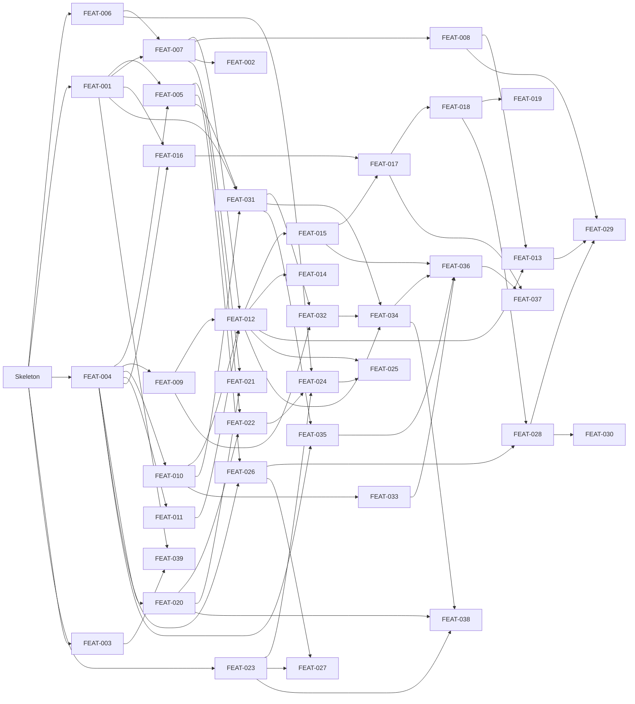

# Implementation Plan: Normcore

> Status: Draft · Version: 1.1 · Last updated: 2026-11-13
> Inputs: docs/srs.md (1.1) · docs/use-cases.md · docs/architecture.md · docs/data-model.md · docs/ux-foundations.md (đủ cả năm tài liệu)
> Bản 1.1 gộp `docs/sua-doi-1.1/implementation-plan.md`: thêm FEAT-031 đến FEAT-039 (phân hệ E, cận lâm sàng), mở rộng FEAT-009, FEAT-010, FEAT-011, chèn vào thứ tự xây, cập nhật nền kỹ thuật và rủi ro. Phần thêm mang nhãn **[1.1]**.

## 1. Overview

Normcore được xây thành 39 tính năng (lát cắt dọc: giao diện, API, nghiệp vụ, dữ liệu) trong 8 nhóm, theo 3 bản phát hành. Thứ tự được xếp để **giảm rủi ro sớm**: mô hình quy trình có cấu trúc và bộ máy tính giá là hai chỗ quyết định sản phẩm có đúng hay không, nên được làm trước; AI và so sánh giá đứng trên nền đó.

| Bản phát hành | Phạm vi | Kết quả trình diễn được |
| :-- | :-- | :-- |
| R1 (MVP) | Quy trình có cấu trúc soạn tay và luồng duyệt; nguồn lực; định mức; bấm giờ; kế toán; tính giá; đối soát; xuất biểu. **[1.1]** Phân hệ E cho hóa sinh và miễn dịch: FEAT-031 đến FEAT-037, FEAT-039; nghiệm thu với cả máy mua và máy đặt theo hóa chất (C-10) | Từ một quy trình ban hành ra giá thành có bảng giải trình và biểu Thông tư 21. **[1.1]** Giá thành một kết quả xét nghiệm có hệ số tiêu hao k và đối soát với xuất kho |
| R2 | Thư viện văn bản; ánh xạ; AI soạn dự thảo, kiểm tra nhất quán, đề xuất liên kết định mức; rà soát khi văn bản bị thay thế. **[1.1]** FEAT-038 | Bác sĩ nhập yêu cầu và nhận dự thảo có dẫn nguồn |
| R3 | Giá tham chiếu; so sánh; gợi ý; kịch bản; phương án giá | Giá đề xuất được so sánh, điều chỉnh và phê duyệt |

Kế hoạch không gắn ngày: năng lực đội và ngày bắt đầu chưa được chốt. Thứ tự sau R1 là thứ tự sống, điều chỉnh theo kết quả thí điểm.

**[1.1]** Chẩn đoán hình ảnh và các nhóm xét nghiệm khác dùng cùng mã đã xây; phần riêng của chúng (FR-CLS-005, tiêu chí Phút chiếm máy) được xây ở R1 trong FEAT-036 vì nằm chung công thức, nhưng không thuộc tiêu chí nghiệm thu R1.

## 2. Walking Skeleton

Đường đi tối thiểu chạy xuyên mọi lớp, làm đầu tiên.

**Có thật**

- App `normcore` cài được trên site Frappe v15 trống, không có ERPNext; 6 Module Def; fixtures tạo 10 vai trò (bản 1.0: 9 vai trò; thêm NC Auditor).
- DocType tối thiểu: NC Department, NC Technical Service, NC Clinical Procedure với bảng con bước và nguồn lực, NC Job Title, NC Costing Parameter Set với đơn giá chức danh, NC Norm Set với dòng định mức, NC Costing Run, NC Service Cost với dòng chi phí.
- `costing/engine.py` thuần Python, tính được dòng LABOR theo BR-COST-001, BR-COST-002, BR-COST-007; kiểm thử chạy được dòng L01, L03, L04, L09 của bộ dữ liệu vàng.
- Một Desk Page `procedure-editor` hiển thị và thêm được bước qua API whitelisted.
- `ai/gateway.py` với nhà cung cấp giả lập trả JSON cố định; có NC AI Log.
- CI: kiểm tra định dạng mã, kiểm thử đơn vị, script quét quy ước fieldname và quyền.
- Triển khai tự động lên site staging.

**Giả lập hoặc chưa có**

- Luồng duyệt (quy trình chuyển thẳng sang "Đã ban hành" bằng nút tạm), phân quyền theo khoa, nhập Excel, phân bổ, đối soát, in ấn, thư viện văn bản, AI thật.

**Xong khi**

Trên site staging, một người dùng tạo dịch vụ, tạo quy trình có một bước với một nguồn lực nhân lực, đặt "Đã ban hành", khởi tạo bộ định mức, chạy lần tính giá và thấy một dòng chi phí có liên kết về mã bước; CI xanh; bốn dòng LABOR của bộ dữ liệu vàng khớp đến từng đồng.

## 3. Epic & Feature Breakdown

### E1. Nền tảng — khối NC Core

| ID | Feature | FRs | UCs | Screens | Blocks/Endpoints | Data |
| :- | :------ | :-- | :-- | :------ | :--------------- | :--- |
| FEAT-001 | Vai trò, khoa, trung tâm chi phí, phạm vi theo khoa | FR-ACC-001..006, FR-ADM-004, FR-ADM-005 | UC-017 | SCR-DSK-031 | NC Core; `core/permissions.py` | NC Department, NC Cost Center, User Permission |
| FEAT-002 | Trang chủ, việc chờ xử lý, thông báo, tham số vận hành | FR-NOTI-001..003, FR-OUT-010, FR-ADM-003 | UC-018 | SCR-DSK-001, SCR-DSK-031 | NC Core; `core/notify.py` | NC Settings, Notification Log |
| FEAT-003 | Sổ sự kiện và tra cứu nhật ký | FR-AUD-001..004 | UC-018 | SCR-DSK-030 | NC Core; `core/audit.py` | NC Audit Event |
| FEAT-004 | Khung nhập Excel và tệp mẫu | FR-ADM-002 | UC-008 | SCR-DSK-031 | NC Core; `core/importer.py` | Dùng chung cho mọi bộ nhập |
| FEAT-039 **[1.1]** | Vai trò kiểm soát nội bộ | FR-ACC-007; phần sửa của FR-ACC-002, FR-ACC-004, FR-AUD-003 | UC-026 | SCR-DSK-030 | NC Core; `core/permissions.py`; fixtures vai trò | Role NC Auditor |

### E2. Dịch vụ và quy trình — khối NC Procedure

| ID | Feature | FRs | UCs | Screens | Blocks/Endpoints | Data |
| :- | :------ | :-- | :-- | :------ | :--------------- | :--- |
| FEAT-005 | Danh mục kỹ thuật và tình trạng chuỗi | FR-SVC-001..004 | UC-003 | SCR-DSK-005, SCR-DSK-006 | NC Procedure; bộ nhập dịch vụ | NC Technical Service, NC Specialty |
| FEAT-006 | Soạn quy trình có cấu trúc (thủ công) | FR-PROC-001..007, FR-PROC-009, FR-PROC-013 | UC-005 | SCR-DSK-007, SCR-DSK-009 | NC Procedure; `api/procedure.py`; trang `procedure-editor` | NC Clinical Procedure, NC Procedure Step, NC Procedure Resource, NC Procedure Citation |
| FEAT-007 | Phê duyệt ba cấp, ban hành, in | FR-PROC-008, FR-PROC-010..012, FR-WF-001..008, FR-WF-013 | UC-006 | SCR-DSK-010 | NC Procedure; Workflow; Print Format | NC Clinical Procedure, NC Review Comment |
| FEAT-008 | Sửa đổi, so sánh phiên bản, thu hồi | FR-WF-009..012 | UC-007 | SCR-DSK-011 | NC Procedure; `procedure/versioning.py`, `procedure/diff.py` | NC Clinical Procedure, NC Norm Set (cờ) |

### E3. Nguồn lực và tham số — khối NC Costing

| ID | Feature | FRs | UCs | Screens | Blocks/Endpoints | Data |
| :- | :------ | :-- | :-- | :------ | :--------------- | :--- |
| FEAT-009 | Mặt hàng và đơn giá có chứng từ | FR-RES-001..004, FR-RES-012 (một phần), FR-RES-013, FR-RES-014, **[1.1]** FR-RES-016..018 | UC-008 | SCR-DSK-017 | NC Costing; bộ nhập mặt hàng, đơn giá | NC Item, NC Item Price |
| FEAT-010 | Thiết bị và phòng | FR-RES-005..008, FR-RES-012 (một phần), **[1.1]** FR-RES-019..026 | UC-008 | SCR-DSK-018 | NC Costing | NC Equipment, NC Room, **[1.1]** NC Equipment Type, NC Equipment Component, NC Equipment Allocation |
| FEAT-011 | Bộ tham số, chức danh, loại giá | FR-RES-009..011, FR-RES-012 (một phần), FR-RES-015 | UC-008 | SCR-DSK-019 | NC Costing | NC Costing Parameter Set, NC Job Title, NC Job Title Rate, NC Price Category |

**[1.1]** Ba tính năng này chưa bắt đầu xây, nên phần mở rộng được làm ngay trong lần xây đầu:

- **FEAT-009:** chọn giá theo thứ tự nguồn rồi đến ngày hiệu lực (FR-RES-004 sửa); nguồn "Hợp đồng" và ngày hết hiệu lực (FR-RES-002 sửa); trạng thái xác minh; quy đổi đơn vị định mức. Kiểm bằng TC-CLS-45 đến TC-CLS-47.
- **FEAT-010:** hình thức có máy, tiêu chí chia, linh kiện, tỷ lệ theo khoa, điện; trường bắt buộc theo điều kiện (FR-RES-005 sửa); khấu hao khi hết thời gian sử dụng theo bộ tham số (FR-RES-007 sửa). Kiểm bằng TC-CLS-48, TC-CLS-49.
- **FEAT-011:** sáu trường mới của NC Costing Parameter Set (FR-RES-009 sửa). Kiểm bằng TC-CLS-50.

### E4. Định mức — khối NC Costing

| ID | Feature | FRs | UCs | Screens | Blocks/Endpoints | Data |
| :- | :------ | :-- | :-- | :------ | :--------------- | :--- |
| FEAT-012 | Bộ định mức theo bước: khởi tạo, sửa, xác nhận, khóa | FR-NORM-001..014, FR-NORM-016 | UC-009 | SCR-DSK-013, SCR-DSK-014 | NC Costing; `api/norm.py`; trang `norm-grid` | NC Norm Set, NC Norm Line |
| FEAT-013 | Phiên bản bộ định mức theo quy trình mới | FR-NORM-015 | UC-009 | SCR-DSK-014 | NC Costing; `norm/init_from_procedure.py` | NC Norm Set |
| FEAT-014 | Khảo sát bấm giờ | FR-TS-001..005 | UC-010 | SCR-DSK-015, SCR-DSK-016 | NC Costing; `norm/time_study.py` | NC Time Study |

### E5. Tính giá — khối NC Costing

| ID | Feature | FRs | UCs | Screens | Blocks/Endpoints | Data |
| :- | :------ | :-- | :-- | :------ | :--------------- | :--- |
| FEAT-015 | Tính chi phí trực tiếp, giá và bảng giải trình | FR-COST-001..003, FR-COST-006, FR-COST-007, FR-COST-010, FR-COST-015, FR-COST-016 | UC-012 | SCR-DSK-022, SCR-DSK-023 | NC Costing; `costing/engine.py`, `runner.py`; `api/costing.py` | NC Costing Run, NC Service Cost, NC Service Cost Line |
| FEAT-016 | Số liệu kế toán, sản lượng, quy tắc phân bổ | FR-ACCT-001..011 | UC-011 | SCR-DSK-020, SCR-DSK-021 | NC Costing; bộ nhập kế toán, sản lượng | NC Accounting Import, NC Account Mapping, NC Service Volume, NC Allocation Rule, NC Cost Center Driver |
| FEAT-017 | Phân bổ hai cấp và đối soát | FR-COST-004, FR-COST-005, FR-COST-008, FR-COST-009, FR-COST-014 | UC-012 | SCR-DSK-024 | NC Costing; `costing/allocation.py`, `reconcile.py` | NC Service Cost Line, NC Reconciliation Line |
| FEAT-018 | Khóa, ảnh chụp đầu vào, so sánh hai lần tính | FR-COST-011..013 | UC-012 | SCR-DSK-022 | NC Costing; `costing/snapshot.py` | NC Costing Run |
| FEAT-019 | Xuất biểu Thông tư 21, bảng giải trình, bộ định mức | FR-OUT-001..006, FR-OUT-008, FR-OUT-009 | UC-016 | SCR-DSK-028 | `exports/`; `api/export.py` | Đọc NC Service Cost, NC Norm Set |

**[1.1]** FEAT-015 phải dựng `engine.py` với điểm cắm cho bước chi phí trực tiếp, để FEAT-036 cắm `costing/cls.py` vào mà không sửa lại bộ máy (ADR-017).

### E6. Văn bản và AI — khối NC Library, NC AI

| ID | Feature | FRs | UCs | Screens | Blocks/Endpoints | Data |
| :- | :------ | :-- | :-- | :------ | :--------------- | :--- |
| FEAT-020 | Thư viện văn bản: nạp, tách mục, hiệu lực, tìm kiếm | FR-LIB-001..006, FR-LIB-010..012 | UC-001 | SCR-DSK-002, SCR-DSK-003 | NC Library; `library/extract.py`, `sections.py`, `search.py`, `validity.py` | NC Legal Document, NC Legal Section |
| FEAT-021 | Thay thế văn bản và hàng đợi rà soát | FR-LIB-007..009 | UC-002 | SCR-DSK-012 | NC Library; NC Procedure | NC Legal Supersession, NC Clinical Procedure (cờ) |
| FEAT-022 | Ánh xạ hướng dẫn với dịch vụ | FR-SVC-005..007 | UC-003 | SCR-DSK-004 | NC Library; `api/library.py` | NC Section Service Map |
| FEAT-023 | Gateway AI: cấu hình, bộ chuyển đổi, nhật ký, hạn mức, chặn nguồn | FR-AI-009..015 | UC-017 | SCR-DSK-029 | NC AI; `ai/gateway.py`, `providers/`, `guard.py` | NC AI Settings, NC Prompt Template, NC AI Log |
| FEAT-024 | Soạn dự thảo quy trình bằng AI | FR-AI-001..005, FR-AI-008 | UC-004 | SCR-DSK-008, SCR-DSK-009 | NC AI, NC Procedure; `ai/citation.py`; `api/procedure.py` | NC Clinical Procedure, NC Procedure Citation |
| FEAT-025 | Kiểm tra nhất quán và đề xuất liên kết định mức | FR-AI-006, FR-AI-007 | UC-005, UC-009 | SCR-DSK-009, SCR-DSK-014 | NC AI, NC Procedure, NC Costing | NC Procedure Resource, NC Norm Line |

### E7. So sánh và phương án giá — khối NC Benchmark

| ID | Feature | FRs | UCs | Screens | Blocks/Endpoints | Data |
| :- | :------ | :-- | :-- | :------ | :--------------- | :--- |
| FEAT-026 | Kho giá tham chiếu và chỉ số giá | FR-BM-001, FR-BM-002, FR-BM-004..008 | UC-013 | SCR-DSK-025 | NC Benchmark; bộ nhập giá tham chiếu | NC Benchmark Facility, NC Benchmark Price, NC CPI Index |
| FEAT-027 | Trích bảng giá PDF bằng AI | FR-BM-003 | UC-013 | SCR-DSK-025 | NC Benchmark, NC AI | NC Benchmark Price |
| FEAT-028 | So sánh giá và gợi ý điều chỉnh | FR-ADJ-001..005, FR-ADJ-008, FR-ADJ-010 | UC-014 | SCR-DSK-026 | NC Benchmark; `benchmark/stats.py`, `rules.py`; trang `price-compare` | NC Adjustment Suggestion |
| FEAT-029 | Kịch bản điều chỉnh và yêu cầu sửa quy trình | FR-ADJ-006, FR-ADJ-007, FR-ADJ-009 | UC-014, UC-007 | SCR-DSK-026 | NC Benchmark; `benchmark/scenario.py` | NC Costing Run (kịch bản), NC Scenario Change, NC Procedure Change Request |
| FEAT-030 | Phương án giá, phê duyệt, lịch sử giá | FR-PRICE-001..010, FR-OUT-007 | UC-015, UC-016 | SCR-DSK-027 | NC Benchmark; Workflow | NC Price Proposal, NC Service Price History |

### E8. Cận lâm sàng — khối NC Costing **[1.1]**

| ID | Feature | FRs | UCs | Screens | Blocks/Endpoints | Data |
| :- | :------ | :-- | :-- | :------ | :--------------- | :--- |
| FEAT-031 | Dịch vụ cận lâm sàng và hệ thống xét nghiệm | FR-SVC-008..011, FR-CLS-001, FR-CLS-002, FR-CLS-005..008, FR-ACC-008 | UC-019 | SCR-DSK-006, SCR-DSK-032 | NC Costing, NC Procedure; bộ nhập hệ thống xét nghiệm | NC Technical Service (trường cận lâm sàng), NC Service Code Map, NC Panel Component, NC Test System |
| FEAT-032 | Kế hoạch chất lượng và ngoại kiểm | FR-QC-001..003, FR-QC-005, FR-QC-007, FR-QC-008 | UC-019 | SCR-DSK-033, SCR-DSK-034 | NC Costing; bộ nhập kế hoạch chất lượng | NC QC Plan, NC QC IQC Line, NC QC Calibration Line, NC EQA Program, NC EQA Service |
| FEAT-033 | Hồ sơ tuân thủ thiết bị | FR-CMP-001, FR-CMP-005..007, FR-ADM-006 | UC-020 | SCR-DSK-035, SCR-DSK-036 | NC Costing; `costing/compliance.py` (tác vụ ngày); bộ nhập hồ sơ | NC Equipment Type, NC Equipment Compliance, NC Settings |
| FEAT-034 | Định mức theo hệ thống xét nghiệm | FR-NORM-017..025, FR-OUT-011 | UC-021 | SCR-DSK-014, SCR-DSK-041 | NC Costing; `api/norm.py`; trang `norm-grid` | NC Norm Set, NC Norm Line, NC Norm Template, NC Norm Template Item |
| FEAT-035 | Sản lượng cận lâm sàng và xuất kho | FR-ACCT-012..015 | UC-022 | SCR-DSK-021, SCR-DSK-037 | NC Costing; bộ nhập sản lượng cận lâm sàng, phút khai thác, xuất kho | NC Test System Volume, NC Equipment Usage, NC Stock Issue Actual, NC Service Volume (kịch bản) |
| FEAT-036 | Tính giá cận lâm sàng | FR-COST-017..025, FR-COST-031, FR-COST-032, FR-CLS-003, FR-CLS-004, FR-QC-004, FR-QC-006, FR-CMP-002..004, NFR-REL-003, NFR-CPL-003 | UC-012 | SCR-DSK-022, SCR-DSK-023 | NC Costing; `costing/cls.py`, `engine.py`, `snapshot.py` | NC Costing Run, NC Service Cost, NC Test System Cost, NC Service Cost Line |
| FEAT-037 | Đối soát vật chất và sản lượng; thiếu dữ liệu; độ nhạy | FR-COST-026..030, FR-OUT-012 | UC-023, UC-024 | SCR-DSK-024, SCR-DSK-038, SCR-DSK-039, SCR-DSK-040 | NC Costing; `costing/reconcile.py`; hai báo cáo; trang `sensitivity` | NC Reconciliation Line |
| FEAT-038 | AI đề xuất định mức từ tài liệu của hãng (R2) | FR-LIB-013, FR-AI-016..018 | UC-025 | SCR-DSK-014, SCR-DSK-033 | NC AI, NC Library, NC Costing; `ai/guard.py`, `ai/citation.py` | NC Legal Document (loại Tài liệu của hãng), NC Document Resource Link, NC Prompt Template, NC Norm Line, NC QC Plan |

FR-CMP-006 (cảnh báo thiếu hồ sơ khi tính) có phần dữ liệu ở FEAT-033 và phần cảnh báo trên lần tính ở FEAT-036.

**Tiêu chí nghiệm thu chính của từng tính năng nhóm E8 và FEAT-039**

- **FEAT-031.** Tạo hai hệ thống cho một dịch vụ với tổng tỷ trọng 100%; mã ngoài trùng bị từ chối; người dùng khoa khác không sửa được; ngừng dùng một hệ thống thì hệ thống đó không vào lần tính mới. Kiểm bằng TC-CLS-20 đến TC-CLS-23.
- **FEAT-032.** Kế hoạch nội kiểm, chuẩn máy, ngoại kiểm lưu đủ trường; mặt hàng sai loại bị từ chối; tổng tỷ lệ ngoại kiểm khác 100% bị từ chối; hệ thống thiếu kế hoạch nội kiểm có cảnh báo. Kiểm bằng TC-CLS-24 đến TC-CLS-26.
- **FEAT-033.** Hồ sơ thiếu chứng từ bị từ chối; hồ sơ còn 20 ngày sinh thông báo; báo cáo hạn liệt kê đúng. Kiểm bằng TC-CLS-27, TC-CLS-28.
- **FEAT-034.** Bộ định mức gắn một hệ thống; khoản mục bắt buộc của mẫu được thêm; dòng trùng mặt hàng của kế hoạch chất lượng bị từ chối; thiếu số xét nghiệm mỗi ống thì không xác nhận chuyên môn được; hai hệ thống của một dịch vụ khóa được hai bộ. Kiểm bằng TC-CLS-29 đến TC-CLS-33.
- **FEAT-035.** Nạp sản lượng theo kịch bản; dòng mã lạ hoặc số âm bị báo lỗi và không lưu; cột số test phụ để trống được; nạp xuất kho theo mặt hàng và khoa. Kiểm bằng TC-CLS-34 đến TC-CLS-36.
- **FEAT-036.** Mọi số của `docs/golden/golden_cls.py` khớp đến hai chữ số thập phân, k khớp sáu chữ số; chạy lại cùng ảnh chụp cho cùng kết quả; bảng giải trình hiện k, mẫu số, nguồn mẫu số. Kiểm bằng TC-CLS-01 đến TC-CLS-15, TC-CLS-37, TC-CLS-38, TC-CLS-51.
- **FEAT-037.** Đối soát vật chất và sản lượng khớp các biến thể V6, V7 của `golden_cls.py`; dòng vượt ngưỡng chưa giải trình chặn khóa; khoa thiếu xuất kho được ghi "Chưa đối soát vật chất"; phân tích độ nhạy không ghi dữ liệu. Kiểm bằng TC-CLS-16 đến TC-CLS-19, TC-CLS-39, TC-CLS-40.
- **FEAT-038.** Nguồn gửi AI chỉ gồm mục tài liệu của hãng đã gắn; đề xuất có trích dẫn nguyên văn hoặc nhãn "Chưa có căn cứ"; mặt hàng ngoài danh mục không được tạo. Kiểm bằng TC-CLS-41 đến TC-CLS-43.
- **FEAT-039.** NC Auditor đọc được mọi DocType, không tạo, sửa, xóa, duyệt được gì. Kiểm bằng TC-CLS-44.

## 4. Build Sequence

Thứ tự xây, theo phụ thuộc và rủi ro. Các dòng có chữ cái (5a, 7a, 8a, 9a) thêm ở bản 1.1; số thứ tự của bản 1.0 giữ nguyên.

| Thứ tự | Hạng mục | Bản | Lý do đặt ở đây |
| :-: | :-- | :-: | :-- |
| 0 | Walking skeleton và nền kỹ thuật (mục 6) | R1 | Chứng minh chuỗi chạy xuyên mọi lớp |
| 1 | FEAT-006 | R1 | Mô hình quy trình có cấu trúc là gốc dữ liệu của mọi thứ (ADR-002) và là rủi ro dùng được lớn nhất (UXQ-02) |
| 2 | FEAT-001 | R1 | Phạm vi theo khoa ảnh hưởng mọi DocType về sau |
| 3 | FEAT-004 | R1 | Khung nhập dùng cho năm bộ nhập |
| 4 | FEAT-005 | R1 | Danh mục dịch vụ đầy đủ |
| 5 | FEAT-009, FEAT-010, FEAT-011 | R1 | Nguồn lực và tham số; làm song song được. **[1.1]** Làm luôn phần mở rộng vì đổi cấu trúc thiết bị và đơn giá |
| 5a **[1.1]** | FEAT-031, FEAT-033 | R1 | Cần thiết bị và dịch vụ; không phụ thuộc quy trình |
| 6 | FEAT-007 | R1 | Chỉ quy trình đã ban hành mới sinh định mức |
| 7 | FEAT-012 | R1 | Bộ định mức |
| 7a **[1.1]** | FEAT-032, FEAT-034 | R1 | Định mức theo hệ thống cần bộ định mức và kế hoạch chất lượng |
| 8 | FEAT-015 | R1 | Bộ máy tính giá: rủi ro đúng sai lớn nhất (TBD-02); cần sớm để chuyên gia tài chính kiểm. **[1.1]** Dựng sẵn điểm cắm chi phí trực tiếp (ADR-017) |
| 8a **[1.1]** | FEAT-035, FEAT-036 | R1 | Rủi ro đúng sai cao thứ hai sau FEAT-015; cần sớm để khoa xét nghiệm và tài chính kiểm số |
| 9 | FEAT-016, FEAT-017 | R1 | Số liệu kế toán, phân bổ, đối soát |
| 9a **[1.1]** | FEAT-037 | R1 | Đối soát vật chất đi sau đối soát tài chính |
| 10 | FEAT-018, FEAT-019 | R1 | Khóa và xuất biểu; hoàn tất giá trị của R1 |
| 11 | FEAT-014, FEAT-008, FEAT-013, FEAT-002, FEAT-003, **[1.1]** FEAT-039 | R1 | Hoàn thiện vòng đời và vận hành |
| 12 | FEAT-020, FEAT-022, FEAT-023 | R2 | Nền của AI: nguồn và gateway |
| 13 | FEAT-024, FEAT-025, FEAT-021, **[1.1]** FEAT-038 | R2 | AI soạn dự thảo; rà soát khi văn bản thay đổi. FEAT-038 dùng chung gateway và kiểm trích dẫn |
| 14 | FEAT-026, FEAT-028 | R3 | So sánh giá |
| 15 | FEAT-029, FEAT-030, FEAT-027 | R3 | Điều chỉnh, phương án giá, trích bảng giá |



## 5. First Vertical Slice

**FEAT-006: Soạn quy trình có cấu trúc (thủ công).**

**Luồng người dùng và lý do chọn.** Người soạn mở một dịch vụ, tạo quy trình, nhập các phần, thêm và sắp lại bước, khai báo nguồn lực theo bước, gắn trích dẫn bằng tay, lưu. Chọn làm đầu tiên vì đây là gốc dữ liệu của định mức và giá, và là nơi cần phản hồi sớm nhất từ bác sĩ (UXQ-02). Lát cắt này thực hiện phần soạn tay của UC-005.

**Tiêu chí nghiệm thu**

1. Tạo quy trình cho một dịch vụ và khoa sinh bản nháp phiên bản 1 có 8 phần cố định [FR-PROC-001]; tạo lần hai bị từ chối và dẫn tới bản đang có [FR-PROC-002]. Kiểm bằng TC-PROC-01, TC-PROC-02.
2. Thêm bước yêu cầu giai đoạn, tên, mô tả; mã bước không đổi khi sắp lại và không tái dùng sau khi xóa [FR-PROC-003, FR-PROC-006]. Kiểm bằng TC-PROC-03.
3. Nguồn lực lưu thành dòng có cấu trúc gắn mã bước, có mã dòng bất biến; ô tên gợi ý bản ghi danh mục và cho để trống liên kết [FR-PROC-004, FR-PROC-005]. Kiểm bằng TC-PROC-04.
4. Trích dẫn lưu văn bản, mục, đoạn trích, quan hệ [FR-PROC-007]. Ở lát cắt này, vì thư viện văn bản chưa có, trường mục văn bản cho phép trống và quan hệ mặc định là "Chưa có căn cứ".
5. Mỗi lần lưu ghi lịch sử theo trường, bước, dòng nguồn lực [FR-PROC-009]. Kiểm bằng TC-PROC-08.
6. Sao chép từ quy trình khác tạo bản nháp với mã bước mới [FR-PROC-013].
7. Trang soạn dùng được bằng bàn phím và đạt tương phản theo NFR-USE-004.

**Màn hình (đầu vào cho bước ui-design):** SCR-DSK-007, SCR-DSK-009.

**Hợp đồng và dữ liệu cần (đầu vào cho bước detailed-design)**

- DocType: NC Clinical Procedure, NC Procedure Step, NC Procedure Resource, NC Procedure Citation theo `docs/data-model.md` mục 3.3; ràng buộc DI-01, DI-02.
- API whitelisted trong `api/procedure.py`: tạo bản nháp; đọc quy trình cho trình soạn; lưu phần; thêm, sửa, xóa, sắp lại bước; thêm, sửa, xóa nguồn lực; thêm, sửa, xóa trích dẫn; sao chép quy trình; tìm bản ghi danh mục theo tên.
- Quy tắc cấp mã bước và mã dòng nguồn lực từ bộ đếm trên bản ghi cha.
- Quyền: ở lát cắt này theo vai trò; phạm vi theo khoa đến ở FEAT-001.

## 6. Engineering Foundations

**Kho mã và quy ước**

- [ ] Một kho mã cho app `normcore`; nhánh `develop` cho staging, `main` cho production.
- [ ] Tiền tố `NC ` cho DocType; fieldname tiếng Anh snake_case; label tiếng Việt [NFR-MNT-003]. Script CI quét (TC-NFR-03).
- [ ] Mọi DocType nghiệp vụ bật `track_changes`; quyền khai báo theo `docs/data-model.md` mục 4; script CI quét quyền (TC-ACC-04) [NFR-SEC-003]. **[1.1]** Script kiểm thêm: không DocType nào cấp quyền ghi cho NC Auditor.
- [ ] Fixtures: vai trò, luồng duyệt, loại giá mẫu, bảng ánh xạ tài khoản, mẫu lệnh, mẫu in [FR-ADM-001]. **[1.1]** Thêm: vai trò NC Auditor; mẫu định mức cho nhóm Hóa sinh và Miễn dịch; mẫu Excel của sáu bộ nhập mới [FR-ADM-002].

**CI và môi trường**

- [ ] CI chạy cho mỗi pull request: định dạng mã, kiểm thử đơn vị thuần (`pytest`), kiểm thử trên site (`bench run-tests`), bộ dữ liệu vàng, hai script quét. **[1.1]** Bộ dữ liệu vàng gồm cả `docs/golden/golden_cls.py`.
- [ ] Ngưỡng độ phủ 90% cho `normcore/costing/` (gồm `cls.py`) và `normcore/benchmark/rules.py` [NFR-MNT-001].
- [ ] Site staging nhận bản dựng từ `develop`; production chỉ nhận bản đã nghiệm thu trên staging (ADR-016).
- [ ] Sao lưu hằng ngày và diễn tập khôi phục trước go-live [NFR-AVL-002].
- [ ] TLS ở reverse proxy; chính sách mật khẩu và thời hạn phiên theo NFR-SEC-001, NFR-SEC-002.
- [ ] **[1.1]** Tác vụ định kỳ hằng ngày: cập nhật trạng thái hồ sơ tuân thủ và gửi nhắc [FR-CMP-005].

**Quan sát**

- [ ] Tác vụ nền ghi trạng thái, thời gian, lỗi vào bản ghi nghiệp vụ [NFR-OBS-001].
- [ ] Trang theo dõi token AI theo tháng và mục đích [NFR-OBS-002].

**Giao diện**

- [ ] Workspace "Normcore" với nhóm theo vai trò.
- [ ] Khung chung cho ba trang Vue: gọi API, hiển thị lỗi, dùng biến CSS của Desk (`docs/design.md`).
- [ ] Bản dịch tiếng Việt cho mọi chuỗi; định dạng số, tiền, ngày theo NFR-LOC-001; kiểm NFR-USE-001.

**Definition of Done cho mỗi tính năng** [NFR-MNT-002]

- [ ] Mọi FR của tính năng có test case đạt; test case tự động chạy trong CI.
- [ ] Bộ dữ liệu vàng vẫn đạt.
- [ ] Quyền của DocType mới khớp ma trận quyền; đã thử với ít nhất một vai trò không có quyền.
- [ ] Nhãn và thông báo bằng tiếng Việt; đã thử trên màn hình 1366 × 768.
- [ ] Đã cài và chạy trên site staging; chủ dự án nghiệm thu theo tiêu chí và test case.
- [ ] Có tài liệu As-Built `docs/as-built/FEAT-NNN.md`.
- [ ] Cột Test ref của `docs/rtm.md` được cập nhật khi nghiệm thu.

**Mẫu tài liệu As-Built**

```markdown
# As-Built: FEAT-NNN <tên tính năng>
- Phiên bản app, ngày nghiệm thu, người nghiệm thu
## 1. Luồng nghiệp vụ đã xây (sơ đồ hoặc các bước; nêu chỗ khác so với SRS và lý do)
## 2. DocType tạo mới hoặc thay đổi (tên, ý nghĩa, trường chính, quan hệ)
## 3. API, tác vụ nền, hook, fixtures
## 4. Quyền và luồng trạng thái
## 5. Cấu hình cần thiết khi triển khai
## 6. Test case đã chạy và kết quả (mã TC)
## 7. Giới hạn đã biết và nợ kỹ thuật
```

## 7. Risks & Assumptions

| Rủi ro hoặc giả định | Ảnh hưởng đến thứ tự | Cách xử lý |
| :-- | :-- | :-- |
| TBD-02: công thức tích lũy và nghĩa vụ tài chính chưa được xác nhận | FEAT-015 | Chốt trước khi bắt đầu FEAT-015; công thức nằm ở một hàm |
| TBD-01: chưa có mẫu biểu chính thức Phụ lục I đến V | FEAT-019, FEAT-026 | Lấy mẫu trước khi bắt đầu FEAT-019; nếu chậm, FEAT-019 lùi sau FEAT-014 |
| TBD-03: chưa có bảng ánh xạ tài khoản mặc định | FEAT-016 | Chuyên gia kế toán xây song song với FEAT-012 và FEAT-015 |
| TBD-04: chưa có mẫu in quy trình | FEAT-007 | Dùng mẫu mặc định; thay khi có mẫu của bệnh viện thí điểm |
| TBD-05: danh sách loại giá và cấp phê duyệt | FEAT-011, FEAT-030 | Loại giá là dữ liệu cấu hình; cài sẵn hai loại mẫu |
| UXQ-02: bác sĩ có thể không quen trình soạn dạng thẻ bước | FEAT-006 | Cho 3 đến 5 bác sĩ thử ngay sau FEAT-006; điều chỉnh trước FEAT-024 |
| Chất lượng tách mục và nhận dạng ký tự (TBD-09) | FEAT-020 | Thử với 3 văn bản thật của chuyên khoa thí điểm trước khi cam kết phạm vi FEAT-020 |
| Chất lượng dự thảo phụ thuộc mô hình | FEAT-024 | Bộ 10 dịch vụ mẫu để chấm chất lượng mẫu lệnh trước khi phát hành R2 |
| Chưa có bệnh viện thí điểm (TBD-06) | Nghiệm thu R1 | Dùng bộ dữ liệu vàng và dữ liệu giả cho đến khi có; kịch bản E2E-02 cần dữ liệu thật. **[1.1]** Phân hệ E cần ít nhất một máy mua và một máy đặt thật để nghiệm thu cuối |
| **[1.1]** TBD-13 đã chốt ngày 13/11/2026: phân hệ E đi cùng R1 (thay dòng TBD-13 của bản 1.0) | R1 lớn hơn: thêm 8 tính năng | Đã phản ánh ở mục 3 (nhóm E8) và mục 4 |
| **[1.1]** TBD-16: LIS có thể không xuất được số test phụ | FEAT-035, FEAT-036 | Đường ước tính từ kế hoạch là đường chính thức (FR-QC-006); nghiệm thu cả hai đường |
| **[1.1]** TBD-14: loại chi phí kế toán của ngoại kiểm, thuê máy | FEAT-036, FEAT-017 | Ba trường tạm trong bộ tham số; chốt trước khi nghiệm thu FEAT-037 vì ảnh hưởng phân bổ cấp 2 và đối soát |
| **[1.1]** TBD-15: cách chia vật liệu nội kiểm dùng chung | FEAT-036 | Công thức nằm ở một hàm; mặc định chia đều theo số thông số |
| **[1.1]** TBD-18: danh sách loại thiết bị bắt buộc có hồ sơ | FEAT-033 | Là dữ liệu cấu hình; cài trống, bệnh viện tự đánh dấu |
| **[1.1]** Số liệu xuất kho không tách được theo khoa (A-08) | FEAT-037 | Lần tính ghi "Chưa đối soát vật chất" và vẫn khóa được sau khi tài chính xác nhận |
| **[1.1]** BR-CLS-001 đến BR-CLS-017 chưa được chuyên gia định giá và khoa xét nghiệm rà soát | FEAT-036 | Rà soát với `docs/golden/golden_cls.py` trước khi bắt đầu FEAT-036 |
| Năng lực đội và ngày bắt đầu chưa chốt | Toàn kế hoạch | Kế hoạch không gắn ngày; thứ tự sau R1 có thể đổi |

**Khoảng trống bao phủ.** Không có. Mọi FR mức Must thuộc một tính năng hoặc nền kỹ thuật (FR-ADM-001 nằm ở nền kỹ thuật, mục fixtures); mọi màn hình trong danh mục được ít nhất một tính năng chạm tới. **[1.1]** 76 yêu cầu chức năng mới và 2 yêu cầu phi chức năng mới đều thuộc một tính năng; 10 màn hình mới (SCR-DSK-032 đến SCR-DSK-041) đều được ít nhất một tính năng chạm tới. Kết quả kiểm tra tự động ở `docs/verification-report.md`.
