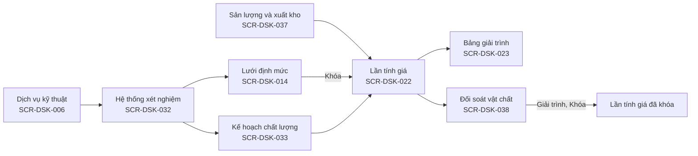

# Sửa đổi 1.1 — Kiến trúc và màn hình (bổ sung cho `docs/architecture.md`, `docs/ux-foundations.md`, `docs/design.md` 1.0)

> Phiên bản 1.1-delta · 13/11/2026 · Nguồn: `docs/srs.md` 1.1
> Phần A gộp vào `architecture.md` mục 9 (ADR). Phần B gộp vào `ux-foundations.md` (sơ đồ điều hướng, danh mục màn hình) và `design.md` (nhãn trạng thái).

## Phần A. Kiến trúc

Không đổi: một ứng dụng Frappe, 6 module (ADR-001), bộ máy tính giá Python thuần dùng số thập phân (ADR-003), ảnh chụp khi khóa (ADR-004), hàng đợi nền (ADR-009), nhập liệu bằng tệp Excel mẫu (ADR-012). Phân hệ E không thêm thành phần hạ tầng, không thêm module.

### ADR-017: Cận lâm sàng là một bước mở rộng của bộ máy tính giá, không phải bộ máy thứ hai

**Status:** Accepted
**Date:** 2026-11-13
**Requirements addressed:** FR-COST-018..024, FR-COST-031, FR-QC-004, FR-QC-006, FR-CMP-002..004, BR-CLS-001..013, BR-CLS-017, NFR-REL-003, NFR-CPL-003; ràng buộc C-09

**Context**
Bộ nháp phân hệ E mô tả một chuỗi tính riêng với năm cấp chi phí và cách làm tròn riêng. SRS 1.1 hợp nhất nó vào chuỗi B–C: dịch vụ cận lâm sàng chỉ khác ở cách tính chi phí trực tiếp; phân bổ cấp 1, cấp 2, tích lũy, làm tròn, đối soát tài chính giữ nguyên.

**Decision**
Thêm module thuần `normcore/costing/cls.py` bên cạnh `normcore/costing/engine.py`. `cls.py` chỉ chứa hàm thuần, nhận cấu trúc dữ liệu đã nạp và trả về danh sách dòng chi phí trực tiếp cùng kết quả theo hệ thống xét nghiệm. `engine.py` gọi `cls.py` ở bước tính chi phí trực tiếp khi dịch vụ có hệ thống xét nghiệm, rồi đi tiếp các bước sẵn có. Thứ tự trong `cls.py`:

1. Hệ số k của từng hệ thống (BR-CLS-001), ghi rõ số nào là ước tính.
2. Chi phí thiết bị năm theo khoa: hình thức có máy, bảo trì, linh kiện theo tháng, kiểm định theo cách phân bổ của lần tính (BR-CLS-009..011). Bước này chạy một lần cho mỗi thiết bị và mỗi khoa, áp cho mọi thiết bị, kể cả thiết bị lâm sàng dùng BR-COST-004.
3. Chi phí từng dòng định mức theo cấp phát sinh (BR-CLS-002..005).
4. Dòng sinh từ kế hoạch chất lượng và thiết bị: nội kiểm, chất chuẩn, linh kiện theo số kết quả, điện (BR-CLS-006, 007, 010, 012).
5. Bình quân gia quyền theo hệ thống, rồi cộng ngoại kiểm ở cấp dịch vụ (BR-CLS-008, BR-CLS-013).

Quy ước số: đơn giá 4 chữ số thập phân, thành tiền dòng 2 chữ số, k 6 chữ số, phép chia trung gian không làm tròn. Chuẩn đối chiếu là `docs/sua-doi-1.1/golden_cls.py`.

**Options considered**
- **Bước mở rộng trong cùng bộ máy (chọn)** — một ảnh chụp, một bảng giải trình, một bảng đối soát tài chính; kiểm thử tái dùng. Mất: `engine.py` phải tách rõ bước "chi phí trực tiếp" để cắm `cls.py`.
- **Bộ máy riêng cho cận lâm sàng** — tách biệt, làm nhanh lúc đầu. Mất: hai cách làm tròn, hai ảnh chụp, phân bổ chi phí chung bị lặp; trái C-09.

**Consequences**
FEAT-015 phải dựng `engine.py` với điểm cắm cho chi phí trực tiếp trước khi FEAT-036 bắt đầu. Chi phí kiểm định, hiệu chuẩn năm của một thiết bị nay là kết quả của bước 2, không còn là số đọc thẳng từ bản ghi thiết bị. Bộ dữ liệu vàng 1.0 không đổi kết quả, vì khoa K01 chỉ có một thiết bị và thiết bị đó không có hồ sơ tuân thủ (dùng số nhập tay); ca kiểm cho hai thiết bị trong một khoa nằm ở `golden_cls.py` (TC-CLS-07, TC-CLS-08).

### ADR-018: Sản lượng cận lâm sàng, phút khai thác và xuất kho là dữ liệu nhập theo kịch bản, tách khỏi sản lượng HIS

**Status:** Accepted
**Date:** 2026-11-13
**Requirements addressed:** FR-ACCT-012..015, FR-COST-017, FR-COST-024, FR-COST-026..029, FR-CLS-004, BR-CLS-014, BR-CLS-015

**Context**
Chi phí một kết quả phụ thuộc mẫu số: số kết quả trả, số test phụ, cỡ mẻ, phút khai thác. Các số này đến từ LIS, RIS, khác nguồn và khác khóa với sản lượng dịch vụ từ HIS. Cần ba kịch bản sản lượng và cần giữ số HIS để đối soát.

**Decision**
Ba DocType nhập riêng: `NC Test System Volume`, `NC Equipment Usage`, `NC Stock Issue Actual`, đều có năm tài chính; hai DocType đầu có thêm kịch bản. `NC Service Volume` (HIS) thêm trường kịch bản. Kịch bản là một tham số của lần tính giá; mỗi lần tính dùng đúng một kịch bản và so sánh kịch bản bằng so sánh hai lần tính (FR-COST-013). Tổng số kết quả của thiết bị (Qtb) không lưu mà được tính từ `NC Test System Volume`.

**Options considered**
- **DocType riêng theo kịch bản (chọn)** — khóa duy nhất rõ, đối soát sản lượng làm được, ảnh chụp đơn giản.
- **Nhét vào NC Service Volume** — ít DocType hơn. Mất: khóa duy nhất phải thêm hệ thống xét nghiệm tùy chọn, lẫn số HIS với số LIS.
- **Một lần tính chạy cả ba kịch bản** — tiện xem. Mất: ba bộ kết quả trong một bản ghi, ảnh chụp và khóa phức tạp.

**Consequences**
Thêm ba mẫu Excel nhập (ADR-012). Phân bổ cấp 2 của khoa cận lâm sàng thay đổi theo kịch bản vì sản lượng đổi.

### Sửa ADR-007: thêm tài liệu của hãng vào danh sách cho phép nguồn gửi AI

**Status của ADR-007:** Accepted, sửa đổi ngày 2026-11-13 (điểm X-11 của `phan-he-e-hop-nhat.md`)
**Requirements addressed (thêm):** FR-LIB-013, FR-AI-016, FR-AI-017

`ai/guard.py` thêm một nguồn được phép: mục (`NC Legal Section`) của văn bản có `doc_type` = "Tài liệu của hãng", và chỉ những mục thuộc tài liệu đã gắn với mặt hàng hoặc thiết bị của hệ thống xét nghiệm đang được đề xuất. Kèm theo đó là tên, đơn vị của mặt hàng và tên thiết bị (đã thuộc danh sách cho phép). Vẫn cấm: đơn giá, sản lượng, xuất kho, số liệu kế toán, kết quả tính giá. Kiểm trích dẫn nguyên văn (`ai/citation.py`) áp dụng không đổi. Kiểm thử tự động của NFR-SEC-005 thêm ca cho mục đích `SUGGEST_CLS_NORM`.

### Ghi chú cho các ADR khác

| ADR | Ghi chú |
| :-- | :-- |
| ADR-004 | Ảnh chụp thêm các nhóm dữ liệu của FR-COST-032. Tăng số phiên bản lược đồ ảnh chụp; ảnh chụp cũ vẫn đọc được |
| ADR-011 | Không thêm workflow; bộ định mức của hệ thống xét nghiệm dùng luồng sẵn có |
| ADR-012 | Thêm mẫu nhập: hệ thống xét nghiệm, kế hoạch chất lượng, hồ sơ tuân thủ, sản lượng cận lâm sàng, phút khai thác, xuất kho |
| ADR-014 | NC Auditor đọc được sổ sự kiện và nhật ký AI |

## Phần B. Màn hình

Mã màn hình mới nối tiếp SCR-DSK-031. Kiểu: **L** danh sách chuẩn, **F** form chuẩn, **P** trang tùy biến, **R** báo cáo.

### B.1 Màn hình mới

| Mã | Tên | Kiểu | Nội dung chính | Trạng thái cần thiết kế |
| :-- | :-- | :-: | :-- | :-- |
| SCR-DSK-032 | Hệ thống xét nghiệm | L + F | Dịch vụ, khoa, thiết bị chính, tỷ trọng; khối tình trạng: bộ định mức, kế hoạch chất lượng, sản lượng, k và giá thành lần tính gần nhất | Ngừng dùng; thiếu kế hoạch nội kiểm (cảnh báo); tổng tỷ trọng của dịch vụ khác 100% |
| SCR-DSK-033 | Kế hoạch chất lượng | F | Số ngày chạy; bảng nội kiểm; bảng chuẩn máy; số test ước tính mỗi năm hiển thị ngay | Mặt hàng sai loại (từ chối) |
| SCR-DSK-034 | Chương trình ngoại kiểm | L + F | Đơn vị, số đợt, số mẫu, phí; bảng dịch vụ tham gia và tỷ lệ | Tổng tỷ lệ khác 100% |
| SCR-DSK-035 | Hồ sơ tuân thủ thiết bị | L + F | Loại, chu kỳ, chi phí, ngày hết hạn, chứng từ; lọc theo khoa và trạng thái | Còn hạn; Sắp hết hạn; Hết hạn |
| SCR-DSK-036 | Báo cáo hạn hồ sơ tuân thủ | R | Hồ sơ đã hết hạn và sắp hết hạn theo khoa | Thiết bị bắt buộc mà chưa có hồ sơ |
| SCR-DSK-037 | Sản lượng cận lâm sàng và xuất kho | L + F | Chọn năm và kịch bản; tải ba tệp; xem dòng đã nhập | Lỗi theo dòng; cột số test phụ trống (sẽ ước tính) |
| SCR-DSK-038 | Đối soát vật chất và sản lượng | R | Hai bảng: mặt hàng theo khoa; dịch vụ theo khoa | Vượt ngưỡng cần giải trình; Chưa đối soát; cảnh báo sản lượng |
| SCR-DSK-039 | Báo cáo thiếu dữ liệu | R | Dịch vụ thiếu đơn giá, sản lượng, bấm giờ, kế hoạch chất lượng, hồ sơ tuân thủ; chạy theo phạm vi | Không thiếu gì |
| SCR-DSK-040 | Phân tích độ nhạy | P nhẹ | Ba ô giả định (sản lượng, đơn giá, hình thức có máy); giá thành gốc và giá thành thử cạnh nhau | Giả định không hợp lệ; nhãn "Kết quả thử, không lưu" |
| SCR-DSK-041 | Mẫu định mức | F | Nhóm chuyên ngành; bảng khoản mục, cấu phần, cấp phát sinh, bắt buộc | |

### B.2 Màn hình sửa

| Mã | Thay đổi |
| :-- | :-- |
| SCR-DSK-006 Dịch vụ kỹ thuật | Thêm khối "Cận lâm sàng": nhóm chuyên ngành, đơn vị kết quả, mã ngoài, dịch vụ bộ, gửi ngoài; danh sách hệ thống xét nghiệm của dịch vụ |
| SCR-DSK-014 Lưới định mức | Thêm cột cấp phát sinh và ô chọn "nhân k"; ô số xét nghiệm mỗi ống ở đầu lưới; nhóm hàng theo bước giữ nguyên, thêm bộ lọc theo cấp phát sinh; hàng khoản mục bắt buộc chưa có lượng được tô nhấn |
| SCR-DSK-017 Mặt hàng và đơn giá | Thêm quy đổi đơn vị định mức, số test danh nghĩa, hạn dùng sau mở; nguồn "Hợp đồng", ngày hết hiệu lực; nút "Xác minh" và nhãn "Chưa xác minh" |
| SCR-DSK-018 Thiết bị và phòng | Thêm hình thức có máy, tiêu chí chia, chi phí hợp đồng; bảng linh kiện; bảng tỷ lệ theo khoa; khối điện; liên kết đến hồ sơ tuân thủ. Trường bắt buộc đổi theo hình thức và tiêu chí |
| SCR-DSK-019 Bộ tham số | Thêm khấu hao thiết bị hết thời gian sử dụng, ngưỡng đối soát vật chất, ngưỡng đối soát sản lượng, ba loại chi phí tạm của TBD-14 |
| SCR-DSK-021 Sản lượng và phân bổ | Thêm cột kịch bản cho sản lượng HIS; liên kết sang SCR-DSK-037 |
| SCR-DSK-022 Lần tính giá | Thêm kịch bản sản lượng và cách phân bổ kiểm định; tab kết quả theo hệ thống xét nghiệm; cảnh báo hồ sơ tuân thủ và sản lượng thấp |
| SCR-DSK-023 Bảng giải trình dịch vụ | Với dịch vụ cận lâm sàng: nhóm thêm theo hệ thống xét nghiệm; cột cấp phát sinh, k, mẫu số; khối "k được tính thế nào"; nhãn "Ước tính từ kế hoạch" |
| SCR-DSK-024 Bảng đối soát | Thêm liên kết sang SCR-DSK-038; điều kiện khóa gồm cả đối soát vật chất |
| SCR-DSK-030 Nhật ký | NC Auditor truy cập được |

### B.3 Điều hướng

Thêm vào nhóm "C. Giá thành" của sơ đồ điều hướng: SCR-DSK-032 đến SCR-DSK-041. Liên kết chính: SCR-DSK-006 → SCR-DSK-032 → SCR-DSK-033; SCR-DSK-032 → SCR-DSK-014; SCR-DSK-018 → SCR-DSK-035; SCR-DSK-037 → SCR-DSK-022; SCR-DSK-022 → SCR-DSK-038; SCR-DSK-022 → SCR-DSK-040.

**Luồng 4: Từ hệ thống xét nghiệm đến giá một kết quả [UC-019, UC-021, UC-022, UC-012, UC-023]**

### B.4 Bổ sung cho `design.md`

Nhãn trạng thái mới, dùng indicator của Desk: "Đang dùng", "Còn hạn", "Đã xác minh", "Đã đối soát" → `green`; "Sắp hết hạn", "Chưa xác minh", "Chưa đối soát", "Ước tính từ kế hoạch", "Sản lượng thấp" → `yellow`; "Hết hạn" → `red`; "Ngừng dùng" → `darkgrey`. Không thêm màu hay thành phần mới. Trang SCR-DSK-040 dùng cùng quy ước bàn phím và tương phản với các trang tùy biến khác (NFR-USE-004).
