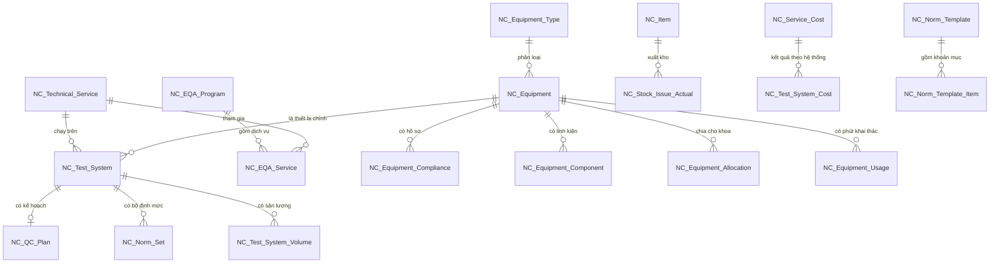

# Sửa đổi 1.1 — Mô hình dữ liệu (bổ sung cho `docs/data-model.md` 1.0)

> Phiên bản 1.1-delta · 13/11/2026 · Nguồn: `docs/srs.md` 1.1, `docs/phan-he-e-hop-nhat.md`
> Tệp này chỉ ghi phần **thêm và đổi** so với `docs/data-model.md` 1.0. Mọi thứ không nêu ở đây giữ nguyên. Khi gộp vào repo: chép từng mục vào đúng chỗ của `data-model.md`, nâng phiên bản tệp đó lên 1.1.
> Quy ước giữ nguyên: tiền tố `NC `, fieldname tiếng Anh snake_case, nhãn tiếng Việt, `track_changes`, `docstatus` giữ 0. Không có DocType tiền tố `CLS` (ràng buộc C-09).

## 1. Tổng quan thay đổi

| Loại | Số lượng | Danh sách |
| :-- | :-: | :-- |
| DocType mới (độc lập) | 9 | NC Equipment Type, NC Equipment Compliance, NC Test System, NC QC Plan, NC EQA Program, NC Norm Template, NC Test System Volume, NC Equipment Usage, NC Stock Issue Actual |
| Bảng con mới | 10 | NC Service Code Map, NC Panel Component, NC Document Resource Link, NC Equipment Component, NC Equipment Allocation, NC QC IQC Line, NC QC Calibration Line, NC EQA Service, NC Norm Template Item, NC Test System Cost |
| DocType mở rộng | 15 | NC Settings, NC Legal Document, NC Technical Service, NC Prompt Template, NC Costing Parameter Set, NC Item, NC Item Price, NC Equipment, NC Norm Set, NC Norm Line, NC Service Volume, NC Costing Run, NC Service Cost, NC Service Cost Line, NC Reconciliation Line |
| Vai trò mới | 1 | NC Auditor |

Mọi DocType mới thuộc module **NC Costing**; không thêm module (ADR-001 giữ nguyên).

**Khác với phương án hợp nhất (mục 4 của `phan-he-e-hop-nhat.md`) ở hai điểm:**

1. Sản lượng cận lâm sàng nằm ở DocType riêng `NC Test System Volume`, không nhét vào `NC Service Volume`. Lý do: khóa duy nhất khác nhau (theo hệ thống xét nghiệm), và sản lượng từ HIS phải được giữ riêng để đối soát sản lượng (BR-CLS-015).
2. Vật liệu nội kiểm, chất chuẩn và ngoại kiểm không là dòng định mức. Chúng nằm ở `NC QC Plan` và `NC EQA Program`; bộ máy tính giá sinh dòng chi phí từ đó (FR-COST-020, FR-NORM-024). Vì vậy DI-05 không đổi.

## 2. Sơ đồ quan hệ bổ sung

## 3. DocType mới

### 3.1 NC Equipment Type — Loại thiết bị [FR-CMP-006, FR-ADM-006]

Naming: `type_code`.

| Trường | Nhãn | Kiểu | BB | Ghi chú |
| :-- | :-- | :-- | :-- | :-- |
| type_code | Mã loại | Data | Có | Duy nhất |
| type_name | Tên loại | Data | Có | Ví dụ: Máy xét nghiệm sinh hóa, Máy X-quang |
| compliance_required | Bắt buộc có hồ sơ tuân thủ | Check | | Danh sách chính thức: TBD-18 |

### 3.2 NC Equipment Compliance — Hồ sơ tuân thủ [FR-CMP-001..007]

Naming: `HSTT-.YYYY.-.####`. Áp dụng cho mọi thiết bị.

| Trường | Nhãn | Kiểu | BB | Ghi chú |
| :-- | :-- | :-- | :-- | :-- |
| equipment | Thiết bị | Link NC Equipment | Có | |
| record_type | Loại hồ sơ | Select | Có | Kiểm định / Hiệu chuẩn / Kiểm xạ / Giấy phép an toàn bức xạ / Khác |
| cycle_months | Chu kỳ (tháng) | Int | Có | Lớn hơn 0 |
| provider | Đơn vị thực hiện | Data | Có | |
| cost_per_time | Chi phí mỗi lần | Currency | Có | Đã gồm thuế GTGT |
| performed_on | Ngày thực hiện | Date | Có | |
| expiry_date | Ngày hết hạn | Date | Có | |
| attachment | Tệp chứng từ | Attach | Có | Private |
| status | Trạng thái | Select (chỉ đọc) | | Còn hạn / Sắp hết hạn / Hết hạn; tác vụ hằng ngày tính theo `expiry_date` và `NC Settings.compliance_reminder_days` |
| note | Ghi chú | Small Text | | |

### 3.3 NC Test System — Hệ thống xét nghiệm [FR-CLS-001..008]

Naming: `test_system_code`.

| Trường | Nhãn | Kiểu | BB | Ghi chú |
| :-- | :-- | :-- | :-- | :-- |
| test_system_code | Mã hệ thống | Data | Có | Duy nhất; dùng trong tệp nhập sản lượng |
| technical_service | Dịch vụ | Link NC Technical Service | Có | Phải có `is_paraclinical` |
| department | Khoa | Link NC Department | Có | Phạm vi quyền theo FR-ACC-008 |
| main_equipment | Thiết bị chính | Link NC Equipment | Có | |
| volume_share_pct | Tỷ trọng sản lượng (%) | Percent | Có | Dùng khi không có số kết quả theo hệ thống [FR-CLS-003, FR-CLS-004] |
| machine_minutes_per_case | Phút chiếm máy một ca | Float | | BB khi thiết bị chính có `allocation_basis` = Phút chiếm máy [FR-CLS-005] |
| est_rerun_rate | Tỷ lệ chạy lại ước tính (%) | Percent | | Mặc định 0 [BR-CLS-001] |
| est_wastage_rate | Tỷ lệ hao hụt ước tính (%) | Percent | | Mặc định 0 |
| status | Trạng thái | Select | Có | Đang dùng / Ngừng dùng [FR-CLS-006] |

Form hiển thị (không lưu): bộ định mức hiện hành, kế hoạch chất lượng, sản lượng kịch bản mặc định, k và giá thành một kết quả của lần tính gần nhất [FR-CLS-007].

### 3.4 NC QC Plan — Kế hoạch chất lượng [FR-QC-001, 002, 007, 008]

Naming: `KHCL-.{test_system}`. Mỗi hệ thống xét nghiệm có tối đa một kế hoạch (DI-11).

| Trường | Nhãn | Kiểu | BB | Ghi chú |
| :-- | :-- | :-- | :-- | :-- |
| test_system | Hệ thống xét nghiệm | Link NC Test System | Có | Duy nhất |
| run_days_per_year | Số ngày chạy mỗi năm | Int | Có | Ký hiệu D khi sản lượng không có số ngày thực tế |
| iqc_lines | Nội kiểm | Table NC QC IQC Line | | |
| calibration_lines | Chuẩn máy | Table NC QC Calibration Line | | |

**NC QC IQC Line** — Bảng con [BR-CLS-006].

| Trường | Nhãn | Kiểu | BB | Ghi chú |
| :-- | :-- | :-- | :-- | :-- |
| qc_material | Vật liệu nội kiểm | Link NC Item | Có | `item_type` phải là Vật liệu nội kiểm (DI-16) |
| levels | Số mức | Int | Có | |
| runs_per_day | Số lần chạy mỗi ngày | Float | Có | |
| qty_per_run | Lượng dùng mỗi lần | Float | Có | Theo đơn vị định mức của mặt hàng |
| shared_parameter_count | Số thông số dùng chung | Int | Có | Mặc định 1; TBD-15 |

**NC QC Calibration Line** — Bảng con [BR-CLS-007].

| Trường | Nhãn | Kiểu | BB | Ghi chú |
| :-- | :-- | :-- | :-- | :-- |
| calibrator | Chất chuẩn | Link NC Item | Có | `item_type` phải là Chất chuẩn (DI-16) |
| points | Số điểm chuẩn | Int | Có | |
| replicates | Số lần lặp | Int | Có | |
| calibrations_per_year | Số lần chuẩn mỗi năm | Float | Có | |
| cost_per_calibration | Chi phí chất chuẩn mỗi lần | Currency | Có | |

### 3.5 NC EQA Program — Chương trình ngoại kiểm [FR-QC-003..005]

Naming: `eqa_code`.

| Trường | Nhãn | Kiểu | BB | Ghi chú |
| :-- | :-- | :-- | :-- | :-- |
| eqa_code | Mã chương trình | Data | Có | Duy nhất |
| program_name | Tên chương trình | Data | Có | |
| provider | Đơn vị triển khai | Data | Có | |
| department | Khoa tham gia | Link NC Department | Có | |
| rounds_per_year | Số đợt mỗi năm | Int | Có | |
| samples_per_round | Số mẫu mỗi đợt | Int | Có | |
| annual_fee | Phí chương trình năm | Currency | Có | |
| annual_shipping_fee | Phí vận chuyển năm | Currency | | |
| services | Dịch vụ tham gia | Table NC EQA Service | Có | Ít nhất một dòng |

**NC EQA Service** — Bảng con: `technical_service` (Link, BB), `share_pct` (Percent; trống ở mọi dòng = chia đều; nếu nhập thì nhập đủ và tổng bằng 100, DI-12).

### 3.6 NC Norm Template — Mẫu định mức [FR-NORM-021..023]

Naming: `template_code`. Trường: `template_code` (BB), `cls_group` (Select như `NC Technical Service.cls_group`, BB), `is_active` (Check), `items` (Table NC Norm Template Item).

**NC Norm Template Item** — Bảng con: `item_name` (Data, BB; tên khoản mục), `component` (Select như `NC Norm Line.component`, BB), `default_cost_level` (Select như `NC Norm Line.cost_level`, BB), `is_mandatory` (Check).

### 3.7 NC Test System Volume — Sản lượng cận lâm sàng [FR-ACCT-013, 014]

Naming: tự động. Duy nhất theo (`fiscal_year`, `scenario`, `test_system`) (DI-14).

| Trường | Nhãn | Kiểu | BB | Ghi chú |
| :-- | :-- | :-- | :-- | :-- |
| fiscal_year | Năm tài chính | Int | Có | |
| scenario | Kịch bản sản lượng | Select | Có | Thực tế 12 tháng / Kế hoạch / Công suất |
| test_system | Hệ thống xét nghiệm | Link NC Test System | Có | |
| technical_service, department | Dịch vụ, khoa | Link (lấy từ hệ thống, chỉ đọc) | | |
| patient_results | Số kết quả trả | Float | Có | Qbn; lớn hơn hoặc bằng 0 |
| iqc_tests | Số test nội kiểm | Float | | Qnk; trống = ước tính từ kế hoạch [FR-QC-006] |
| calibration_tests | Số test chuẩn máy | Float | | Qchuan |
| rerun_tests | Số test chạy lại | Float | | Qlai |
| eqa_tests | Số test ngoại kiểm | Float | | Qngk |
| wastage_rate | Tỷ lệ hao hụt (%) | Percent | | h |
| avg_batch_size | Cỡ mẻ bình quân | Float | | BB khi bộ định mức có dòng Theo mẻ [FR-COST-023] |
| run_days | Số ngày chạy máy | Int | | Trống = lấy `NC QC Plan.run_days_per_year` |
| source_file | Tệp nguồn | Attach | | |

### 3.8 NC Equipment Usage — Phút khai thác của thiết bị [FR-ACCT-013]

Naming: tự động. Duy nhất theo (`fiscal_year`, `scenario`, `equipment`, `department`). Trường: `fiscal_year` (BB), `scenario` (BB), `equipment` (Link, BB), `department` (Link, BB), `total_minutes` (Float, BB; Mtb). Chỉ cần cho thiết bị có `allocation_basis` = Phút chiếm máy. Qtb không lưu: bộ máy tính giá cộng `patient_results` của các hệ thống xét nghiệm dùng thiết bị đó trong khoa.

### 3.9 NC Stock Issue Actual — Xuất kho thực tế [FR-ACCT-015]

Naming: tự động. Duy nhất theo (`fiscal_year`, `department`, `item`). Trường: `fiscal_year` (BB), `department` (Link, BB), `item` (Link NC Item, BB), `issued_qty` (Float, BB; theo đơn vị mua `NC Item.uom`), `source_file` (Attach).

## 4. DocType mở rộng

Chỉ liệt kê trường thêm hoặc đổi. "Đổi BB" nghĩa là điều kiện bắt buộc của trường đã có thay đổi.

**NC Settings** — thêm: `compliance_reminder_days` (Int, mặc định 30) [FR-CMP-005, FR-ADM-006].

**NC Legal Document** — `doc_type` thêm lựa chọn "Tài liệu của hãng"; thêm `related_resources` (Table NC Document Resource Link) bắt buộc khi loại là "Tài liệu của hãng" [FR-LIB-013]. **NC Document Resource Link** — bảng con: `linked_doctype` (NC Item / NC Equipment, BB), `linked_name` (Dynamic Link, BB).

**NC Technical Service** [FR-SVC-008..011]

| Trường thêm | Nhãn | Kiểu | Ghi chú |
| :-- | :-- | :-- | :-- |
| is_paraclinical | Thuộc khối cận lâm sàng | Check | |
| cls_group | Nhóm chuyên ngành | Select | Hóa sinh / Miễn dịch / Huyết học / Vi sinh / Giải phẫu bệnh / Chẩn đoán hình ảnh / Thăm dò chức năng / Khác. BB khi `is_paraclinical` |
| result_unit | Đơn vị kết quả | Select | Kết quả xét nghiệm / Ca chụp. BB khi `is_paraclinical` |
| external_codes | Mã trên hệ thống ngoài | Table NC Service Code Map | |
| is_panel | Là dịch vụ bộ | Check | |
| panel_costing_mode | Cách tính dịch vụ bộ | Select | Theo cả bộ / Theo từng thông số; TBD-17 |
| panel_components | Thông số thành phần | Table NC Panel Component | |
| is_send_out | Gửi ngoài | Check | Bật thì không yêu cầu bộ định mức |
| send_out_price | Giá hợp đồng gửi mẫu | Currency | |

**NC Service Code Map** — bảng con: `source_system` (HIS / LIS / RIS, BB), `external_code` (BB), `external_name`. Một cặp (`source_system`, `external_code`) chỉ thuộc một dịch vụ (DI-09). **NC Panel Component** — bảng con: `parameter_code` (BB), `parameter_name` (BB), `technical_service` (Link, tùy chọn).

**NC Prompt Template** — `template_code` thêm `SUGGEST_CLS_NORM` [FR-AI-016]. `NC AI Log.purpose` thêm cùng giá trị.

**NC Costing Parameter Set** [FR-RES-009 sửa, BR-CLS-017]

| Trường thêm | Nhãn | Kiểu | Mặc định |
| :-- | :-- | :-- | :-- |
| expired_depreciation_mode | Khấu hao thiết bị hết thời gian sử dụng | Select: ZERO / CONTINUE | ZERO |
| material_recon_tolerance | Ngưỡng đối soát vật chất (%) | Percent | 5 |
| volume_recon_tolerance | Ngưỡng đối soát sản lượng (%) | Percent | 2 |
| eqa_cost_category | Loại chi phí của phí ngoại kiểm | Select (loại chi phí BR-COST-008) | DRUG_SUPPLY |
| rental_cost_category | Loại chi phí của tiền thuê máy | Select | DEPRECIATION |
| jv_cost_category | Loại chi phí của hợp đồng liên doanh, liên kết | Select | DEPRECIATION |

Ba trường cuối là tạm thời cho đến khi chốt TBD-14.

**NC Item** [FR-RES-018]

| Trường | Thay đổi |
| :-- | :-- |
| item_type | Thêm lựa chọn: Chất chuẩn, Vật liệu nội kiểm |
| norm_uom | Mới. Đơn vị định mức (Data). Ví dụ: test, mL. Trống = dùng `uom` |
| norm_units_per_purchase_unit | Mới. Số đơn vị định mức trong một đơn vị mua (Float, mặc định 1). BB với Hóa chất, Chất chuẩn, Vật liệu nội kiểm |
| nominal_tests | Mới. Số test danh nghĩa của một đơn vị mua (Int) |
| open_stability_days | Mới. Hạn dùng sau mở (ngày, Int) |
| is_main_reagent | Mới. Là hóa chất chính (Check). Mặc định bật cờ nhân k ở dòng định mức [FR-NORM-019]; dùng cho BR-CLS-016 |

`reuse_count` giữ nguyên ý nghĩa (vật tư dùng nhiều lần). Đơn giá một đơn vị định mức = `unit_price` ÷ `norm_units_per_purchase_unit`, giữ 4 chữ số thập phân.

**NC Item Price** [FR-RES-002 và 004 sửa, FR-RES-016, 017]

| Trường | Thay đổi |
| :-- | :-- |
| price_source | Thêm lựa chọn "Hợp đồng". Thứ tự ưu tiên khi chọn giá: Trúng thầu, Hợp đồng, Hóa đơn, Giá công bố, Báo giá |
| valid_to | Mới. Hiệu lực đến (Date, tùy chọn) |
| verification_status | Mới. Select: Chưa xác minh / Đã xác minh; mặc định Chưa xác minh |
| verified_by, verified_on | Mới. Link User, Datetime |
| attachment | Đổi BB: bắt buộc khi chuyển sang "Đã xác minh" |

**NC Equipment** [FR-RES-005 và 007 sửa, FR-RES-019..026]

| Trường | Thay đổi |
| :-- | :-- |
| equipment_type | Mới. Link NC Equipment Type |
| acquisition_mode | Mới, BB. Select: Mua / Thuê / Đặt theo hóa chất / Liên doanh, liên kết; mặc định Mua |
| annual_contract_cost | Mới. Currency. BB khi Thuê hoặc Liên doanh, liên kết |
| contract_asset_value | Mới. Currency. Giá trị ghi trên hợp đồng, dùng cho phân bổ theo giá trị tài sản khi không có nguyên giá |
| allocation_basis | Mới, BB. Select: Giờ kế hoạch / Số kết quả / Phút chiếm máy; mặc định Giờ kế hoạch |
| original_cost, useful_life_years | Đổi BB: chỉ bắt buộc khi `acquisition_mode` = Mua |
| planned_hours_per_year, utilization_rate | Đổi BB: chỉ bắt buộc khi `allocation_basis` = Giờ kế hoạch |
| annual_calibration_cost | Giữ. Chỉ dùng khi thiết bị không có bản ghi NC Equipment Compliance còn hạn [FR-CMP-002] |
| maintenance_vendor_paid | Mới. Check. Bảo trì do nhà cung cấp chịu (có tác dụng khi Đặt theo hóa chất) |
| power_kw | Giữ. Hiểu là công suất khi chạy |
| power_standby_kw, run_hours_per_day, standby_hours_per_day | Mới. Float |
| continuous_power | Mới. Check. Cấp điện liên tục (D = 365) |
| components | Mới. Table NC Equipment Component |
| department_allocations | Mới. Table NC Equipment Allocation. Trống = 100% cho `department` |

**NC Equipment Component** — bảng con [FR-RES-023, BR-CLS-010]: `component_name` (BB), `replacement_cost` (Currency, BB), `life_basis` (Tháng / Số kết quả / Giờ chạy, BB), `life_value` (Float, BB), `vendor_paid` (Check). **NC Equipment Allocation** — bảng con [FR-RES-024, 025]: `department` (Link, BB), `share_pct` (Percent, BB); tổng bằng 100 (DI-10).

**NC Norm Set** [FR-NORM-017, 020, 022, 025]

| Trường thêm | Nhãn | Kiểu | Ghi chú |
| :-- | :-- | :-- | :-- |
| test_system | Hệ thống xét nghiệm | Link NC Test System | BB khi dịch vụ có hệ thống xét nghiệm; dịch vụ và khoa phải khớp (DI-15) |
| tests_per_tube | Số xét nghiệm bình quân trên một ống mẫu | Float | BB khi có dòng `cost_level` = TUBE |
| norm_template | Mẫu định mức | Link NC Norm Template | |
| copied_from | Sao chép từ | Link NC Norm Set | |

Naming khi có `test_system`: `DM-.{technical_service}.-.{department}.-.{test_system}.-v.{version_no}`.

**NC Norm Line** [FR-NORM-018, 019, 023]

| Trường | Thay đổi |
| :-- | :-- |
| cost_level | Mới, BB. Select: RESULT (Theo kết quả) / TUBE (Theo ống mẫu) / BATCH (Theo mẻ) / DAY (Theo ngày-máy) / PERIOD (Theo kỳ); mặc định RESULT. Dịch vụ không thuộc khối cận lâm sàng: luôn RESULT |
| apply_k | Mới. Check. Chỉ bật được khi `cost_level` = RESULT và cấu phần là DRUG hoặc SUPPLY. Bật thì `wastage_rate` phải bằng 0 |
| attach_to | Mới. Select: Hệ thống xét nghiệm / Thiết bị. BB khi DAY hoặc PERIOD [BR-CLS-005] |
| attach_equipment | Mới. Link NC Equipment. BB khi `attach_to` = Thiết bị |
| template_item | Mới. Data. Tên khoản mục của mẫu định mức mà dòng đáp ứng |
| hospital_qty | Ý nghĩa theo cấp: một kết quả (RESULT), một ống (TUBE), một mẻ (BATCH), một ngày (DAY), một năm (PERIOD) |
| exclude_reason | Thêm lựa chọn "Không áp dụng" (dùng cho khoản mục bắt buộc của mẫu, FR-NORM-023) |

Dòng cấu phần EQUIPMENT của dịch vụ cận lâm sàng có thiết bị chia theo Số kết quả hoặc Phút chiếm máy: `hospital_qty` không dùng để tính tiền; chi phí lấy từ thiết bị theo BR-CLS-009.

**NC Service Volume** [FR-ACCT-012] — thêm `scenario` (Select như trên, BB, mặc định Thực tế 12 tháng). Khóa duy nhất đổi thành (`fiscal_year`, `technical_service`, `department`, `scenario`). Đây là sản lượng từ HIS.

**NC Costing Run** [FR-COST-017] — thêm `volume_scenario` (Select, BB, mặc định Thực tế 12 tháng) và `compliance_allocation_mode` (Select: Theo giá trị tài sản / Gắn trực tiếp thiết bị, BB, mặc định Theo giá trị tài sản). Ảnh chụp (`snapshot_file`) thêm: hệ thống xét nghiệm, kế hoạch chất lượng, chương trình ngoại kiểm, hồ sơ tuân thủ, thiết bị và linh kiện, sản lượng cận lâm sàng, phút khai thác, xuất kho [FR-COST-032].

**NC Service Cost** [FR-COST-022, 025] — thêm `is_paraclinical` (Check), `eqa_cost` (Currency), `test_system_costs` (Table NC Test System Cost). `volume` của dịch vụ cận lâm sàng = tổng `patient_results` [FR-COST-024].

**NC Test System Cost** — bảng con của NC Service Cost.

| Trường | Nhãn | Kiểu | Ghi chú |
| :-- | :-- | :-- | :-- |
| test_system, norm_set | Hệ thống, bộ định mức | Link | |
| patient_results | Số kết quả trả | Float | |
| share_pct | Tỷ trọng đã dùng | Float 6 | BR-CLS-013 |
| q_iqc, q_calibration, q_rerun, q_eqa | Các số test phụ đã dùng | Float | |
| wastage_rate | Hao hụt đã dùng (%) | Percent | |
| k_factor | Hệ số k | Float 6 | NFR-REL-003 |
| k_estimated | Ước tính từ kế hoạch | Check | [FR-QC-006] |
| direct_cost | Chi phí trực tiếp một kết quả | Currency | |
| low_volume_warning | Cảnh báo sản lượng thấp | Check | BR-CLS-016 |

**NC Service Cost Line** [FR-COST-031, NFR-CPL-003]

| Trường thêm | Nhãn | Kiểu | Ghi chú |
| :-- | :-- | :-- | :-- |
| test_system | Hệ thống xét nghiệm | Link | Trống với dòng ở cấp dịch vụ (ngoại kiểm, phân bổ) |
| line_origin | Nguồn của dòng | Select | Định mức / Kế hoạch chất lượng / Ngoại kiểm / Thiết bị / Hồ sơ tuân thủ |
| cost_level | Cấp phát sinh | Data | |
| k_factor | Hệ số k đã nhân | Float 6 | Trống khi không nhân |
| divisor_label | Tên mẫu số | Data | Qbn / Qtb / Mtb / số xét nghiệm mỗi ống / cỡ mẻ |
| divisor_value | Giá trị mẫu số | Float | |
| divisor_source | Nguồn của mẫu số | Select | Thực tế / Ước tính từ kế hoạch |

**NC Reconciliation Line** [FR-COST-026..029]

| Trường thêm | Nhãn | Kiểu | Ghi chú |
| :-- | :-- | :-- | :-- |
| recon_type | Loại đối soát | Select | Tài chính / Vật chất / Sản lượng; mặc định Tài chính (các dòng 1.0) |
| department | Khoa | Link | Vật chất, Sản lượng |
| item | Mặt hàng | Link NC Item | Vật chất |
| technical_service | Dịch vụ | Link | Sản lượng |
| calculated_qty, actual_qty | Lượng tính được, lượng thực tế | Float | Vật chất: theo đơn vị định mức. Sản lượng: kết quả trả, sản lượng HIS |
| recon_status | Tình trạng | Select | Đã đối soát / Chưa đối soát. "Chưa đối soát" dùng cho khoa thiếu số liệu xuất kho; cần `explanation` trước khi khóa [FR-COST-029] |

Các trường `variance_pct`, `over_tolerance`, `explanation` dùng chung cho cả ba loại. Dòng Sản lượng vượt ngưỡng chỉ là cảnh báo, không chặn khóa.

## 5. Ma trận quyền bổ sung

Thêm cột **Auditor** vào mọi dòng của ma trận 1.0 với quyền **R** (kể cả "Cấu hình AI, mẫu lệnh" và "Nhật ký AI, sổ sự kiện"); NC Auditor không có W hay A ở bất kỳ DocType nào [FR-ACC-007].

| Nhóm DocType mới | Clinician | Dept Head | Council | Finance | Resource Mgr | Doc Controller | Director | Consultant | Admin | Auditor |
| :-- | :-: | :-: | :-: | :-: | :-: | :-: | :-: | :-: | :-: | :-: |
| Hệ thống xét nghiệm, kế hoạch chất lượng, chương trình ngoại kiểm | W (khoa) | W (khoa) | — | R | R | — | R | R | R | R |
| Loại thiết bị, hồ sơ tuân thủ | R | R | — | R | W | — | R | R | W | R |
| Mẫu định mức | R | R | — | W | R | — | R | R | W | R |
| Sản lượng cận lâm sàng, phút khai thác, xuất kho thực tế | — | R (khoa) | — | W | — | — | R | — | R | R |

Các bảng con theo quyền của DocType cha. Đối soát vật chất và sản lượng theo dòng "Lần tính giá, kết quả, đối soát" của ma trận 1.0.

## 6. Luồng trạng thái

Không thêm workflow. Bộ định mức của hệ thống xét nghiệm dùng luồng 5.2; lần tính giá giữ nguyên. Điều kiện bổ sung cho bước "Xác nhận chuyên môn" của luồng 5.2: FR-NORM-020 (số xét nghiệm mỗi ống) và FR-NORM-023 (khoản mục bắt buộc của mẫu). Điều kiện bổ sung cho bước khóa lần tính giá: mọi dòng đối soát Vật chất "Vượt ngưỡng" hoặc "Chưa đối soát" có giải trình.

## 7. Ràng buộc toàn vẹn

| Mã | Ràng buộc |
| :-- | :-- |
| DI-03 (sửa) | Mỗi (dịch vụ, khoa) có tối đa một bộ định mức "Đã khóa" đang hiệu lực; với dịch vụ có hệ thống xét nghiệm, tối đa một bộ cho mỗi (dịch vụ, khoa, hệ thống xét nghiệm) [FR-NORM-017] |
| DI-09 | Cặp (`source_system`, `external_code`) của NC Service Code Map là duy nhất trên toàn bộ dịch vụ [FR-SVC-009] |
| DI-10 | Tổng `share_pct` của NC Equipment Allocation trên một thiết bị bằng 100 khi bảng có dòng [FR-RES-025] |
| DI-11 | Mỗi NC Test System có tối đa một NC QC Plan |
| DI-12 | Trong một NC EQA Program, `share_pct` hoặc trống ở mọi dòng, hoặc có ở mọi dòng và tổng bằng 100 [FR-QC-005] |
| DI-13 | Mặt hàng của một NC Norm Line không được trùng với `qc_material` hay `calibrator` trong NC QC Plan của cùng hệ thống xét nghiệm [FR-NORM-024] |
| DI-14 | NC Test System Volume duy nhất theo (năm tài chính, kịch bản, hệ thống xét nghiệm) |
| DI-15 | NC Norm Set có `test_system` thì `technical_service` và `department` phải bằng của hệ thống đó |
| DI-16 | `qc_material` phải có `item_type` = Vật liệu nội kiểm; `calibrator` phải có `item_type` = Chất chuẩn [FR-QC-008] |
| DI-17 | `apply_k` bật thì `cost_level` = RESULT, cấu phần là DRUG hoặc SUPPLY và `wastage_rate` = 0 [FR-NORM-019] |

DI-05 không đổi. DI-06 mở rộng: lần tính giá chỉ đọc hệ thống xét nghiệm "Đang dùng". DI-07 mở rộng: bản ghi đã vào ảnh chụp của lần tính giá khóa vẫn sửa được ở bản gốc; ảnh chụp là nguồn tái lập (ADR-004).
