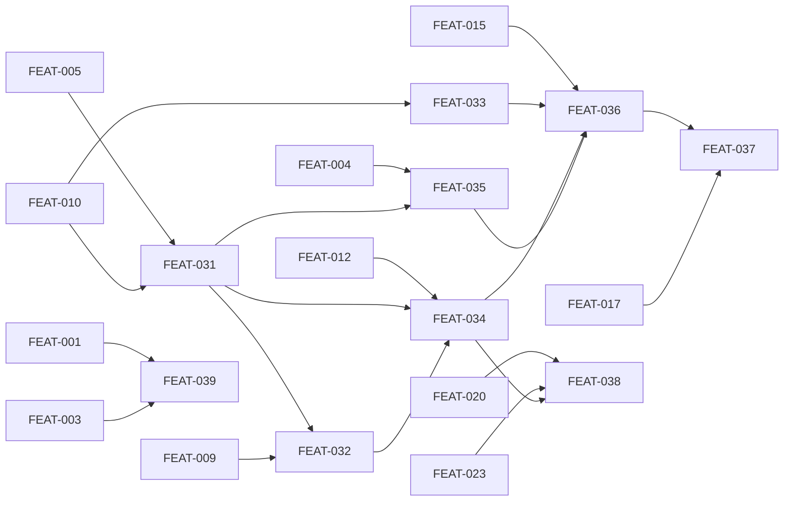

# Sửa đổi 1.1 — Kế hoạch xây dựng (bổ sung cho `docs/implementation-plan.md` 1.0)

> Phiên bản 1.1-delta · 13/11/2026 · Nguồn: `docs/srs.md` 1.1, các tệp khác trong `docs/sua-doi-1.1/`
> Thêm 9 tính năng (FEAT-031 đến FEAT-039), mở rộng 3 tính năng (FEAT-009, 010, 011), chèn vào thứ tự xây. Kế hoạch vẫn không gắn ngày. Definition of Done và mẫu As-Built của bản 1.0 áp dụng không đổi cho mọi tính năng dưới đây.

## 1. Phạm vi bản phát hành sau sửa đổi

| Bản | 1.0 | Thêm ở 1.1 |
| :-: | :-- | :-- |
| R1 | Phân hệ B, C; soạn quy trình thủ công và luồng duyệt của A | Phân hệ E cho hóa sinh và miễn dịch: FEAT-031 đến FEAT-037, FEAT-039. Nghiệm thu với cả máy mua và máy đặt theo hóa chất (C-10) |
| R2 | AI và thư viện văn bản | FEAT-038 |
| R3 | Phân hệ D | Không đổi |

Chẩn đoán hình ảnh và các nhóm xét nghiệm khác dùng cùng mã đã xây; phần riêng của chúng (FR-CLS-005, tiêu chí Phút chiếm máy) được xây ở R1 trong FEAT-036 vì nằm chung công thức, nhưng không thuộc tiêu chí nghiệm thu R1.

## 2. Tính năng mở rộng

| Tính năng | Thêm vào phạm vi | Ghi chú cho thiết kế chi tiết |
| :-- | :-- | :-- |
| FEAT-009 Mặt hàng và đơn giá | FR-RES-016, 017, 018; sửa FR-RES-002, FR-RES-004 | Chọn giá theo thứ tự nguồn rồi đến ngày hiệu lực; trạng thái xác minh; quy đổi đơn vị định mức. Màn hình SCR-DSK-017 |
| FEAT-010 Thiết bị và phòng | FR-RES-019..026; sửa FR-RES-005, FR-RES-007 | Hình thức có máy, tiêu chí chia, linh kiện, tỷ lệ theo khoa, điện; NC Equipment Type. Trường bắt buộc theo điều kiện. Màn hình SCR-DSK-018 |
| FEAT-011 Bộ tham số | Sửa FR-RES-009 | Sáu trường mới của NC Costing Parameter Set. Màn hình SCR-DSK-019 |

Ba tính năng này chưa bắt đầu xây, nên phần mở rộng được làm ngay trong lần xây đầu, không tách thành tính năng riêng.

## 3. Tính năng mới

| Mã | Tên | Bản | Yêu cầu | Use case | Màn hình | Phụ thuộc |
| :-- | :-- | :-: | :-- | :-- | :-- | :-- |
| FEAT-031 | Dịch vụ cận lâm sàng và hệ thống xét nghiệm | R1 | FR-SVC-008..011, FR-CLS-001, 002, 005..008, FR-ACC-008 | UC-019 | SCR-DSK-006, 032 | FEAT-001, FEAT-005, FEAT-010 |
| FEAT-032 | Kế hoạch chất lượng và ngoại kiểm | R1 | FR-QC-001..003, 005, 007, 008 | UC-019 | SCR-DSK-033, 034 | FEAT-031, FEAT-009 |
| FEAT-033 | Hồ sơ tuân thủ thiết bị | R1 | FR-CMP-001, 005, 006, 007, FR-ADM-006 | UC-020 | SCR-DSK-035, 036 | FEAT-010 |
| FEAT-034 | Định mức theo hệ thống xét nghiệm | R1 | FR-NORM-017..025, FR-OUT-011 | UC-021 | SCR-DSK-014, 041 | FEAT-012, FEAT-031, FEAT-032 |
| FEAT-035 | Sản lượng cận lâm sàng và xuất kho | R1 | FR-ACCT-012..015 | UC-022 | SCR-DSK-021, 037 | FEAT-004, FEAT-031 |
| FEAT-036 | Tính giá cận lâm sàng | R1 | FR-COST-017..025, 031, 032, FR-CLS-003, 004, FR-QC-004, 006, FR-CMP-002..004, NFR-REL-003, NFR-CPL-003 | UC-012 | SCR-DSK-022, 023 | FEAT-015, FEAT-033, FEAT-034, FEAT-035 |
| FEAT-037 | Đối soát vật chất và sản lượng; thiếu dữ liệu; độ nhạy | R1 | FR-COST-026..030, FR-OUT-012 | UC-023, UC-024 | SCR-DSK-024, 038, 039, 040 | FEAT-036, FEAT-017 |
| FEAT-038 | AI đề xuất định mức từ tài liệu của hãng | R2 | FR-LIB-013, FR-AI-016..018 | UC-025 | SCR-DSK-014, 033 | FEAT-020, FEAT-023, FEAT-034 |
| FEAT-039 | Vai trò kiểm soát nội bộ | R1 | FR-ACC-007; sửa FR-ACC-002, FR-ACC-004, FR-AUD-003 | UC-026 | SCR-DSK-030 | FEAT-001, FEAT-003 |

FR-CMP-006 (cảnh báo thiếu hồ sơ khi tính) có phần dữ liệu ở FEAT-033 và phần cảnh báo trên lần tính ở FEAT-036.

**Tiêu chí nghiệm thu chính của từng tính năng**

- **FEAT-031.** Tạo hai hệ thống cho một dịch vụ với tổng tỷ trọng 100%; mã ngoài trùng bị từ chối; người dùng khoa khác không sửa được; ngừng dùng một hệ thống thì hệ thống đó không vào lần tính mới. Kiểm bằng TC-CLS-20 đến TC-CLS-23.
- **FEAT-032.** Kế hoạch nội kiểm, chuẩn máy, ngoại kiểm lưu đủ trường; mặt hàng sai loại bị từ chối; tổng tỷ lệ ngoại kiểm khác 100% bị từ chối; hệ thống thiếu kế hoạch nội kiểm có cảnh báo. Kiểm bằng TC-CLS-24 đến TC-CLS-26.
- **FEAT-033.** Hồ sơ thiếu chứng từ bị từ chối; hồ sơ còn 20 ngày sinh thông báo; báo cáo hạn liệt kê đúng. Kiểm bằng TC-CLS-27, TC-CLS-28.
- **FEAT-034.** Bộ định mức gắn một hệ thống; khoản mục bắt buộc của mẫu được thêm; dòng trùng mặt hàng của kế hoạch chất lượng bị từ chối; thiếu số xét nghiệm mỗi ống thì không xác nhận chuyên môn được; hai hệ thống của một dịch vụ khóa được hai bộ. Kiểm bằng TC-CLS-29 đến TC-CLS-33.
- **FEAT-035.** Nạp sản lượng theo kịch bản; dòng mã lạ hoặc số âm bị báo lỗi và không lưu; cột số test phụ để trống được; nạp xuất kho theo mặt hàng và khoa. Kiểm bằng TC-CLS-34 đến TC-CLS-36.
- **FEAT-036.** Mọi số của `golden_cls.py` khớp đến hai chữ số thập phân, k khớp sáu chữ số; chạy lại cùng ảnh chụp cho cùng kết quả; bảng giải trình hiện k, mẫu số, nguồn mẫu số. Kiểm bằng TC-CLS-01 đến TC-CLS-15, TC-CLS-37, TC-CLS-38.
- **FEAT-037.** Đối soát vật chất và sản lượng khớp các biến thể V6, V7 của `golden_cls.py`; dòng vượt ngưỡng chưa giải trình chặn khóa; khoa thiếu xuất kho được ghi "Chưa đối soát vật chất"; phân tích độ nhạy không ghi dữ liệu. Kiểm bằng TC-CLS-16 đến TC-CLS-19, TC-CLS-39, TC-CLS-40.
- **FEAT-038.** Nguồn gửi AI chỉ gồm mục tài liệu của hãng đã gắn; đề xuất có trích dẫn nguyên văn hoặc nhãn "Chưa có căn cứ"; mặt hàng ngoài danh mục không được tạo. Kiểm bằng TC-CLS-41 đến TC-CLS-43.
- **FEAT-039.** NC Auditor đọc được mọi DocType, không tạo, sửa, xóa, duyệt được gì. Kiểm bằng TC-CLS-44.

## 4. Thứ tự xây sau sửa đổi

Chèn vào bảng thứ tự của bản 1.0; các dòng không nêu giữ nguyên vị trí.

| Thứ tự | Hạng mục | Bản | Lý do đặt ở đây |
| :-: | :-- | :-: | :-- |
| 5 | FEAT-009, FEAT-010, FEAT-011 (đã mở rộng) | R1 | Như 1.0; phần mở rộng làm ngay vì đổi cấu trúc thiết bị và đơn giá |
| 5a | FEAT-031, FEAT-033 | R1 | Cần thiết bị và dịch vụ; không phụ thuộc quy trình |
| 7 | FEAT-012 | R1 | Như 1.0 |
| 7a | FEAT-032, FEAT-034 | R1 | Định mức theo hệ thống cần bộ định mức và kế hoạch chất lượng |
| 8 | FEAT-015 | R1 | Như 1.0; dựng sẵn điểm cắm chi phí trực tiếp (ADR-017) |
| 8a | FEAT-035, FEAT-036 | R1 | Rủi ro đúng sai cao thứ hai sau FEAT-015; cần sớm để khoa xét nghiệm và tài chính kiểm số |
| 9 | FEAT-016, FEAT-017 | R1 | Như 1.0 |
| 9a | FEAT-037 | R1 | Đối soát vật chất đi sau đối soát tài chính |
| 11 | Thêm FEAT-039 vào nhóm hoàn thiện | R1 | Chỉ là quyền đọc |
| 13 | Thêm FEAT-038 sau FEAT-024 | R2 | Dùng chung gateway và kiểm trích dẫn |

Walking skeleton và lát cắt đầu tiên (FEAT-006) không đổi.

## 5. Nền kỹ thuật bổ sung

- [ ] Fixtures thêm: vai trò NC Auditor; mẫu định mức cho nhóm Hóa sinh và Miễn dịch; mẫu Excel của sáu bộ nhập mới [FR-ADM-001, FR-ADM-002].
- [ ] CI chạy thêm `docs/sua-doi-1.1/golden_cls.py` cùng bộ dữ liệu vàng 1.0; ngưỡng độ phủ 90% áp cho cả `normcore/costing/cls.py` [NFR-MNT-001].
- [ ] Script quét quyền (TC-ACC-04) kiểm thêm: không DocType nào cấp quyền ghi cho NC Auditor.
- [ ] Tác vụ định kỳ hằng ngày: cập nhật trạng thái hồ sơ tuân thủ và gửi nhắc [FR-CMP-005].

## 6. Rủi ro và giả định bổ sung

| Rủi ro hoặc giả định | Ảnh hưởng đến thứ tự | Cách xử lý |
| :-- | :-- | :-- |
| TBD-13 đã chốt: E đi cùng R1 | R1 lớn hơn: thêm 8 tính năng | Đã phản ánh ở mục 3 và 4; dòng TBD-13 trong bảng rủi ro 1.0 được thay bằng dòng này |
| TBD-16: LIS có thể không xuất được số test phụ | FEAT-035, FEAT-036 | Đường ước tính từ kế hoạch là đường chính thức (FR-QC-006); nghiệm thu cả hai đường |
| TBD-14: loại chi phí kế toán của ngoại kiểm, thuê máy | FEAT-036, FEAT-017 | Ba trường tạm trong bộ tham số; chốt trước khi nghiệm thu FEAT-037 vì ảnh hưởng phân bổ cấp 2 và đối soát |
| TBD-15: cách chia vật liệu nội kiểm dùng chung | FEAT-036 | Công thức nằm ở một hàm; mặc định chia đều theo số thông số |
| TBD-18: danh sách loại thiết bị bắt buộc có hồ sơ | FEAT-033 | Là dữ liệu cấu hình; cài trống, bệnh viện tự đánh dấu |
| Bệnh viện thí điểm chưa có (TBD-06) | Nghiệm thu R1 của phân hệ E | Dùng `golden_cls.py` và dữ liệu giả; cần ít nhất một máy mua và một máy đặt thật để nghiệm thu cuối |
| Số liệu xuất kho không tách được theo khoa (A-08) | FEAT-037 | Lần tính ghi "Chưa đối soát vật chất" và vẫn khóa được sau khi tài chính xác nhận |

**Khoảng trống bao phủ.** Không có: 76 yêu cầu chức năng mới và 2 yêu cầu phi chức năng mới đều thuộc một tính năng ở mục 2 hoặc 3; 10 màn hình mới đều được ít nhất một tính năng chạm tới. Bảng đối chiếu ở `docs/sua-doi-1.1/rtm.md`.
