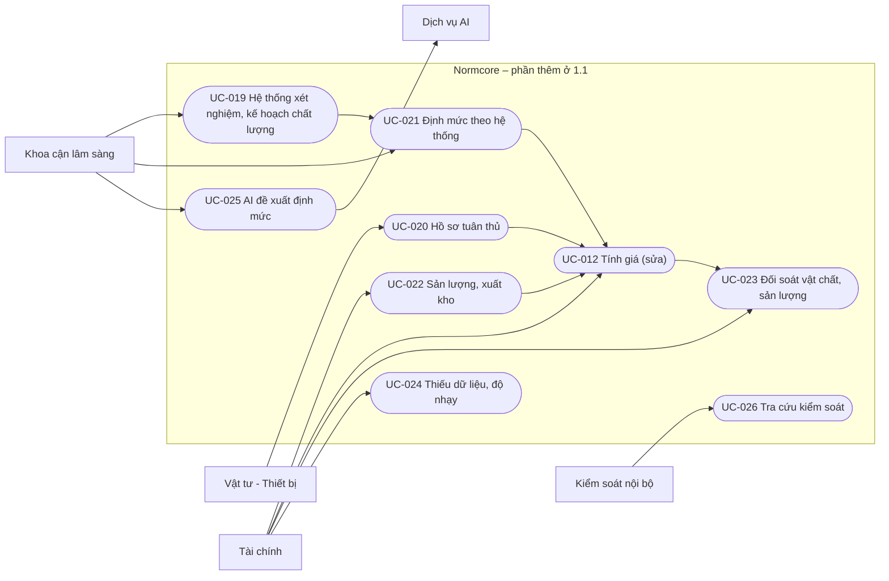

# Sửa đổi 1.1 — Use case (bổ sung cho `docs/use-cases.md` 1.0)

> Phiên bản 1.1-delta · 13/11/2026 · Nguồn: `docs/srs.md` 1.1
> Thêm 8 use case (UC-019 đến UC-026) và sửa 2 use case (UC-008, UC-012). UC-001 đến UC-018 còn lại giữ nguyên. Tên tác nhân theo vai trò ở SRS mục 2.3.

## 1. Use case sửa

### UC-008: Khai báo nguồn lực, đơn giá và tham số (sửa)

- **Traces to (thêm):** FR-RES-016..026
- **Thêm vào Main success scenario:**
  - Khi thêm đơn giá, người dùng chọn nguồn (có thêm "Hợp đồng") và có thể nhập ngày hết hiệu lực. Người dùng xác minh đơn giá bằng cách đính kèm chứng từ; đơn giá chuyển "Đã xác minh".
  - Với hóa chất xét nghiệm, chất chuẩn, vật liệu nội kiểm: nhập số đơn vị định mức trong một đơn vị mua, số test danh nghĩa, hạn dùng sau mở.
  - Khi khai báo thiết bị: chọn hình thức có máy và tiêu chí chia chi phí; khai linh kiện lớn; khai tỷ lệ phân bổ theo khoa nếu dùng chung; khai công suất điện nếu muốn tính điện theo thiết bị.
  - Khi lập bộ tham số: chọn cách tính khấu hao của thiết bị đã hết thời gian sử dụng, ngưỡng đối soát vật chất và ngưỡng đối soát sản lượng.
- **Alternate flows (thêm):**
  - Hình thức Thuê hoặc Liên doanh, liên kết → hệ thống yêu cầu chi phí năm theo hợp đồng thay cho nguyên giá và thời gian sử dụng.
  - Hình thức Đặt theo hóa chất → không yêu cầu nguyên giá; người dùng đánh dấu bảo trì và linh kiện do nhà cung cấp chịu.
- **Exception flows (thêm):**
  - Tổng tỷ lệ phân bổ theo khoa khác 100% → hệ thống từ chối lưu.
  - Xác minh đơn giá khi chưa có tệp chứng từ → hệ thống từ chối.
- **Đổi so với 1.0:** khi một mặt hàng có nhiều đơn giá còn hiệu lực, hệ thống chọn theo thứ tự nguồn (Trúng thầu, Hợp đồng, Hóa đơn, Giá công bố, Báo giá) rồi mới đến ngày hiệu lực gần nhất (FR-RES-004).

### UC-012: Chạy tính giá, đối soát và khóa (sửa)

- **Traces to (thêm):** FR-COST-017..025, FR-COST-031, FR-COST-032, FR-CLS-003, FR-CLS-004, FR-QC-004, FR-QC-006, FR-CMP-002..004, FR-CMP-006
- **Preconditions (thêm):** dịch vụ cận lâm sàng trong phạm vi có hệ thống xét nghiệm "Đang dùng", mỗi hệ thống có bộ định mức "Đã khóa" và sản lượng của kịch bản được chọn.
- **Thêm vào Main success scenario:**
  - Bước 1: tài chính chọn thêm kịch bản sản lượng (mặc định Thực tế 12 tháng) và cách phân bổ chi phí kiểm định, hiệu chuẩn (mặc định Theo giá trị tài sản).
  - Bước 4: với dịch vụ cận lâm sàng, hệ thống tính hệ số k của từng hệ thống xét nghiệm; tính chi phí từng dòng theo cấp phát sinh; tính nội kiểm, chất chuẩn, ngoại kiểm từ kế hoạch chất lượng; tính chi phí thiết bị theo hình thức có máy và tiêu chí chia; lấy bình quân gia quyền khi dịch vụ có nhiều hệ thống. Sau đó phân bổ cấp 1, cấp 2 chạy như cũ, dùng tổng số kết quả trả làm sản lượng.
  - Bước 6: bảng giải trình của dịch vụ cận lâm sàng hiện thêm hệ thống xét nghiệm, cấp phát sinh, k và các số tạo nên k, mẫu số chia.
  - Bước 8: ảnh chụp gồm cả hệ thống xét nghiệm, kế hoạch chất lượng, hồ sơ tuân thủ, thiết bị, sản lượng cận lâm sàng và xuất kho.
- **Alternate flows (thêm):**
  - 4e. Sản lượng không có số test nội kiểm, chuẩn máy, chạy lại → hệ thống ước tính từ kế hoạch chất lượng, gắn nhãn "Ước tính từ kế hoạch".
  - 4f. Thiết bị thuộc loại bắt buộc có hồ sơ tuân thủ nhưng không có hồ sơ còn hạn → gắn cảnh báo trên lần tính, vẫn tính.
  - 4g. Thiết bị hết thời gian sử dụng → khấu hao bằng 0 hoặc tiếp tục tính theo lựa chọn của bộ tham số; lựa chọn hiện trên bảng giải trình.
  - 4h. Số test tiêu thụ trong thời hạn dùng sau mở nhỏ hơn số test danh nghĩa của một đơn vị mua → cảnh báo "Sản lượng thấp".
- **Exception flows (thêm):**
  - 4i. Hệ thống xét nghiệm thiếu sản lượng, số kết quả trả bằng 0, hoặc có dòng Theo mẻ mà thiếu cỡ mẻ → dừng tính dịch vụ đó, ghi lỗi, tiếp tục dịch vụ khác.
  - 4k. Tổng tỷ trọng các hệ thống của một dịch vụ khác 100% (khi không có số kết quả theo hệ thống) → dừng tính dịch vụ đó, ghi lỗi.

## 2. Use case mới

### UC-019: Khai dịch vụ cận lâm sàng, hệ thống xét nghiệm và kế hoạch chất lượng

- **ID:** UC-019
- **Actors:** Kỹ thuật viên trưởng hoặc trưởng khoa cận lâm sàng (chính), Kế hoạch tổng hợp
- **Description:** Xác định mỗi dịch vụ cận lâm sàng chạy trên thiết bị nào và hoạt động bảo đảm chất lượng nào đi kèm.
- **Preconditions:** Dịch vụ, khoa, thiết bị, vật liệu nội kiểm và chất chuẩn đã có trong danh mục.
- **Postconditions (success):** Dịch vụ được đánh dấu cận lâm sàng; có ít nhất một hệ thống xét nghiệm "Đang dùng" kèm kế hoạch nội kiểm, chuẩn máy; chương trình ngoại kiểm đã khai.
- **Traces to:** FR-SVC-008..011, FR-CLS-001, FR-CLS-002, FR-CLS-005..008, FR-QC-001..003, FR-QC-005, FR-QC-007, FR-QC-008, FR-ACC-008

**Main success scenario**
1. Kế hoạch tổng hợp đánh dấu dịch vụ thuộc khối cận lâm sàng, chọn nhóm chuyên ngành và đơn vị kết quả, khai mã của dịch vụ trên HIS và LIS.
2. Người dùng khoa tạo hệ thống xét nghiệm: mã, dịch vụ, khoa, thiết bị chính, tỷ trọng sản lượng, tỷ lệ chạy lại và hao hụt ước tính.
3. Người dùng lập kế hoạch chất lượng cho hệ thống: số ngày chạy mỗi năm; nội kiểm (vật liệu, số mức, số lần mỗi ngày, lượng mỗi lần, số thông số dùng chung); chuẩn máy (chất chuẩn, số điểm, số lần lặp, số lần mỗi năm, chi phí mỗi lần).
4. Người dùng khai chương trình ngoại kiểm của khoa: đơn vị triển khai, số đợt, số mẫu, phí, các dịch vụ tham gia.
5. Hệ thống hiển thị trên hệ thống xét nghiệm tình trạng: bộ định mức, kế hoạch chất lượng, sản lượng.

**Alternate flows**
- 2a. Dịch vụ chạy trên hai máy → tạo hai hệ thống, tổng tỷ trọng 100%.
- 2b. Thiết bị chia theo Phút chiếm máy → hệ thống yêu cầu số phút chiếm máy một ca.
- 1a. Dịch vụ bộ → khai thông số thành phần và cách tính. 1b. Dịch vụ gửi ngoài → khai giá hợp đồng; không cần hệ thống xét nghiệm.
- 2c. Nhập hàng loạt từ tệp Excel mẫu.
- 5a. Ngừng dùng một hệ thống → không vào các lần tính mới.

**Exception flows**
- 1c. Mã ngoài đã gắn với dịch vụ khác của cùng hệ thống nguồn → từ chối.
- 3a. Vật liệu không thuộc loại Vật liệu nội kiểm, hoặc chất chuẩn không thuộc loại Chất chuẩn → từ chối lưu.
- 4a. Tỷ lệ riêng của các dịch vụ trong chương trình ngoại kiểm có tổng khác 100% → từ chối lưu.
- 2d. Người dùng sửa hệ thống của khoa không được gán → từ chối.

### UC-020: Quản lý hồ sơ tuân thủ thiết bị

- **ID:** UC-020
- **Actors:** Vật tư - Thiết bị y tế (chính), Trưởng khoa, Quản trị
- **Description:** Ghi nhận các lần kiểm định, hiệu chuẩn, kiểm xạ, cấp phép của thiết bị để tính chi phí và theo dõi hạn.
- **Preconditions:** Thiết bị đã khai báo.
- **Postconditions (success):** Mỗi hồ sơ có chu kỳ, chi phí, ngày hết hạn và chứng từ; người phụ trách được nhắc trước hạn.
- **Traces to:** FR-CMP-001, FR-CMP-005, FR-CMP-007, FR-ADM-006

**Main success scenario**
1. Người dùng tạo hồ sơ tuân thủ cho một thiết bị: loại, chu kỳ tháng, đơn vị thực hiện, chi phí mỗi lần, ngày thực hiện, ngày hết hạn, tệp chứng từ.
2. Hằng ngày hệ thống cập nhật trạng thái hồ sơ và gửi thông báo cho Vật tư - Thiết bị và trưởng khoa khi hồ sơ còn không quá số ngày cấu hình.
3. Người dùng mở báo cáo hồ sơ tuân thủ, xem theo khoa các hồ sơ đã hết hạn và sắp hết hạn.

**Alternate flows**
- 1a. Nhập hàng loạt từ tệp Excel mẫu.
- 2a. Quản trị đổi số ngày nhắc hoặc đánh dấu loại thiết bị bắt buộc có hồ sơ.

**Exception flows**
- 1b. Thiếu tệp chứng từ hoặc chu kỳ bằng 0 → từ chối lưu.

### UC-021: Lập bộ định mức cho hệ thống xét nghiệm

- **ID:** UC-021
- **Actors:** Kỹ thuật viên trưởng (chính), Trưởng khoa, Tài chính
- **Description:** Bóc định mức một kết quả cho một hệ thống xét nghiệm, phân theo cấp phát sinh chi phí.
- **Preconditions:** Dịch vụ có quy trình "Đã ban hành"; hệ thống xét nghiệm "Đang dùng".
- **Postconditions (success):** Bộ định mức của hệ thống ở trạng thái "Đã khóa".
- **Traces to:** FR-NORM-017..025, FR-OUT-011; dùng lại FR-NORM-001..016 và UC-009

**Main success scenario**
1. Người dùng khởi tạo bộ định mức cho một hệ thống xét nghiệm; hệ thống sinh dòng từ quy trình và thêm các khoản mục bắt buộc của mẫu định mức nhóm chuyên ngành.
2. Với mỗi dòng, người dùng chọn cấp phát sinh: theo kết quả, theo ống mẫu, theo mẻ, theo ngày-máy, theo kỳ; nhập lượng tương ứng.
3. Với hóa chất chính và vật tư tiêu hao theo test, cờ "nhân hệ số tiêu hao k" bật sẵn; người dùng điều chỉnh nếu cần.
4. Người dùng nhập số xét nghiệm bình quân trên một ống mẫu.
5. Trưởng khoa xác nhận từng dòng và xác nhận chuyên môn; tài chính khóa (luồng của UC-009).
6. Người dùng xuất bộ định mức kèm kế hoạch chất lượng và hệ số k.

**Alternate flows**
- 1a. Sao chép từ bộ định mức của hệ thống khác của cùng dịch vụ.
- 2a. Khoản mục bắt buộc không áp dụng → đánh dấu loại trừ với lý do "Không áp dụng".
- 5a. Hệ thống chưa có kế hoạch nội kiểm → cảnh báo, vẫn cho khóa.

**Exception flows**
- 2b. Dòng dùng mặt hàng đã có trong kế hoạch nội kiểm hoặc chuẩn máy của hệ thống → từ chối lưu.
- 5b. Có dòng Theo ống mẫu mà chưa nhập số xét nghiệm mỗi ống → từ chối xác nhận chuyên môn.
- 5c. Thiếu khoản mục bắt buộc của mẫu, chưa có lý do → từ chối xác nhận chuyên môn, liệt kê khoản mục.

### UC-022: Nạp sản lượng cận lâm sàng và xuất kho thực tế

- **ID:** UC-022
- **Actors:** Tài chính (chính)
- **Description:** Đưa số kết quả trả, số test phụ và lượng xuất kho vào hệ thống theo kịch bản sản lượng.
- **Preconditions:** Hệ thống xét nghiệm đã khai; có tệp xuất từ LIS, RIS và phần mềm kho.
- **Postconditions (success):** Có sản lượng theo hệ thống xét nghiệm và kịch bản; có lượng xuất kho theo mặt hàng và khoa.
- **Traces to:** FR-ACCT-012..015, FR-SVC-009

**Main success scenario**
1. Tài chính chọn năm tài chính và kịch bản sản lượng.
2. Tài chính nạp tệp sản lượng cận lâm sàng; hệ thống đổi mã ngoài sang mã dịch vụ và lưu theo hệ thống xét nghiệm.
3. Tài chính nạp tệp xuất kho thực tế theo mặt hàng và khoa.
4. Với thiết bị chia theo Phút chiếm máy, tài chính nhập tổng số phút khai thác.

**Alternate flows**
- 2a. Tệp không có số test nội kiểm, chuẩn máy, chạy lại → để trống; lần tính sẽ ước tính từ kế hoạch.
- 1a. Lập kịch bản Kế hoạch hoặc Công suất → nạp tệp riêng cho kịch bản đó.

**Exception flows**
- 2b. Mã dịch vụ, mã khoa, mã hệ thống không tồn tại hoặc số âm → liệt kê dòng lỗi, không lưu các dòng đó.

### UC-023: Đối soát vật chất và sản lượng

- **ID:** UC-023
- **Actors:** Tài chính (chính), Trưởng khoa
- **Description:** So lượng vật tư, hóa chất tính được từ định mức với lượng xuất kho, và số kết quả trả với sản lượng HIS.
- **Preconditions:** Lần tính giá ở trạng thái "Đã tính".
- **Postconditions (success):** Mọi dòng đối soát vật chất vượt ngưỡng hoặc chưa đối soát có giải trình; lần tính giá khóa được.
- **Traces to:** FR-COST-026..029

**Main success scenario**
1. Hệ thống lập bảng đối soát vật chất theo khoa và mặt hàng: lượng tính được, lượng xuất kho, chênh lệch.
2. Hệ thống đánh dấu "Vượt ngưỡng" các dòng lệch quá ngưỡng đối soát vật chất.
3. Tài chính cùng trưởng khoa rà soát và ghi giải trình cho từng dòng vượt ngưỡng.
4. Hệ thống lập bảng đối soát sản lượng theo dịch vụ và khoa, gắn cảnh báo cho dòng lệch quá ngưỡng.

**Alternate flows**
- 1a. Khoa không có số liệu xuất kho → hệ thống ghi "Chưa đối soát vật chất"; tài chính xác nhận kèm lý do.
- 3a. Nguyên nhân là định mức hoặc tỷ lệ hao hụt sai → khoa tạo phiên bản bộ định mức mới; tài chính tạo lần tính mới.

**Exception flows**
- 3b. Còn dòng vật chất vượt ngưỡng hoặc chưa đối soát mà chưa có giải trình → hệ thống từ chối khóa lần tính giá.

### UC-024: Xem báo cáo thiếu dữ liệu và phân tích độ nhạy

- **ID:** UC-024
- **Actors:** Tài chính (chính), Trưởng khoa
- **Description:** Biết trước dịch vụ nào chưa đủ dữ liệu để tính, và thử các giả định về sản lượng, đơn giá, hình thức có máy.
- **Preconditions:** Có phạm vi khoa hoặc dịch vụ.
- **Postconditions (success):** Người dùng có danh sách dữ liệu thiếu; kết quả thử không ghi vào lần tính giá.
- **Traces to:** FR-OUT-012, FR-COST-030

**Main success scenario**
1. Người dùng mở báo cáo thiếu dữ liệu cho một phạm vi; hệ thống liệt kê dịch vụ thiếu đơn giá, sản lượng, bấm giờ, kế hoạch chất lượng, hồ sơ tuân thủ.
2. Người dùng mở phân tích độ nhạy của một dịch vụ từ một lần tính giá, đổi sản lượng, đơn giá hoặc hình thức có máy giả định.
3. Hệ thống tính lại giá thành và hiển thị chênh lệch so với kết quả gốc.

**Exception flows**
- 2a. Giá trị giả định không hợp lệ (sản lượng bằng 0) → hệ thống báo lỗi, không tính.

### UC-025: AI đề xuất định mức từ tài liệu của hãng

- **ID:** UC-025
- **Actors:** Kỹ thuật viên trưởng (chính), Kế hoạch tổng hợp, Dịch vụ AI
- **Description:** Dùng hướng dẫn sử dụng hóa chất, thiết bị của hãng để gợi ý lượng hóa chất mỗi test, tần suất chuẩn máy, nội kiểm, hạn dùng sau mở. Thuộc bản phát hành 2.
- **Preconditions:** AI được bật; tài liệu của hãng đã nạp và gắn với mặt hàng hoặc thiết bị.
- **Postconditions (success):** Các đề xuất được chấp nhận trở thành dòng định mức hoặc số liệu kế hoạch chất lượng; đề xuất chưa chấp nhận không vào phép tính.
- **Traces to:** FR-LIB-013, FR-AI-016..018; dùng lại FR-AI-005, FR-AI-008..011

**Main success scenario**
1. Kế hoạch tổng hợp nạp tài liệu của hãng, gắn với hóa chất hoặc thiết bị; hệ thống tách mục.
2. Người dùng khoa yêu cầu AI đề xuất định mức cho một hệ thống xét nghiệm.
3. Hệ thống gửi các mục tài liệu liên quan và quy trình đã ban hành; nhận về các đề xuất có trích dẫn.
4. Người dùng chấp nhận hoặc bỏ từng đề xuất.

**Exception flows**
- 3a. Trích dẫn không có nguyên văn trong tài liệu → loại trích dẫn, gắn "Chưa có căn cứ".
- 3b. AI đề xuất mặt hàng ngoài danh mục → giữ dạng văn bản, yêu cầu liên kết thủ công.
- 3c. AI lỗi hoặc quá thời hạn → thông báo, giữ nguyên dữ liệu.

### UC-026: Kiểm soát nội bộ tra cứu dữ liệu và nhật ký

- **ID:** UC-026
- **Actors:** Kiểm soát nội bộ (chính)
- **Description:** Xem toàn bộ dữ liệu nghiệp vụ và nhật ký để kiểm tra, không thay đổi dữ liệu.
- **Preconditions:** Người dùng có vai trò NC Auditor.
- **Postconditions (success):** Không bản ghi nào bị thay đổi.
- **Traces to:** FR-ACC-007; các yêu cầu sửa FR-ACC-002, FR-ACC-004, FR-AUD-003

**Main success scenario**
1. Người dùng mở bất kỳ bản ghi nghiệp vụ nào, gồm số liệu kế toán, kết quả phân bổ, đối soát.
2. Người dùng tra cứu nhật ký theo bản ghi, người dùng hoặc khoảng thời gian.

**Exception flows**
- 1a. Người dùng thử tạo, sửa, xóa hoặc duyệt → hệ thống từ chối.

## 3. Sơ đồ use case bổ sung

