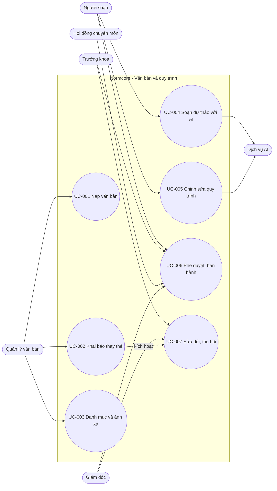
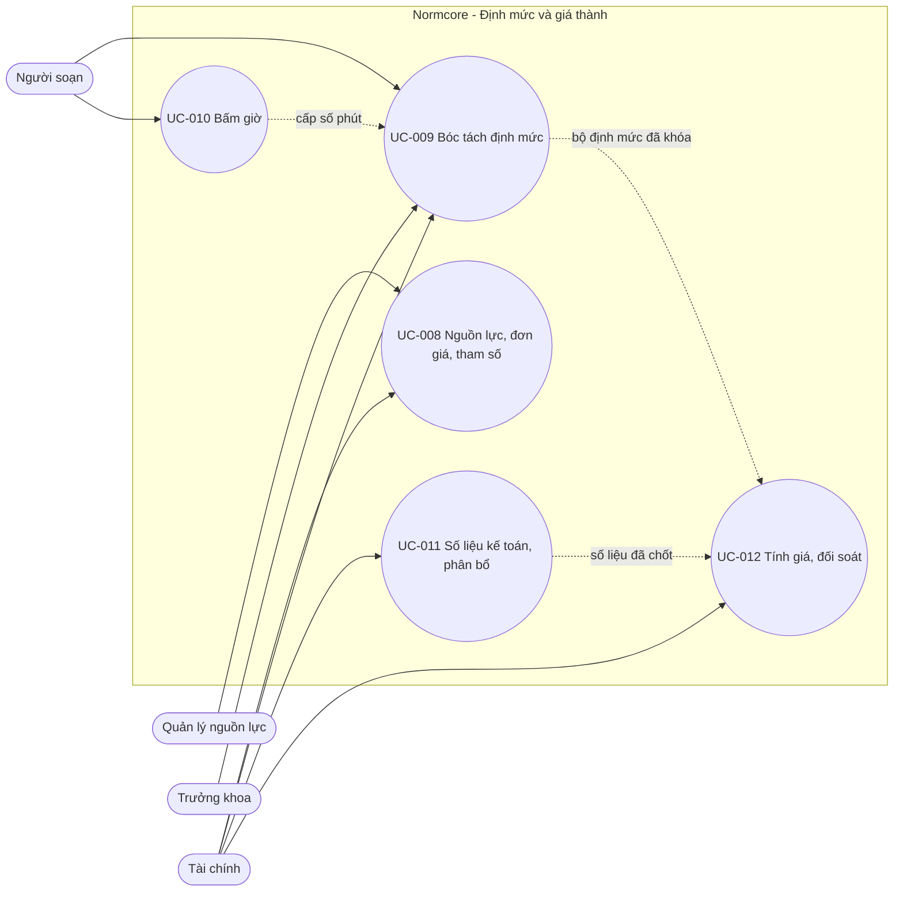
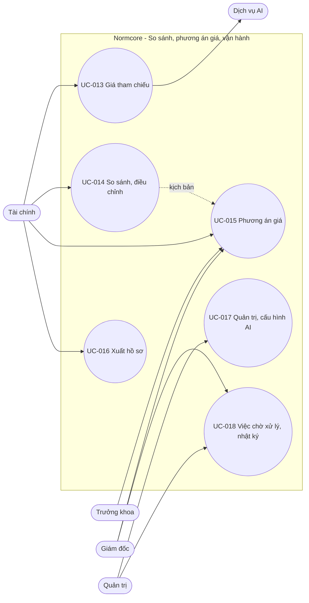
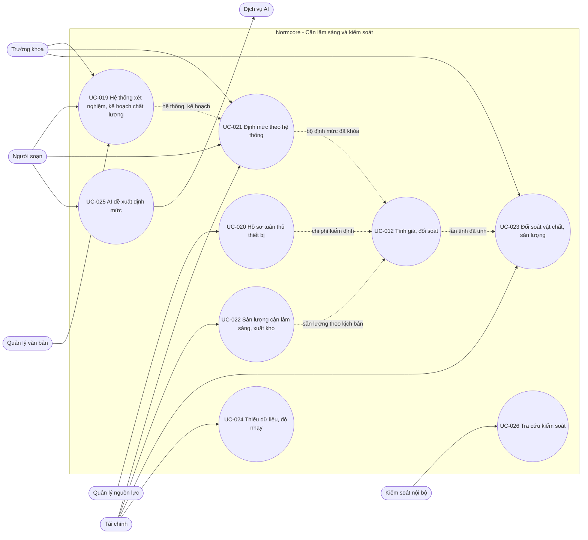

# Use Cases: Normcore

> Version: 1.1 · Last updated: 2026-11-13 · Source: docs/srs.md v1.1
> Quy ước dẫn chiếu: `FR-LIB-001..006` nghĩa là FR-LIB-001 đến FR-LIB-006.
> Bản 1.1 gộp `docs/sua-doi-1.1/use-cases.md`: sửa UC-008 và UC-012, thêm UC-019 đến UC-026 (phân hệ E, cận lâm sàng, và vai trò kiểm soát). Phần thêm mang nhãn **[1.1]**.

## Tác nhân

| Tác nhân | Vai trò hệ thống |
| :-- | :-- |
| Người soạn | NC Clinician. **[1.1]** Ở khoa cận lâm sàng là kỹ thuật viên trưởng hoặc người được khoa phân công |
| Trưởng khoa | NC Department Head |
| Hội đồng chuyên môn | NC Council Member |
| Tài chính | NC Finance |
| Quản lý nguồn lực | NC Resource Manager |
| Quản lý văn bản | NC Document Controller |
| Giám đốc | NC Director |
| Quản trị | NC Admin |
| Kiểm soát nội bộ **[1.1]** | NC Auditor |
| Dịch vụ AI | Hệ thống ngoài |

## Sơ đồ use case

### Phân hệ A: Văn bản và quy trình

### Phân hệ B và C: Định mức và giá thành

### Phân hệ D và vận hành

### Phân hệ E: Cận lâm sàng, và kiểm soát nội bộ **[1.1]**

---

## Đặc tả use case

### UC-001: Nạp văn bản pháp lý vào thư viện

- **ID:** UC-001
- **Actors:** Quản lý văn bản (chính)
- **Description:** Đưa một văn bản pháp lý hoặc tài liệu chuyên môn vào thư viện để làm nguồn cho quy trình.
- **Preconditions:** Người dùng đã đăng nhập với vai trò NC Document Controller; có tệp PDF hoặc DOCX.
- **Postconditions (success):** Văn bản có trạng thái hiệu lực đúng; nội dung đã tách thành mục và tìm kiếm được.
- **Traces to:** FR-LIB-001..006, FR-LIB-010..012

**Main success scenario**
1. Người dùng mở danh sách văn bản, chọn tạo mới.
2. Người dùng nhập số hiệu, tên, loại, cơ quan ban hành, ngày ban hành, ngày hiệu lực và đính tệp.
3. Hệ thống kiểm tra trùng số hiệu, lưu bản ghi, đặt trạng thái lập chỉ mục "Chưa lập".
4. Hệ thống chạy nền: tách nội dung thành mục, lưu số mục, tiêu đề, trang, văn bản thuần.
5. Hệ thống đặt trạng thái lập chỉ mục "Đã lập" và trạng thái hiệu lực theo ngày.
6. Người dùng mở một mục, đối chiếu văn bản đã tách với trang gốc, sửa lỗi nếu có.

**Alternate flows**
- 4a. Tệp PDF không có lớp văn bản → hệ thống nhận dạng ký tự rồi tách mục.
- 6a. Người dùng tìm theo từ khóa hoặc mã dịch vụ → hệ thống trả các mục khớp kèm số hiệu, số mục, trang, trạng thái hiệu lực.

**Exception flows**
- 3a. Số hiệu trùng → hệ thống từ chối lưu, chỉ ra bản ghi trùng.
- 4b. Tách mục hoặc nhận dạng thất bại → trạng thái "Lỗi", ghi lý do, thông báo cho người tải lên; người dùng thay tệp và chạy lại.

### UC-002: Khai báo văn bản thay thế và rà soát quy trình bị ảnh hưởng

- **ID:** UC-002
- **Actors:** Quản lý văn bản (chính), Trưởng khoa
- **Description:** Ghi nhận một văn bản mới thay thế toàn bộ hoặc một phần văn bản cũ; hệ thống chỉ ra các quy trình cần rà soát.
- **Preconditions:** Cả hai văn bản đã có trong thư viện.
- **Postconditions (success):** Văn bản hoặc mục bị thay thế có ngày hết hiệu lực; quy trình bị ảnh hưởng mang cờ "Cần rà soát"; trưởng khoa nhận thông báo.
- **Traces to:** FR-LIB-007..009, FR-WF-009, FR-NOTI-001

**Main success scenario**
1. Người dùng mở văn bản mới, chọn "Khai báo thay thế".
2. Người dùng chọn văn bản bị thay thế, phạm vi (toàn bộ hoặc chọn mục) và ngày bắt đầu thay thế.
3. Hệ thống ghi liên kết thay thế và đặt ngày hết hiệu lực tương ứng.
4. Khi đến ngày, tác vụ hằng ngày chuyển văn bản hoặc mục sang "Hết hiệu lực".
5. Hệ thống tìm các quy trình "Đã ban hành" có trích dẫn văn bản hoặc mục đó, gắn cờ "Cần rà soát", thông báo trưởng khoa.
6. Trưởng khoa mở hàng đợi rà soát, xem trích dẫn bị ảnh hưởng và mục thay thế tương ứng.
7. Trưởng khoa chọn "Sửa đổi quy trình" (sang UC-007) hoặc ghi kết luận "Không cần sửa" kèm lý do; hệ thống gỡ cờ.

**Alternate flows**
- 2a. Thay thế một phần → người dùng chọn từng mục; các mục khác giữ hiệu lực.

**Exception flows**
- 5a. Không có quy trình nào trích dẫn → hệ thống chỉ ghi liên kết thay thế.

### UC-003: Quản lý danh mục kỹ thuật và ánh xạ hướng dẫn

- **ID:** UC-003
- **Actors:** Quản lý văn bản (chính)
- **Description:** Nạp danh mục kỹ thuật của bệnh viện và gắn từng quy trình trong văn bản hướng dẫn của Bộ với dịch vụ tương ứng.
- **Preconditions:** Có tệp Excel danh mục theo mẫu; văn bản hướng dẫn đã lập chỉ mục.
- **Postconditions (success):** Dịch vụ có mã, tên, chuyên khoa, khoa thực hiện; các mục hướng dẫn được ánh xạ ở trạng thái "Đã xác nhận".
- **Traces to:** FR-SVC-001..007

**Main success scenario**
1. Người dùng nạp tệp danh mục; hệ thống tạo hoặc cập nhật dịch vụ theo mã và báo cáo dòng lỗi.
2. Người dùng gán khoa thực hiện cho các dịch vụ.
3. Người dùng mở màn hình ánh xạ của một văn bản hướng dẫn.
4. Hệ thống hiển thị từng mục quy trình với dịch vụ đề xuất và độ tin cậy.
5. Người dùng xác nhận hoặc sửa từng ánh xạ; hệ thống lưu người xác nhận và thời điểm.
6. Người dùng mở một dịch vụ và thấy tình trạng chuỗi: quy trình, định mức, giá thành, giá đã duyệt.

**Alternate flows**
- 4a. Mục không có dịch vụ khớp → người dùng tìm tay hoặc để trống.
- 5a. Một mục áp cho nhiều dịch vụ → người dùng thêm nhiều ánh xạ cho cùng mục.

**Exception flows**
- 1a. Dòng thiếu mã, thiếu tên hoặc trùng mã → bỏ qua dòng, liệt kê trong báo cáo lỗi.

### UC-004: Soạn dự thảo quy trình với AI

- **ID:** UC-004
- **Actors:** Người soạn (chính), Dịch vụ AI
- **Description:** Người soạn nêu yêu cầu; AI rà soát hướng dẫn của Bộ và tạo dự thảo quy trình đầy đủ cấu trúc, có dẫn nguồn.
- **Preconditions:** Dịch vụ thuộc khoa của người soạn; chưa có bản nháp hay bản đang duyệt của cùng khoa; tính năng AI đang bật.
- **Postconditions (success):** Có bản nháp phiên bản 1 với phần, bước, nguồn lực; mỗi phần và bước có trích dẫn hoặc nhãn "Chưa có căn cứ"; nhật ký AI được ghi.
- **Traces to:** FR-PROC-001, FR-PROC-002, FR-AI-001..005, FR-AI-008..011, FR-AI-015

**Main success scenario**
1. Người soạn mở dịch vụ, chọn "Soạn quy trình".
2. Hệ thống hiển thị các mục hướng dẫn còn hiệu lực đã ánh xạ với dịch vụ và quy trình hiện hành nếu có.
3. Người soạn nhập yêu cầu: điều kiện của khoa, thiết bị, thuốc, vật tư, biến thể kỹ thuật; chọn thêm mục liên quan nếu muốn.
4. Người soạn chọn "Soạn dự thảo"; hệ thống gửi yêu cầu và các mục nguồn cho AI, hiển thị tiến độ.
5. AI trả kết quả; hệ thống kiểm tra từng đoạn trích có nguyên văn trong mục nguồn.
6. Hệ thống tạo bản nháp có cấu trúc, gắn trích dẫn, gắn nhãn "Khác biệt" kèm lý do ở chỗ khác hướng dẫn.
7. Hệ thống ghi nhật ký AI và mở trình soạn quy trình (sang UC-005).

**Alternate flows**
- 1a. Tính năng AI tắt → hệ thống tạo bản nháp trống với các phần cố định; người soạn nhập tay.
- 2a. Không có mục hướng dẫn đã xác nhận, còn hiệu lực → hệ thống cảnh báo; người soạn xác nhận soạn tiếp; dự thảo mang nhãn "Chưa có căn cứ" ở phần không có nguồn.

**Exception flows**
- 1b. Đã có bản nháp hoặc bản đang duyệt của cùng khoa → hệ thống từ chối tạo, dẫn tới bản đang có.
- 4a. AI quá thời hạn hoặc trả lỗi → hệ thống thông báo, giữ dữ liệu đã nhập, cho soạn tay hoặc thử lại.
- 5a. Đoạn trích không khớp nguyên văn → hệ thống loại trích dẫn, gắn "Chưa có căn cứ" cho phần liên quan.

### UC-005: Chỉnh sửa quy trình và kiểm tra nhất quán

- **ID:** UC-005
- **Actors:** Người soạn (chính), Dịch vụ AI
- **Description:** Người soạn sửa nội dung, bước, nguồn lực và trích dẫn của bản nháp cho đến khi thống nhất.
- **Preconditions:** Quy trình ở trạng thái "Nháp"; người soạn thuộc khoa chủ trì.
- **Postconditions (success):** Bản nháp phản ánh ý kiến chuyên môn của khoa; lịch sử thay đổi được ghi.
- **Traces to:** FR-PROC-003..009, FR-PROC-013, FR-AI-006

**Main success scenario**
1. Người soạn mở trình soạn; bên trái là các phần và bước, bên phải là trích dẫn và mục nguồn.
2. Người soạn sửa nội dung các phần; thêm, sửa, bỏ, sắp lại bước.
3. Người soạn khai báo nguồn lực cho từng bước; hệ thống gợi ý bản ghi danh mục khớp.
4. Người soạn xem đề xuất của AI còn nhãn "Đề xuất", chấp nhận hoặc bỏ từng đề xuất.
5. Người soạn sửa lý do ở các chỗ "Khác biệt".
6. Người soạn chọn "Kiểm tra nhất quán"; hệ thống liệt kê các điểm lệch.
7. Người soạn xử lý các điểm lệch và lưu; hệ thống ghi lịch sử thay đổi.

**Alternate flows**
- 2a. Sắp lại bước → thứ tự hiển thị đổi, mã bước giữ nguyên.
- 3a. Không có bản ghi danh mục khớp → để trống liên kết; liên kết sẽ được yêu cầu ở UC-009.
- 1a. Người soạn bắt đầu bằng sao chép từ quy trình của dịch vụ khác → bản nháp mới với mã bước cấp mới, ghi nguồn sao chép.

**Exception flows**
- 6a. AI không khả dụng → hệ thống vẫn chạy các kiểm tra bằng quy tắc, báo phần kiểm tra bằng AI chưa thực hiện.

### UC-006: Phê duyệt và ban hành quy trình

- **ID:** UC-006
- **Actors:** Người soạn, Trưởng khoa, Hội đồng chuyên môn, Giám đốc
- **Description:** Quy trình đi qua ba cấp duyệt và được ban hành với số hiệu, ngày hiệu lực.
- **Preconditions:** Quy trình ở trạng thái "Nháp", không còn đề xuất AI chưa xử lý.
- **Postconditions (success):** Quy trình "Đã ban hành", nội dung khóa; phiên bản trước chuyển "Đã thay thế" khi đến ngày hiệu lực; in được bản PDF ban hành.
- **Traces to:** FR-PROC-008, FR-PROC-010..012, FR-WF-001..008, FR-WF-013, FR-NOTI-001, FR-NOTI-002

**Main success scenario**
1. Người soạn chọn "Gửi duyệt"; hệ thống kiểm tra tính hợp lệ.
2. Hệ thống chuyển sang "Chờ trưởng khoa duyệt", thông báo trưởng khoa.
3. Trưởng khoa xem quy trình, xem riêng danh sách chỗ "Khác biệt" và "Chưa có căn cứ", chọn "Đồng ý".
4. Hệ thống chuyển sang "Chờ hội đồng thẩm định", thông báo thành viên hội đồng.
5. Thành viên hội đồng ghi ý kiến gắn với phần hoặc bước.
6. Thư ký hội đồng ghi kết luận "Thông qua"; hệ thống chuyển sang "Chờ ban hành", thông báo Giám đốc.
7. Giám đốc nhập số quyết định, ngày hiệu lực và chọn "Ban hành".
8. Hệ thống khóa nội dung, đặt "Đã ban hành"; khi đến ngày hiệu lực chuyển phiên bản trước sang "Đã thay thế".
9. Người dùng in bản PDF ban hành.

**Alternate flows**
- 6a. Hội đồng yêu cầu sửa → thư ký chọn "Từ chối" kèm lý do; quy trình về "Nháp", các ý kiến được giữ.
- 9a. Người dùng xuất DOCX thay cho PDF.

**Exception flows**
- 1a. Thiếu bước ở giai đoạn Thực hiện, bước thiếu mô tả, nguồn lực thiếu số lượng hoặc đơn vị, "Khác biệt" thiếu lý do → hệ thống liệt kê lỗi, giữ "Nháp".
- 3a, 7a. Người duyệt từ chối → hệ thống yêu cầu lý do, trả về "Nháp", thông báo người soạn.
- 2a. Quá số ngày cấu hình chưa xử lý → hệ thống nhắc người duyệt.

### UC-007: Sửa đổi, so sánh phiên bản và thu hồi quy trình

- **ID:** UC-007
- **Actors:** Trưởng khoa (chính), Người soạn, Giám đốc
- **Description:** Tạo phiên bản mới từ quy trình đã ban hành, so sánh hai phiên bản, hoặc thu hồi quy trình.
- **Preconditions:** Có quy trình "Đã ban hành".
- **Postconditions (success):** Có bản nháp phiên bản kế tiếp giữ nguyên mã bước; sau khi ban hành, bộ định mức liên quan mang cờ "Cần cập nhật".
- **Traces to:** FR-WF-009..012

**Main success scenario**
1. Trưởng khoa mở quy trình đã ban hành, chọn "Sửa đổi".
2. Hệ thống tạo bản nháp phiên bản kế tiếp, sao chép toàn bộ nội dung, giữ mã bước.
3. Người soạn chỉnh sửa (UC-005) và quy trình đi qua phê duyệt (UC-006).
4. Khi phiên bản mới được ban hành, hệ thống gắn cờ "Cần cập nhật" cho các bộ định mức dựa trên phiên bản cũ, liệt kê mã bước thêm, bỏ, đổi.

**Alternate flows**
- 1a. Người dùng chọn "So sánh phiên bản" → hệ thống hiển thị khác biệt theo phần, bước, dòng nguồn lực.
- 1b. Giám đốc chọn "Thu hồi" → hệ thống yêu cầu lý do, chuyển "Đã thu hồi".
- 1c. Yêu cầu sửa đổi đến từ phân hệ D (UC-014) → bản nháp ghi kèm đề xuất thay đổi và lý do.

**Exception flows**
- 1d. Đã có bản nháp phiên bản kế tiếp → hệ thống dẫn tới bản đang có.

### UC-008: Quản lý danh mục nguồn lực, đơn giá và tham số

- **ID:** UC-008
- **Actors:** Quản lý nguồn lực (chính), Tài chính
- **Description:** Duy trì danh mục mặt hàng, đơn giá có chứng từ, thiết bị, phòng, chức danh, bộ tham số và loại giá.
- **Preconditions:** Người dùng có vai trò NC Resource Manager hoặc NC Finance.
- **Postconditions (success):** Mỗi nguồn lực có đơn giá hiệu lực xác định được tại ngày tính giá.
- **Traces to:** FR-RES-001..015, FR-ADM-002, FR-ADM-005, **[1.1]** FR-RES-016..026

**Main success scenario**
1. Người dùng tải tệp mẫu của danh mục cần nhập.
2. Người dùng nạp tệp mặt hàng và đơn giá; hệ thống tạo hoặc cập nhật theo mã, báo cáo dòng lỗi. **[1.1]** Nguồn giá có thêm "Hợp đồng"; đơn giá có thể có ngày hết hiệu lực. Với hóa chất xét nghiệm, chất chuẩn, vật liệu nội kiểm: nhập số đơn vị định mức trong một đơn vị mua, số test danh nghĩa, hạn dùng sau mở.
3. Người dùng khai báo thiết bị; hệ thống tính khấu hao năm và đơn giá giờ máy. **[1.1]** Người dùng chọn hình thức có máy và tiêu chí chia chi phí; khai linh kiện lớn; khai tỷ lệ phân bổ theo khoa nếu thiết bị dùng chung; khai công suất điện nếu muốn tính điện theo thiết bị.
4. Người dùng khai báo phòng; hệ thống tính đơn giá giờ phòng.
5. Tài chính tạo bộ tham số với ngày hiệu lực và khai báo chi phí theo chức danh; hệ thống tính đơn giá giờ công. **[1.1]** Bộ tham số có thêm: cách tính khấu hao của thiết bị đã hết thời gian sử dụng, ngưỡng đối soát vật chất, ngưỡng đối soát sản lượng.
6. Tài chính khai báo loại giá với cấp phê duyệt và cơ cấu chi phí được kết cấu.

**Alternate flows**
- 2a. Mặt hàng thanh toán riêng ngoài giá → người dùng đánh dấu; mặt hàng bị loại khỏi giá thành.
- 2b. Mặt hàng có loại tương đương → người dùng gán nhóm tương đương.
- 3a. Thiết bị đã hết thời gian sử dụng → **[1.1] sửa:** khấu hao bằng 0 hoặc tiếp tục tính, theo lựa chọn của bộ tham số (mặc định bằng 0); vẫn tính bảo trì và kiểm định.
- 5a. Bộ tham số đang được lần tính giá đã khóa sử dụng → hệ thống từ chối sửa, người dùng nhân bản.
- 2d. **[1.1]** Người dùng xác minh một đơn giá bằng cách đính kèm chứng từ → đơn giá chuyển "Đã xác minh".
- 2e. **[1.1]** Một mặt hàng có nhiều đơn giá còn hiệu lực → hệ thống chọn theo thứ tự nguồn (Trúng thầu, Hợp đồng, Hóa đơn, Giá công bố, Báo giá), cùng nguồn thì lấy bản có ngày hiệu lực gần nhất. Bản 1.0 chỉ xét ngày hiệu lực.
- 3b. **[1.1]** Hình thức Thuê hoặc Liên doanh, liên kết → hệ thống yêu cầu chi phí năm theo hợp đồng thay cho nguyên giá và thời gian sử dụng.
- 3c. **[1.1]** Hình thức Đặt theo hóa chất → không yêu cầu nguyên giá; người dùng đánh dấu bảo trì và linh kiện do nhà cung cấp chịu.

**Exception flows**
- 2c. Dòng nhập thiếu trường bắt buộc → bỏ qua dòng, báo cáo lỗi.
- 6a. Xóa bản ghi đang được tham chiếu → hệ thống từ chối, nêu bản ghi tham chiếu.
- 3d. **[1.1]** Tổng tỷ lệ phân bổ theo khoa của thiết bị khác 100% → hệ thống từ chối lưu.
- 2f. **[1.1]** Xác minh đơn giá khi chưa có tệp chứng từ → hệ thống từ chối.

### UC-009: Bóc tách và xác nhận bộ định mức

- **ID:** UC-009
- **Actors:** Người soạn (chính), Trưởng khoa, Tài chính, Dịch vụ AI
- **Description:** Từ quy trình đã ban hành, lập bộ định mức theo từng bước, xác nhận chuyên môn rồi khóa.
- **Preconditions:** Dịch vụ có quy trình "Đã ban hành"; danh mục nguồn lực đã có.
- **Postconditions (success):** Bộ định mức "Đã khóa", mọi dòng có nguồn lực danh mục, lượng, căn cứ, người xác nhận.
- **Traces to:** FR-NORM-001..016, FR-AI-007, FR-AI-008

**Main success scenario**
1. Người dùng mở dịch vụ, chọn "Khởi tạo bộ định mức" cho một khoa.
2. Hệ thống tạo bộ nháp, sinh một dòng cho mỗi dòng nguồn lực của quy trình.
3. Hệ thống đề xuất bản ghi danh mục khớp và cấu phần cho các dòng chưa liên kết, mang nhãn "Đề xuất".
4. Người dùng chấp nhận hoặc sửa liên kết; nhập lượng, đơn vị, số người, số phút, hao hụt, số lần dùng, căn cứ.
5. Người dùng thêm các dòng không có trong quy trình (điện, nước, giặt hấp), gắn mã bước hoặc "chung cho cả dịch vụ".
6. Người dùng nhập định mức do cơ quan có thẩm quyền ban hành ở các dòng có; hệ thống tính lượng áp dụng.
7. Hệ thống hiển thị chi phí trực tiếp tạm tính theo bước và cấu phần.
8. Bác sĩ hoặc trưởng khoa xác nhận từng dòng; trưởng khoa chuyển bộ sang "Đã xác nhận chuyên môn".
9. Tài chính rà soát và chọn "Khóa"; bộ định mức chuyển "Đã khóa".

**Alternate flows**
- 4a. Hao hụt vượt trần → hệ thống yêu cầu lý do.
- 4b. Dòng thuộc diện không tính vào giá → người dùng đánh dấu loại trừ và chọn lý do.
- 1a. Quy trình có phiên bản mới → người dùng tạo phiên bản bộ định mức mới; hệ thống mang sang dòng của bước còn tồn tại, đánh dấu dòng của bước bị bỏ, liệt kê bước mới chưa có dòng.
- 1c. **[1.1]** Dịch vụ có hệ thống xét nghiệm → bộ định mức lập theo từng hệ thống; xem UC-021.

**Exception flows**
- 1b. Chưa có quy trình "Đã ban hành" → hệ thống từ chối khởi tạo.
- 8a. Còn dòng chưa xác nhận, chưa liên kết danh mục, hoặc đề xuất AI chưa xử lý → hệ thống từ chối chuyển trạng thái, liệt kê các dòng.
- 4c. Cùng nguồn lực lặp trong một bước → hệ thống cảnh báo trùng.
- 9a. Bộ đã khóa → hệ thống từ chối sửa, cho tạo phiên bản mới.

### UC-010: Khảo sát bấm giờ và áp vào định mức

- **ID:** UC-010
- **Actors:** Người soạn hoặc người khảo sát (chính)
- **Description:** Ghi thời gian thực tế của từng bước qua nhiều ca và dùng trung vị làm định mức thời gian.
- **Preconditions:** Dịch vụ có quy trình "Đã ban hành".
- **Postconditions (success):** Bộ định mức nháp có số phút nhân lực và máy lấy từ bấm giờ, căn cứ "Bấm giờ".
- **Traces to:** FR-TS-001..005

**Main success scenario**
1. Người khảo sát tạo phiếu bấm giờ cho dịch vụ và khoa trên máy tính bảng; hệ thống nạp danh sách bước.
2. Với mỗi ca, người khảo sát ghi theo từng bước: chức danh, số người, số phút nhân lực, số phút máy.
3. Khi đủ số ca tối thiểu, hệ thống tính trung vị theo bước, chức danh và thiết bị.
4. Người dùng mở bộ định mức nháp, chọn "Áp kết quả bấm giờ".
5. Hệ thống cập nhật số phút các dòng tương ứng, đặt căn cứ "Bấm giờ".

**Alternate flows**
- 2a. Một bước không thực hiện trong ca → để trống; ca đó không tham gia trung vị của bước.

**Exception flows**
- 4a. Số ca ít hơn mức tối thiểu → hệ thống cảnh báo, yêu cầu xác nhận trước khi áp.

### UC-011: Nạp số liệu kế toán, sản lượng và thiết lập phân bổ

- **ID:** UC-011
- **Actors:** Tài chính (chính)
- **Description:** Đưa chi phí thực tế theo tài khoản và trung tâm chi phí, sản lượng dịch vụ và quy tắc phân bổ vào hệ thống.
- **Preconditions:** Khoa và trung tâm chi phí đã khai báo; có tệp xuất từ phần mềm kế toán và từ HIS.
- **Postconditions (success):** Lần nhập "Đã chốt"; mỗi dòng có loại chi phí; có sản lượng theo dịch vụ - khoa; có quy tắc phân bổ hai cấp.
- **Traces to:** FR-ACCT-001..011

**Main success scenario**
1. Tài chính nạp tệp chi phí cho một năm tài chính; hệ thống tạo lần nhập "Nháp", hiển thị số dòng, tổng tiền.
2. Hệ thống gán loại chi phí cho từng dòng theo bảng ánh xạ tài khoản.
3. Tài chính rà soát, sửa loại chi phí hoặc đánh dấu loại trừ ở một số dòng kèm lý do.
4. Tài chính nạp tệp sản lượng dịch vụ theo khoa.
5. Tài chính nhập tiêu chí của các trung tâm chi phí: số nhân lực, diện tích, doanh thu.
6. Tài chính khai báo quy tắc phân bổ cấp 1 và cấp 2 theo loại chi phí.
7. Tài chính chốt lần nhập; hệ thống khóa các dòng và ghi tổng theo trung tâm chi phí, loại chi phí.

**Alternate flows**
- 2a. Tài chính sửa bảng ánh xạ tài khoản mặc định rồi chạy gán lại.
- 1a. Nhập lần hai cho cùng năm → hệ thống tạo lần nhập mới, giữ lần cũ.
- 4b. **[1.1]** Sản lượng cận lâm sàng và xuất kho thực tế được nạp ở UC-022; sản lượng ở bước 4 mang kịch bản sản lượng (mặc định Thực tế 12 tháng).

**Exception flows**
- 1b. Dòng thiếu mã tài khoản, số tiền không phải số, mã trung tâm chi phí không tồn tại → liệt kê lỗi, không cho chốt.
- 7a. Còn dòng chưa có loại chi phí → hệ thống từ chối chốt.
- 4a. Mã dịch vụ hoặc mã khoa không tồn tại → báo lỗi dòng.

### UC-012: Chạy tính giá, đối soát và khóa

- **ID:** UC-012
- **Actors:** Tài chính (chính)
- **Description:** Tính giá thành và giá tính toán cho các dịch vụ trong phạm vi, đối soát với số kế toán, rồi khóa kết quả.
- **Preconditions:** Có bộ tham số; lần nhập kế toán "Đã chốt"; các dịch vụ có bộ định mức "Đã khóa". **[1.1]** Dịch vụ cận lâm sàng trong phạm vi có hệ thống xét nghiệm "Đang dùng", mỗi hệ thống có bộ định mức "Đã khóa" và sản lượng của kịch bản được chọn.
- **Postconditions (success):** Lần tính giá "Đã khóa" kèm ảnh chụp đầu vào; mỗi dịch vụ có bảng giải trình; bảng đối soát có giải trình cho dòng vượt ngưỡng.
- **Traces to:** FR-COST-001..016, FR-RES-003, FR-RES-004, FR-RES-007, **[1.1]** FR-COST-017..025, FR-COST-031, FR-COST-032, FR-CLS-003, FR-CLS-004, FR-QC-004, FR-QC-006, FR-CMP-002..004, FR-CMP-006

**Main success scenario**
1. Tài chính tạo lần tính giá: năm tài chính, ngày tính giá, bộ tham số, lần nhập kế toán, loại giá, phạm vi. **[1.1]** Chọn thêm kịch bản sản lượng (mặc định Thực tế 12 tháng) và cách phân bổ chi phí kiểm định, hiệu chuẩn (mặc định Theo giá trị tài sản).
2. Hệ thống kiểm tra điều kiện của từng dịch vụ trong phạm vi.
3. Tài chính chọn "Tính"; hệ thống chạy nền và hiển thị tiến độ.
4. Hệ thống tính chi phí trực tiếp từng dòng, phân bổ cấp 1, phân bổ cấp 2, giá thành toàn bộ, tích lũy, nghĩa vụ tài chính, giá tính toán, giá làm tròn. **[1.1]** Với dịch vụ cận lâm sàng, chi phí trực tiếp được tính như sau: hệ số k của từng hệ thống xét nghiệm; chi phí từng dòng theo cấp phát sinh; nội kiểm, chất chuẩn, ngoại kiểm từ kế hoạch chất lượng; chi phí thiết bị theo hình thức có máy và tiêu chí chia; bình quân gia quyền khi dịch vụ có nhiều hệ thống. Phân bổ cấp 1, cấp 2 chạy như cũ, dùng tổng số kết quả trả làm sản lượng.
5. Hệ thống lập bảng đối soát theo trung tâm chi phí và loại chi phí.
6. Tài chính mở bảng giải trình của từng dịch vụ để kiểm tra. **[1.1]** Bảng giải trình của dịch vụ cận lâm sàng hiện thêm hệ thống xét nghiệm, cấp phát sinh, k và các số tạo nên k, mẫu số chia.
7. Tài chính ghi giải trình cho các dòng đối soát "Vượt ngưỡng".
8. Tài chính chọn "Khóa"; hệ thống lưu ảnh chụp đầu vào và kết quả. **[1.1]** Ảnh chụp gồm cả hệ thống xét nghiệm, kế hoạch chất lượng, hồ sơ tuân thủ, thiết bị, sản lượng cận lâm sàng và xuất kho.

**Alternate flows**
- 2a. Có dịch vụ chưa có bộ định mức "Đã khóa" → hệ thống liệt kê; tài chính xác nhận chỉ tính dịch vụ đủ điều kiện.
- 4a. Loại giá không kết cấu khấu hao → hệ thống loại khấu hao thiết bị và hạ tầng, ghi rõ trên bảng giải trình.
- 4b. Dịch vụ không có sản lượng → không phân bổ cấp 2, gắn cảnh báo, vẫn tính chi phí trực tiếp. **[1.1]** Không áp dụng cho dịch vụ có hệ thống xét nghiệm; xem 4i.
- 4c. Đơn giá có chứng từ quá 24 tháng → gắn cảnh báo trên dòng chi phí.
- 8a. Tài chính so sánh với một lần tính giá trước → hệ thống hiển thị chênh lệch theo dịch vụ và cấu phần.
- 4e. **[1.1]** Sản lượng không có số test nội kiểm, chuẩn máy, chạy lại → hệ thống ước tính từ kế hoạch chất lượng, gắn nhãn "Ước tính từ kế hoạch".
- 4f. **[1.1]** Thiết bị thuộc loại bắt buộc có hồ sơ tuân thủ nhưng không có hồ sơ còn hạn → gắn cảnh báo trên lần tính, vẫn tính.
- 4g. **[1.1]** Thiết bị hết thời gian sử dụng → khấu hao bằng 0 hoặc tiếp tục tính theo lựa chọn của bộ tham số; lựa chọn hiện trên bảng giải trình.
- 4h. **[1.1]** Số test tiêu thụ trong thời hạn dùng sau mở nhỏ hơn số test danh nghĩa của một đơn vị mua → cảnh báo "Sản lượng thấp".
- 5a. **[1.1]** Đối soát vật chất và đối soát sản lượng của dịch vụ cận lâm sàng: xem UC-023.

**Exception flows**
- 4d. Một dòng định mức không có đơn giá hiệu lực → dừng tính dịch vụ đó, ghi lỗi nêu dòng thiếu, tiếp tục các dịch vụ khác.
- 8b. Còn dòng "Vượt ngưỡng" chưa giải trình → hệ thống từ chối khóa.
- 8c. Lần tính giá đã khóa → hệ thống từ chối tính lại, cho nhân bản.
- 4i. **[1.1]** Hệ thống xét nghiệm thiếu sản lượng, số kết quả trả bằng 0, hoặc có dòng Theo mẻ mà thiếu cỡ mẻ → dừng tính dịch vụ đó, ghi lỗi, tiếp tục dịch vụ khác.
- 4k. **[1.1]** Tổng tỷ trọng các hệ thống của một dịch vụ khác 100% (khi không có số kết quả theo hệ thống) → dừng tính dịch vụ đó, ghi lỗi.

### UC-013: Nạp và xác nhận giá tham chiếu

- **ID:** UC-013
- **Actors:** Tài chính (chính), Dịch vụ AI
- **Description:** Xây kho giá của các đơn vị khác để so sánh.
- **Preconditions:** Có bảng giá của đơn vị khác (tệp Excel, PDF hoặc số liệu khảo sát).
- **Postconditions (success):** Các dòng giá tham chiếu "Đã xác nhận", gắn mã dịch vụ, có nguồn và ngày hiệu lực.
- **Traces to:** FR-BM-001..008

**Main success scenario**
1. Tài chính tạo đơn vị tham chiếu: tên, tỉnh hoặc thành phố, loại hình, hạng.
2. Tài chính nạp tệp Excel giá tham chiếu theo mẫu.
3. Hệ thống đề xuất dịch vụ khớp cho các dòng chỉ có tên gốc.
4. Tài chính xác nhận từng cặp khớp; dòng chuyển "Đã xác nhận".
5. Tài chính nhập chỉ số giá tiêu dùng theo tháng; hệ thống tính giá hiệu chỉnh.

**Alternate flows**
- 2a. Nguồn là tệp PDF → hệ thống dùng AI trích thành các dòng "Đề xuất"; tài chính rà soát từng dòng với trang gốc.
- 1a. Cần khảo sát → tài chính lập phiếu khảo sát giá theo Phụ lục I, gửi đơn vị, rồi nhập kết quả.

**Exception flows**
- 2b. Trùng đơn vị, dịch vụ, loại giá, ngày hiệu lực → hệ thống từ chối dòng trùng.
- 2c. AI không khả dụng → tài chính nhập tay hoặc bằng Excel.

### UC-014: So sánh giá và xử lý gợi ý điều chỉnh

- **ID:** UC-014
- **Actors:** Tài chính (chính), Trưởng khoa
- **Description:** Đặt giá tính toán cạnh giá các đơn vị khác, xem gợi ý điều chỉnh và lập kịch bản.
- **Preconditions:** Có lần tính giá "Đã tính" hoặc "Đã khóa"; có giá tham chiếu "Đã xác nhận".
- **Postconditions (success):** Có kịch bản điều chỉnh với giá tính lại; mọi gợi ý có quyết định chấp nhận hoặc từ chối.
- **Traces to:** FR-ADJ-001..010

**Main success scenario**
1. Tài chính mở so sánh của một lần tính giá.
2. Hệ thống chọn giá tham chiếu hợp lệ cho từng dịch vụ và tính thấp nhất, trung vị, cao nhất, độ lệch.
3. Tài chính mở một dịch vụ lệch quá ngưỡng; hệ thống hiển thị cơ cấu giá thành theo cấu phần và danh sách gợi ý xếp theo tác động.
4. Tài chính chấp nhận một gợi ý không cần sửa quy trình; hệ thống ghi vào kịch bản và tính lại giá.
5. Nếu thay đổi chạm dòng định mức, hệ thống tạo phiên bản bộ định mức nháp để xác nhận lại.
6. Tài chính lặp lại cho đến khi giá hợp lý, rồi dùng kịch bản để lập phương án giá (UC-015).

**Alternate flows**
- 2a. Tài chính lọc đơn vị tham chiếu theo tỉnh, hạng, loại hình → hệ thống tính lại thống kê.
- 4a. Tài chính từ chối gợi ý → hệ thống yêu cầu lý do.
- 4b. Thay đổi cần sửa quy trình (đổi mặt hàng, thêm hoặc bỏ bước) → hệ thống từ chối áp trực tiếp, tạo yêu cầu sửa đổi quy trình gửi khoa chủ trì (UC-007).

**Exception flows**
- 2b. Dịch vụ có ít hơn 3 đơn vị tham chiếu → nhãn "Chưa đủ dữ liệu so sánh", không sinh gợi ý dựa trên so sánh.

### UC-015: Lập và phê duyệt phương án giá

- **ID:** UC-015
- **Actors:** Tài chính (chính), Trưởng khoa, Giám đốc
- **Description:** Chốt giá đề xuất cho từng dịch vụ và đưa qua xác nhận của khoa và phê duyệt của Giám đốc.
- **Preconditions:** Có lần tính giá "Đã khóa" hoặc kịch bản điều chỉnh đã hoàn tất.
- **Postconditions (success):** Phương án giá được duyệt; giá đã duyệt và ngày áp dụng ghi vào dịch vụ, hoặc phương án ở trạng thái chờ trình cơ quan có thẩm quyền.
- **Traces to:** FR-PRICE-001..010

**Main success scenario**
1. Tài chính lập phương án giá từ lần tính giá hoặc kịch bản; hệ thống tạo dòng cho từng dịch vụ.
2. Tài chính sửa giá đề xuất ở một số dòng, ghi căn cứ điều chỉnh.
3. Tài chính gửi duyệt; hệ thống chuyển "Chờ khoa xác nhận", thông báo các trưởng khoa.
4. Từng trưởng khoa xác nhận phần dịch vụ của khoa mình.
5. Hệ thống chuyển "Chờ phê duyệt", thông báo Giám đốc.
6. Giám đốc xem tổng hợp, các dòng cảnh báo, và phê duyệt.
7. Hệ thống khóa phương án, ghi giá đã duyệt và ngày áp dụng vào từng dịch vụ, giữ lịch sử giá.

**Alternate flows**
- 2a. Giá đề xuất thấp hơn giá thành toàn bộ → hệ thống cảnh báo; Giám đốc phải xác nhận riêng dòng đó khi phê duyệt.
- 7a. Loại giá do cơ quan có thẩm quyền quyết định → phương án ở trạng thái "Đã duyệt nội bộ, chờ trình"; sau khi có văn bản phê duyệt, tài chính ghi số văn bản, ngày, giá được duyệt.

**Exception flows**
- 4a, 6a. Người duyệt từ chối → hệ thống yêu cầu lý do, trả phương án về "Nháp".

### UC-016: Xuất hồ sơ

- **ID:** UC-016
- **Actors:** Tài chính (chính)
- **Description:** Xuất các biểu và hồ sơ phục vụ thẩm định, thanh tra, kiểm toán.
- **Preconditions:** Có lần tính giá "Đã khóa" hoặc phương án giá.
- **Postconditions (success):** Các tệp Excel và PDF được sinh, có thông tin truy vết ở chân trang; nhật ký xuất được ghi.
- **Traces to:** FR-OUT-001..009, FR-AUD-004

**Main success scenario**
1. Tài chính mở trung tâm xuất hồ sơ, chọn phương án giá hoặc lần tính giá.
2. Tài chính chọn loại tệp: Phụ lục II, III, IV, V; bảng giải trình; bộ định mức; bảng so sánh giá.
3. Hệ thống sinh tệp, ghi mã lần tính giá, bộ tham số, thời điểm và người xuất.
4. Hệ thống ghi nhật ký xuất và cung cấp tệp tải về.

**Alternate flows**
- 2a. Xuất toàn bộ hồ sơ → hệ thống chạy nền, đóng gói thành một tệp nén, thông báo khi xong.

**Exception flows**
- 3a. Lỗi sinh tệp → hệ thống ghi lỗi vào nhật ký tác vụ nền và thông báo người dùng.

### UC-017: Quản trị hệ thống và cấu hình AI

- **ID:** UC-017
- **Actors:** Quản trị (chính)
- **Description:** Thiết lập ban đầu, quản lý người dùng, phạm vi khoa, tham số vận hành và nhà cung cấp AI.
- **Preconditions:** Ứng dụng đã cài trên site.
- **Postconditions (success):** Người dùng có vai trò và phạm vi khoa đúng; AI hoạt động theo cấu hình hoặc được tắt.
- **Traces to:** FR-ACC-001..006, FR-AI-012..015, FR-ADM-001, FR-ADM-003, FR-ADM-004

**Main success scenario**
1. Sau khi cài, hệ thống đã có sẵn vai trò, luồng duyệt, loại giá mẫu, mẫu in, mẫu lệnh mặc định.
2. Quản trị khai báo khoa, phòng, trung tâm chi phí.
3. Quản trị tạo tài khoản, gán vai trò và khoa cho người dùng.
4. Quản trị nhập cấu hình AI: loại giao thức, địa chỉ, mô hình, khóa, thời hạn, hạn mức tháng; chọn "Kiểm tra kết nối".
5. Quản trị chỉnh tham số vận hành: số ca bấm giờ tối thiểu, số ngày nhắc duyệt.

**Alternate flows**
- 4a. Bệnh viện chưa dùng AI → quản trị tắt tính năng AI; các nút gọi AI bị ẩn.
- 4b. Quản trị sửa mẫu lệnh → hệ thống tạo phiên bản mẫu lệnh mới, giữ bản cũ.

**Exception flows**
- 4c. Kiểm tra kết nối thất bại → hệ thống hiển thị lỗi trả về, không lưu trạng thái "đang bật".
- 4d. Vượt hạn mức token tháng → hệ thống chặn lần gọi mới, thông báo quản trị.
- 3a. Người dùng mở bản ghi ngoài phạm vi → hệ thống từ chối, không lộ nội dung.

### UC-018: Theo dõi việc chờ xử lý và tra cứu nhật ký

- **ID:** UC-018
- **Actors:** Mọi người dùng; Giám đốc và Quản trị (tra cứu nhật ký)
- **Description:** Xem việc đang chờ mình, tình trạng chuỗi của các dịch vụ và lịch sử thay đổi.
- **Preconditions:** Người dùng đã đăng nhập.
- **Postconditions (success):** Người dùng đi thẳng đến bản ghi cần xử lý; người có quyền truy được ai đổi gì, lúc nào.
- **Traces to:** FR-OUT-010, FR-NOTI-003, FR-AUD-001..003

**Main success scenario**
1. Người dùng mở trang chủ Normcore.
2. Hệ thống hiển thị danh sách việc chờ xử lý của người đó và số dịch vụ theo tình trạng chuỗi trong phạm vi khoa.
3. Người dùng chọn một việc; hệ thống mở bản ghi.
4. Giám đốc hoặc Quản trị mở nhật ký, lọc theo bản ghi, người dùng, khoảng thời gian; hệ thống trả các sự kiện theo thứ tự thời gian với giá trị trước và sau. **[1.1]** Kiểm soát nội bộ cũng tra cứu được nhật ký; xem UC-026.

**Exception flows**
- 4a. Người dùng không có quyền tra cứu nhật ký → hệ thống từ chối.

### UC-019: Khai dịch vụ cận lâm sàng, hệ thống xét nghiệm và kế hoạch chất lượng **[1.1]**

- **ID:** UC-019
- **Actors:** Người soạn của khoa cận lâm sàng (chính), Trưởng khoa, Quản lý văn bản
- **Description:** Xác định mỗi dịch vụ cận lâm sàng chạy trên thiết bị nào và hoạt động bảo đảm chất lượng nào đi kèm.
- **Preconditions:** Dịch vụ, khoa, thiết bị, vật liệu nội kiểm và chất chuẩn đã có trong danh mục.
- **Postconditions (success):** Dịch vụ được đánh dấu cận lâm sàng; có ít nhất một hệ thống xét nghiệm "Đang dùng" kèm kế hoạch nội kiểm, chuẩn máy; chương trình ngoại kiểm đã khai.
- **Traces to:** FR-SVC-008..011, FR-CLS-001, FR-CLS-002, FR-CLS-005..008, FR-QC-001..003, FR-QC-005, FR-QC-007, FR-QC-008, FR-ACC-008

**Main success scenario**
1. Quản lý văn bản đánh dấu dịch vụ thuộc khối cận lâm sàng, chọn nhóm chuyên ngành và đơn vị kết quả, khai mã của dịch vụ trên HIS và LIS.
2. Người soạn tạo hệ thống xét nghiệm: mã, dịch vụ, khoa, thiết bị chính, tỷ trọng sản lượng, tỷ lệ chạy lại và hao hụt ước tính.
3. Người soạn lập kế hoạch chất lượng cho hệ thống: số ngày chạy mỗi năm; nội kiểm (vật liệu, số mức, số lần mỗi ngày, lượng mỗi lần, số thông số dùng chung); chuẩn máy (chất chuẩn, số điểm, số lần lặp, số lần mỗi năm, chi phí mỗi lần).
4. Người soạn khai chương trình ngoại kiểm của khoa: đơn vị triển khai, số đợt, số mẫu, phí, các dịch vụ tham gia.
5. Hệ thống hiển thị trên hệ thống xét nghiệm tình trạng: bộ định mức, kế hoạch chất lượng, sản lượng.

**Alternate flows**
- 2a. Dịch vụ chạy trên hai máy → tạo hai hệ thống, tổng tỷ trọng 100%.
- 2b. Thiết bị chia theo Phút chiếm máy → hệ thống yêu cầu số phút chiếm máy một ca.
- 1a. Dịch vụ bộ → khai thông số thành phần và cách tính.
- 1b. Dịch vụ gửi ngoài → khai giá hợp đồng; không cần hệ thống xét nghiệm.
- 2c. Nhập hàng loạt từ tệp Excel mẫu.
- 5a. Ngừng dùng một hệ thống → hệ thống đó không vào các lần tính mới.

**Exception flows**
- 1c. Mã ngoài đã gắn với dịch vụ khác của cùng hệ thống nguồn → từ chối.
- 3a. Vật liệu không thuộc loại Vật liệu nội kiểm, hoặc chất chuẩn không thuộc loại Chất chuẩn → từ chối lưu.
- 4a. Tỷ lệ riêng của các dịch vụ trong chương trình ngoại kiểm có tổng khác 100% → từ chối lưu.
- 2d. Người dùng sửa hệ thống của khoa không được gán → từ chối.

### UC-020: Quản lý hồ sơ tuân thủ thiết bị **[1.1]**

- **ID:** UC-020
- **Actors:** Quản lý nguồn lực (chính), Trưởng khoa, Quản trị
- **Description:** Ghi nhận các lần kiểm định, hiệu chuẩn, kiểm xạ, cấp phép của thiết bị để tính chi phí và theo dõi hạn.
- **Preconditions:** Thiết bị đã khai báo.
- **Postconditions (success):** Mỗi hồ sơ có chu kỳ, chi phí, ngày hết hạn và chứng từ; người phụ trách được nhắc trước hạn.
- **Traces to:** FR-CMP-001, FR-CMP-005, FR-CMP-007, FR-ADM-006

**Main success scenario**
1. Người dùng tạo hồ sơ tuân thủ cho một thiết bị: loại, chu kỳ tháng, đơn vị thực hiện, chi phí mỗi lần, ngày thực hiện, ngày hết hạn, tệp chứng từ.
2. Hằng ngày hệ thống cập nhật trạng thái hồ sơ và gửi thông báo cho quản lý nguồn lực và trưởng khoa khi hồ sơ còn không quá số ngày cấu hình.
3. Người dùng mở báo cáo hồ sơ tuân thủ, xem theo khoa các hồ sơ đã hết hạn và sắp hết hạn.

**Alternate flows**
- 1a. Nhập hàng loạt từ tệp Excel mẫu.
- 2a. Quản trị đổi số ngày nhắc hoặc đánh dấu loại thiết bị bắt buộc có hồ sơ.

**Exception flows**
- 1b. Thiếu tệp chứng từ hoặc chu kỳ bằng 0 → từ chối lưu.

### UC-021: Lập bộ định mức cho hệ thống xét nghiệm **[1.1]**

- **ID:** UC-021
- **Actors:** Người soạn của khoa cận lâm sàng (chính), Trưởng khoa, Tài chính
- **Description:** Bóc định mức một kết quả cho một hệ thống xét nghiệm, phân theo cấp phát sinh chi phí. Mở rộng UC-009.
- **Preconditions:** Dịch vụ có quy trình "Đã ban hành"; hệ thống xét nghiệm "Đang dùng".
- **Postconditions (success):** Bộ định mức của hệ thống ở trạng thái "Đã khóa".
- **Traces to:** FR-NORM-017..025, FR-OUT-011

**Main success scenario**
1. Người dùng khởi tạo bộ định mức cho một hệ thống xét nghiệm; hệ thống sinh dòng từ quy trình và thêm các khoản mục bắt buộc của mẫu định mức nhóm chuyên ngành.
2. Với mỗi dòng, người dùng chọn cấp phát sinh: theo kết quả, theo ống mẫu, theo mẻ, theo ngày-máy, theo kỳ; nhập lượng tương ứng.
3. Với hóa chất chính và vật tư tiêu hao theo test, cờ "nhân hệ số tiêu hao k" bật sẵn; người dùng điều chỉnh nếu cần.
4. Người dùng nhập số xét nghiệm bình quân trên một ống mẫu.
5. Trưởng khoa xác nhận từng dòng và xác nhận chuyên môn; tài chính khóa (các bước 8 và 9 của UC-009).
6. Người dùng xuất bộ định mức kèm kế hoạch chất lượng và hệ số k.

**Alternate flows**
- 1a. Sao chép từ bộ định mức của hệ thống khác của cùng dịch vụ.
- 2a. Khoản mục bắt buộc không áp dụng → đánh dấu loại trừ với lý do "Không áp dụng".
- 5a. Hệ thống chưa có kế hoạch nội kiểm → cảnh báo, vẫn cho khóa.

**Exception flows**
- 2b. Dòng dùng mặt hàng đã có trong kế hoạch nội kiểm hoặc chuẩn máy của hệ thống → từ chối lưu.
- 5b. Có dòng Theo ống mẫu mà chưa nhập số xét nghiệm mỗi ống → từ chối xác nhận chuyên môn.
- 5c. Thiếu khoản mục bắt buộc của mẫu, chưa có lý do → từ chối xác nhận chuyên môn, liệt kê khoản mục.

### UC-022: Nạp sản lượng cận lâm sàng và xuất kho thực tế **[1.1]**

- **ID:** UC-022
- **Actors:** Tài chính (chính)
- **Description:** Đưa số kết quả trả, số test phụ và lượng xuất kho vào hệ thống theo kịch bản sản lượng.
- **Preconditions:** Hệ thống xét nghiệm đã khai; có tệp xuất từ LIS, RIS và phần mềm kho.
- **Postconditions (success):** Có sản lượng theo hệ thống xét nghiệm và kịch bản; có lượng xuất kho theo mặt hàng và khoa.
- **Traces to:** FR-ACCT-012..015, FR-SVC-009

**Main success scenario**
1. Tài chính chọn năm tài chính và kịch bản sản lượng.
2. Tài chính nạp tệp sản lượng cận lâm sàng; hệ thống đổi mã ngoài sang mã dịch vụ và lưu theo hệ thống xét nghiệm.
3. Tài chính nạp tệp xuất kho thực tế theo mặt hàng và khoa.
4. Với thiết bị chia theo Phút chiếm máy, tài chính nhập tổng số phút khai thác.

**Alternate flows**
- 2a. Tệp không có số test nội kiểm, chuẩn máy, chạy lại → để trống; lần tính sẽ ước tính từ kế hoạch.
- 1a. Lập kịch bản Kế hoạch hoặc Công suất → nạp tệp riêng cho kịch bản đó.

**Exception flows**
- 2b. Mã dịch vụ, mã khoa, mã hệ thống không tồn tại hoặc số âm → liệt kê dòng lỗi, không lưu các dòng đó.

### UC-023: Đối soát vật chất và sản lượng **[1.1]**

- **ID:** UC-023
- **Actors:** Tài chính (chính), Trưởng khoa
- **Description:** So lượng vật tư, hóa chất tính được từ định mức với lượng xuất kho, và số kết quả trả với sản lượng HIS.
- **Preconditions:** Lần tính giá ở trạng thái "Đã tính".
- **Postconditions (success):** Mọi dòng đối soát vật chất vượt ngưỡng hoặc chưa đối soát có giải trình; lần tính giá khóa được.
- **Traces to:** FR-COST-026..029

**Main success scenario**
1. Hệ thống lập bảng đối soát vật chất theo khoa và mặt hàng: lượng tính được, lượng xuất kho, chênh lệch.
2. Hệ thống đánh dấu "Vượt ngưỡng" các dòng lệch quá ngưỡng đối soát vật chất.
3. Tài chính cùng trưởng khoa rà soát và ghi giải trình cho từng dòng vượt ngưỡng.
4. Hệ thống lập bảng đối soát sản lượng theo dịch vụ và khoa, gắn cảnh báo cho dòng lệch quá ngưỡng.

**Alternate flows**
- 1a. Khoa không có số liệu xuất kho → hệ thống ghi "Chưa đối soát vật chất"; tài chính xác nhận kèm lý do.
- 3a. Nguyên nhân là định mức hoặc tỷ lệ hao hụt sai → khoa tạo phiên bản bộ định mức mới; tài chính tạo lần tính mới.

**Exception flows**
- 3b. Còn dòng vật chất vượt ngưỡng hoặc chưa đối soát mà chưa có giải trình → hệ thống từ chối khóa lần tính giá.

### UC-024: Xem báo cáo thiếu dữ liệu và phân tích độ nhạy **[1.1]**

- **ID:** UC-024
- **Actors:** Tài chính (chính), Trưởng khoa
- **Description:** Biết trước dịch vụ nào chưa đủ dữ liệu để tính, và thử các giả định về sản lượng, đơn giá, hình thức có máy.
- **Preconditions:** Có phạm vi khoa hoặc dịch vụ.
- **Postconditions (success):** Người dùng có danh sách dữ liệu thiếu; kết quả thử không ghi vào lần tính giá.
- **Traces to:** FR-OUT-012, FR-COST-030

**Main success scenario**
1. Người dùng mở báo cáo thiếu dữ liệu cho một phạm vi; hệ thống liệt kê dịch vụ thiếu đơn giá, sản lượng, bấm giờ, kế hoạch chất lượng, hồ sơ tuân thủ.
2. Người dùng mở phân tích độ nhạy của một dịch vụ từ một lần tính giá, đổi sản lượng, đơn giá hoặc hình thức có máy giả định.
3. Hệ thống tính lại giá thành và hiển thị chênh lệch so với kết quả gốc.

**Exception flows**
- 2a. Giá trị giả định không hợp lệ (sản lượng bằng 0) → hệ thống báo lỗi, không tính.

### UC-025: AI đề xuất định mức từ tài liệu của hãng **[1.1]**

- **ID:** UC-025
- **Actors:** Người soạn của khoa cận lâm sàng (chính), Quản lý văn bản, Dịch vụ AI
- **Description:** Dùng hướng dẫn sử dụng hóa chất, thiết bị của hãng để gợi ý lượng hóa chất mỗi test, tần suất chuẩn máy, nội kiểm, hạn dùng sau mở. Thuộc bản phát hành 2.
- **Preconditions:** AI được bật; tài liệu của hãng đã nạp và gắn với mặt hàng hoặc thiết bị.
- **Postconditions (success):** Các đề xuất được chấp nhận trở thành dòng định mức hoặc số liệu kế hoạch chất lượng; đề xuất chưa chấp nhận không vào phép tính.
- **Traces to:** FR-LIB-013, FR-AI-016..018

**Main success scenario**
1. Quản lý văn bản nạp tài liệu của hãng, gắn với hóa chất hoặc thiết bị; hệ thống tách mục.
2. Người soạn yêu cầu AI đề xuất định mức cho một hệ thống xét nghiệm.
3. Hệ thống gửi các mục tài liệu liên quan và quy trình đã ban hành; nhận về các đề xuất có trích dẫn.
4. Người soạn chấp nhận hoặc bỏ từng đề xuất.

**Exception flows**
- 3a. Trích dẫn không có nguyên văn trong tài liệu → loại trích dẫn, gắn "Chưa có căn cứ".
- 3b. AI đề xuất mặt hàng ngoài danh mục → giữ dạng văn bản, yêu cầu liên kết thủ công.
- 3c. AI lỗi hoặc quá thời hạn → thông báo, giữ nguyên dữ liệu.

### UC-026: Kiểm soát nội bộ tra cứu dữ liệu và nhật ký **[1.1]**

- **ID:** UC-026
- **Actors:** Kiểm soát nội bộ (chính)
- **Description:** Xem toàn bộ dữ liệu nghiệp vụ và nhật ký để kiểm tra, không thay đổi dữ liệu.
- **Preconditions:** Người dùng có vai trò NC Auditor.
- **Postconditions (success):** Không bản ghi nào bị thay đổi.
- **Traces to:** FR-ACC-007; và phần sửa ở bản 1.1 của FR-ACC-002, FR-ACC-004, FR-AUD-003

**Main success scenario**
1. Người dùng mở bất kỳ bản ghi nghiệp vụ nào, gồm số liệu kế toán, kết quả phân bổ, đối soát.
2. Người dùng tra cứu nhật ký theo bản ghi, người dùng hoặc khoảng thời gian.

**Exception flows**
- 1a. Người dùng thử tạo, sửa, xóa hoặc duyệt → hệ thống từ chối.
