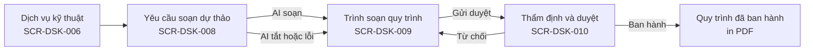
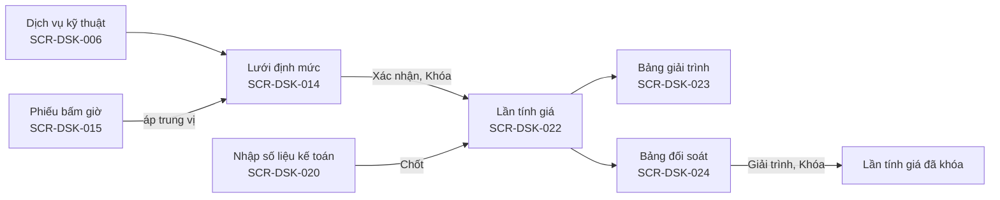
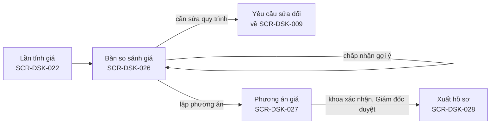
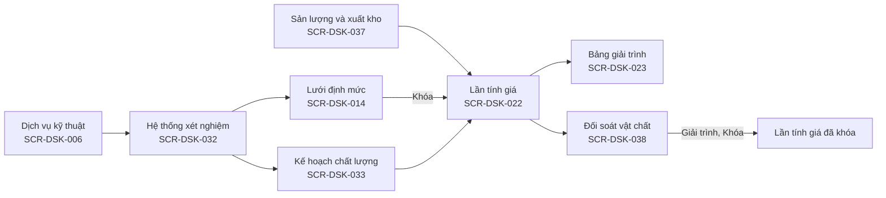

# UX Foundations: Normcore

> Status: Draft · Version: 1.1 · Last updated: 2026-11-13
> Sources: docs/srs.md · docs/architecture.md · docs/use-cases.md
> Design system: **docs/design.md** (quy ước giao diện; giá trị thiết kế lấy từ hệ thiết kế có sẵn của Frappe Desk, không định nghĩa bộ token riêng)
> Bản 1.1 gộp phần màn hình của `docs/sua-doi-1.1/architecture-ux.md`: thêm SCR-DSK-032 đến SCR-DSK-041 (phân hệ E, cận lâm sàng), sửa 10 màn hình, thêm luồng 4. Phần thêm mang nhãn **[1.1]**.

## 1. Overview

Normcore có **một bề mặt giao diện**: Desk của Frappe trên trình duyệt, mã bề mặt `DSK`. Người dùng là 10 lớp ở `docs/srs.md` mục 2.3 (bản 1.0: 9 lớp; thêm Kiểm soát nội bộ). Phần lớn màn hình là danh sách và form chuẩn; ba màn hình là trang tùy biến (ADR-010): trình soạn quy trình, lưới định mức, bàn so sánh giá. **[1.1]** Thêm một trang tùy biến nhẹ: phân tích độ nhạy. Phiếu bấm giờ dùng trên máy tính bảng bằng chính giao diện Desk đáp ứng.

Nguồn thiết kế: dùng hệ thiết kế có sẵn của Frappe Desk làm khung thành phần bắt buộc (ràng buộc C-01). Chủ dự án chưa được hỏi về nhận diện thương hiệu riêng cho Normcore; xem Part D.

---

## Part A — Shared Core

### A1. Brand and visual direction

Giao diện làm việc, mật độ thông tin cao, trung tính, theo phong cách Desk. Không thêm màu thương hiệu riêng ở v1. Chi tiết: design.md mục 1.

### A2. Voice and tone

Tiếng Việt, ngắn, dùng thuật ngữ của ngành: "quy trình kỹ thuật", "định mức", "giá thành", "phương án giá". Thông báo lỗi nêu việc cần làm, không đổ lỗi. Nhãn nút là động từ: "Gửi duyệt", "Ban hành", "Khóa", "Tính". Quy tắc câu chữ: design.md mục 5.

### A3. Design language summary

Bảng màu, kiểu chữ, khoảng cách, thành phần và trạng thái lấy nguyên từ Frappe Desk v15. Ba trang tùy biến dùng biến CSS của Desk để tự theo giao diện sáng, tối. Không có bảng giá trị ở đây; xem design.md mục 2 và 3.

### A4. Accessibility standard

Theo NFR-USE-004: các trang tùy biến đạt tương phản chữ tối thiểu 4,5:1 và thao tác được bằng bàn phím. Form chuẩn kế thừa mức của Desk. Quy tắc cụ thể: design.md mục 4.

### A5. Cross-surface principles

- **Xác nhận hành động không đảo ngược.** Ban hành, Khóa, Chốt, Phê duyệt luôn có hộp xác nhận nêu rõ hệ quả.
- **Luôn thấy trạng thái.** Mọi form có nhãn trạng thái màu ở đầu trang; bản ghi đã khóa hiển thị dải thông báo "Chỉ đọc" kèm cách tạo phiên bản mới.
- **Luôn thấy nguồn gốc.** Mọi con số tiền có liên kết đến dòng tạo ra nó; mọi đoạn quy trình có liên kết đến trích dẫn. **[1.1]** Mọi chi phí cận lâm sàng hiện mẫu số đã dùng để chia và nguồn của mẫu số (số thực tế hay ước tính từ kế hoạch) [NFR-CPL-003].
- **Đề xuất của AI luôn khác biệt bằng mắt.** Nhãn "Đề xuất" và nền nhạt cho đến khi được chấp nhận [FR-AI-008].
- **Cảnh báo không chặn, lỗi thì chặn.** Cảnh báo màu vàng cho phép đi tiếp; lỗi màu đỏ liệt kê đầy đủ việc phải sửa.

---

## Part B — Surfaces

### B1. Desk — surface code `DSK`

#### Users and primary jobs

| Lớp người dùng (SRS 2.3) | Việc chính |
| :-- | :-- |
| Người soạn (NC Clinician) | Soạn quy trình với AI; chỉnh bước và nguồn lực; xác nhận dòng định mức; ghi phiếu bấm giờ. **[1.1]** Ở khoa cận lâm sàng: khai hệ thống xét nghiệm, kế hoạch chất lượng, định mức theo hệ thống |
| Trưởng khoa (NC Department Head) | Duyệt quy trình; xác nhận bộ định mức; xác nhận phương án giá của khoa; xử lý quy trình cần rà soát. **[1.1]** Giải trình đối soát vật chất của khoa |
| Hội đồng (NC Council Member) | Ghi ý kiến theo bước; kết luận thẩm định |
| Tài chính (NC Finance) | Tham số; nạp kế toán và sản lượng; phân bổ; tính giá; đối soát; so sánh; phương án giá; xuất hồ sơ. **[1.1]** Nạp sản lượng cận lâm sàng và xuất kho; đối soát vật chất và sản lượng; phân tích độ nhạy |
| Quản lý nguồn lực (NC Resource Manager) | Mặt hàng, đơn giá, thiết bị, phòng. **[1.1]** Hình thức có máy, linh kiện, hồ sơ tuân thủ |
| Quản lý văn bản (NC Document Controller) | Nạp văn bản; khai báo thay thế; danh mục kỹ thuật; ánh xạ. **[1.1]** Đánh dấu dịch vụ cận lâm sàng, mã ngoài; nạp tài liệu của hãng |
| Giám đốc (NC Director) | Ban hành quy trình; phê duyệt giá; xem tổng quan |
| Quản trị (NC Admin) | Người dùng, khoa, cấu hình AI, nhật ký |
| Kiểm soát nội bộ (NC Auditor) **[1.1]** | Xem toàn bộ dữ liệu và nhật ký; không ghi |

#### Information architecture & navigation

Điều hướng bằng Workspace "Normcore" của Desk, chia nhóm theo phân hệ. Mỗi vai trò chỉ thấy nhóm mình có quyền.

```mermaid
flowchart TB
    home["SCR-DSK-001 Trang chủ Normcore"]

    subgraph gA["A. Văn bản và quy trình"]
        a1["SCR-DSK-002 Danh sách văn bản"]
        a2["SCR-DSK-003 Văn bản và mục"]
        a3["SCR-DSK-004 Ánh xạ hướng dẫn"]
        a4["SCR-DSK-005 Danh sách dịch vụ"]
        a5["SCR-DSK-006 Dịch vụ kỹ thuật"]
        a6["SCR-DSK-007 Danh sách quy trình"]
        a7["SCR-DSK-008 Yêu cầu soạn dự thảo"]
        a8["SCR-DSK-009 Trình soạn quy trình"]
        a9["SCR-DSK-010 Thẩm định và duyệt"]
        a10["SCR-DSK-011 So sánh phiên bản"]
        a11["SCR-DSK-012 Hàng đợi rà soát"]
    end

    subgraph gB["B. Định mức"]
        b1["SCR-DSK-013 Danh sách bộ định mức"]
        b2["SCR-DSK-014 Lưới định mức"]
        b3["SCR-DSK-015 Phiếu bấm giờ"]
        b4["SCR-DSK-016 Kết quả bấm giờ"]
    end

    subgraph gC["C. Giá thành"]
        c1["SCR-DSK-017 Mặt hàng và đơn giá"]
        c2["SCR-DSK-018 Thiết bị và phòng"]
        c3["SCR-DSK-019 Bộ tham số"]
        c4["SCR-DSK-020 Nhập số liệu kế toán"]
        c5["SCR-DSK-021 Sản lượng và phân bổ"]
        c6["SCR-DSK-022 Lần tính giá"]
        c7["SCR-DSK-023 Bảng giải trình dịch vụ"]
        c8["SCR-DSK-024 Bảng đối soát"]
    end

    subgraph gD["D. So sánh và phương án giá"]
        d1["SCR-DSK-025 Giá tham chiếu"]
        d2["SCR-DSK-026 Bàn so sánh giá"]
        d3["SCR-DSK-027 Phương án giá"]
        d4["SCR-DSK-028 Xuất hồ sơ"]
    end

    subgraph gF["E. Cận lâm sàng"]
        f1["SCR-DSK-032 Hệ thống xét nghiệm"]
        f2["SCR-DSK-033 Kế hoạch chất lượng"]
        f3["SCR-DSK-034 Chương trình ngoại kiểm"]
        f4["SCR-DSK-035 Hồ sơ tuân thủ thiết bị"]
        f5["SCR-DSK-036 Báo cáo hạn hồ sơ tuân thủ"]
        f6["SCR-DSK-037 Sản lượng cận lâm sàng và xuất kho"]
        f7["SCR-DSK-038 Đối soát vật chất và sản lượng"]
        f8["SCR-DSK-039 Báo cáo thiếu dữ liệu"]
        f9["SCR-DSK-040 Phân tích độ nhạy"]
        f10["SCR-DSK-041 Mẫu định mức"]
    end

    subgraph gE["Quản trị"]
        e1["SCR-DSK-029 Cấu hình AI và mẫu lệnh"]
        e2["SCR-DSK-030 Nhật ký"]
        e3["SCR-DSK-031 Khoa, người dùng, tham số vận hành"]
    end

    home --> gA
    home --> gB
    home --> gC
    home --> gD
    home --> gF
    home --> gE
    a5 --> a7
    a7 --> a8
    a8 --> a9
    a5 --> b2
    b2 --> c7
    c6 --> c7
    c6 --> c8
    c6 --> d2
    d2 --> d3
    d3 --> d4
    a5 --> f1
    f1 --> f2
    f1 --> b2
    c2 --> f4
    f6 --> c6
    c6 --> f7
    c6 --> f9
```

**[1.1]** Nhóm "E. Cận lâm sàng" và bảy liên kết cuối của sơ đồ thêm ở bản 1.1.

#### Key user flows

**Luồng 1: Từ yêu cầu đến quy trình ban hành [UC-004, UC-005, UC-006]**

**Luồng 2: Từ quy trình đến giá thành [UC-009, UC-010, UC-012]**

**Luồng 3: Từ giá thành đến giá được duyệt [UC-014, UC-015, UC-016]**

**Luồng 4: Từ hệ thống xét nghiệm đến giá một kết quả [UC-019, UC-021, UC-022, UC-012, UC-023]** **[1.1]**

#### Screen / page inventory

Kiểu: **L** danh sách chuẩn, **F** form chuẩn, **P** trang tùy biến, **R** báo cáo, **W** workspace.

| ID | Màn hình | Kiểu | Mục đích | Trạng thái và điểm chính |
| :-- | :-- | :-- | :-- | :-- |
| SCR-DSK-001 | Trang chủ Normcore | W | Việc chờ xử lý; số dịch vụ theo tình trạng chuỗi; lối tắt theo vai trò | Trống (chưa có việc); lọc theo khoa |
| SCR-DSK-002 | Danh sách văn bản | L | Tìm, lọc văn bản theo loại, hiệu lực, lập chỉ mục | Nhãn màu hiệu lực; ô tìm toàn văn trả về mục |
| SCR-DSK-003 | Văn bản và mục | F | Thông tin văn bản, tệp, danh sách mục, khai báo thay thế | Đang lập chỉ mục; lỗi lập chỉ mục; xem mục cạnh trang gốc. **[1.1]** Loại "Tài liệu của hãng" có bảng mặt hàng, thiết bị liên quan |
| SCR-DSK-004 | Ánh xạ hướng dẫn | P nhẹ (bảng trong form) | Xác nhận ánh xạ mục quy trình với dịch vụ | Đề xuất kèm độ tin cậy; lọc "chưa xác nhận"; xác nhận hàng loạt các dòng 100% |
| SCR-DSK-005 | Danh sách dịch vụ | L | Tìm dịch vụ theo mã, tên, chuyên khoa, khoa, tình trạng chuỗi | Cột và bộ lọc tình trạng chuỗi **[AMD-004]** (làm ở FEAT-002 cùng FR-OUT-010; FEAT-005 có mã, tên, chuyên khoa, khoa) |
| SCR-DSK-006 | Dịch vụ kỹ thuật | F | Điểm trung tâm của một dịch vụ: quy trình, định mức, giá thành, giá đã duyệt | Nút hành động theo tình trạng: "Soạn quy trình", "Khởi tạo bộ định mức" **[AMD-004]** (nút làm ở FEAT-024 và FEAT-012). **[1.1]** Khối "Cận lâm sàng": nhóm chuyên ngành, đơn vị kết quả, mã ngoài, dịch vụ bộ, gửi ngoài; danh sách hệ thống xét nghiệm của dịch vụ |
| SCR-DSK-007 | Danh sách quy trình | L | Lọc theo trạng thái, khoa, cờ "Cần rà soát" | |
| SCR-DSK-008 | Yêu cầu soạn dự thảo | Hộp thoại nhiều bước | Xem nguồn sẽ dùng; nhập yêu cầu; chọn mục bổ sung | Không có nguồn (cảnh báo); đang soạn (tiến độ); lỗi AI (cho soạn tay) |
| SCR-DSK-009 | Trình soạn quy trình | P | Sửa phần, bước, nguồn lực; bảng trích dẫn bên phải; kiểm tra nhất quán | Đề xuất AI chưa xử lý; chỗ "Khác biệt", "Chưa có căn cứ"; chỉ đọc khi đã ban hành |
| SCR-DSK-010 | Thẩm định và duyệt | Chế độ của SCR-DSK-009 | Xem quy trình chỉ đọc; ghi ý kiến theo bước; nút duyệt, từ chối, ban hành | Bảng tóm tắt khác biệt; danh sách ý kiến chưa xử lý |
| SCR-DSK-011 | So sánh phiên bản | P nhẹ | Khác biệt theo phần, bước, nguồn lực giữa hai phiên bản | Thêm (xanh), bỏ (đỏ), đổi (vàng) |
| SCR-DSK-012 | Hàng đợi rà soát | L có bộ lọc sẵn | Quy trình mang cờ "Cần rà soát" và trích dẫn bị ảnh hưởng | Hành động: "Sửa đổi", "Không cần sửa" |
| SCR-DSK-013 | Danh sách bộ định mức | L | Lọc theo trạng thái, khoa, cờ "Cần cập nhật" | **[1.1]** Thêm cột và bộ lọc hệ thống xét nghiệm |
| SCR-DSK-014 | Lưới định mức | P | Lưới dòng định mức nhóm theo bước; chi phí tạm tính theo bước và cấu phần; xác nhận dòng | Dòng đề xuất AI; dòng chưa liên kết; dòng loại trừ; cảnh báo trùng; chỉ đọc khi đã khóa. **[1.1]** Cột cấp phát sinh và ô chọn "nhân k"; ô số xét nghiệm mỗi ống ở đầu lưới; bộ lọc theo cấp phát sinh; hàng khoản mục bắt buộc chưa có lượng được tô nhấn; cảnh báo thiếu kế hoạch nội kiểm |
| SCR-DSK-015 | Phiếu bấm giờ | F (bố cục máy tính bảng) | Ghi số phút theo bước cho một ca | Nút lớn; mỗi bước một hàng; lưu ngoại tuyến không yêu cầu ở v1 |
| SCR-DSK-016 | Kết quả bấm giờ | R | Trung vị theo bước, chức danh, thiết bị; số ca | Chưa đủ số ca (cảnh báo); nút "Áp vào bộ định mức" |
| SCR-DSK-017 | Mặt hàng và đơn giá | L + F | Danh mục mặt hàng; lịch sử đơn giá có chứng từ | Đơn giá quá 24 tháng; mặt hàng thanh toán riêng. **[1.1]** Quy đổi đơn vị định mức, số test danh nghĩa, hạn dùng sau mở; nguồn "Hợp đồng", ngày hết hiệu lực; nút "Xác minh" và nhãn "Chưa xác minh" |
| SCR-DSK-018 | Thiết bị và phòng | L + F | Khai báo thiết bị, phòng; xem đơn giá giờ tạm tính | Thiết bị hết thời gian sử dụng. **[1.1]** Hình thức có máy, tiêu chí chia, chi phí hợp đồng; bảng linh kiện; bảng tỷ lệ theo khoa; khối điện; liên kết đến hồ sơ tuân thủ; trường bắt buộc đổi theo hình thức và tiêu chí |
| SCR-DSK-019 | Bộ tham số | F | Tham số tính giá và chi phí theo chức danh | Đã được dùng (chỉ đọc, cho nhân bản). **[1.1]** Khấu hao thiết bị hết thời gian sử dụng, ngưỡng đối soát vật chất và sản lượng, ba loại chi phí tạm của TBD-14 |
| SCR-DSK-020 | Nhập số liệu kế toán | F | Tải tệp; xem dòng; sửa loại chi phí; chốt | Lỗi theo dòng; dòng chưa gán loại; đã chốt |
| SCR-DSK-021 | Sản lượng và phân bổ | L + F | Sản lượng dịch vụ; tiêu chí trung tâm chi phí; quy tắc phân bổ | **[1.1]** Cột kịch bản cho sản lượng HIS; liên kết sang SCR-DSK-037 |
| SCR-DSK-022 | Lần tính giá | F | Tạo, chạy, xem tiến độ, kết quả theo dịch vụ, khóa | Đang tính; tính lỗi; dịch vụ lỗi hoặc cảnh báo; đã khóa. **[1.1]** Kịch bản sản lượng và cách phân bổ kiểm định; tab kết quả theo hệ thống xét nghiệm; cảnh báo hồ sơ tuân thủ và sản lượng thấp |
| SCR-DSK-023 | Bảng giải trình dịch vụ | P nhẹ (chế độ xem của NC Service Cost) | Từng dòng chi phí nhóm theo cấu phần và bước, kèm nguồn | Dòng phân bổ hiển thị tiêu chí; cảnh báo theo dòng. **[1.1]** Với dịch vụ cận lâm sàng: nhóm thêm theo hệ thống xét nghiệm; cột cấp phát sinh, k, mẫu số; khối "k được tính thế nào"; nhãn "Ước tính từ kế hoạch" |
| SCR-DSK-024 | Bảng đối soát | R | Số đã tính, số kế toán, chênh lệch theo trung tâm và loại chi phí | Dòng vượt ngưỡng cần giải trình. **[1.1]** Liên kết sang SCR-DSK-038; điều kiện khóa gồm cả đối soát vật chất |
| SCR-DSK-025 | Giá tham chiếu | L + F | Đơn vị, giá, nguồn; nhập tệp; rà soát dòng "Đề xuất" | Chưa gắn mã; chưa xác nhận |
| SCR-DSK-026 | Bàn so sánh giá | P | Danh sách dịch vụ với thấp nhất, trung vị, cao nhất, độ lệch; chi tiết cơ cấu giá và gợi ý | Chưa đủ dữ liệu so sánh; gợi ý cần sửa quy trình; kịch bản đang mở |
| SCR-DSK-027 | Phương án giá | F | Dòng giá đề xuất; căn cứ điều chỉnh; xác nhận của khoa; phê duyệt | Dòng dưới giá thành; chờ khoa; chờ trình |
| SCR-DSK-028 | Xuất hồ sơ | Hộp thoại từ phương án hoặc lần tính giá | Chọn loại tệp và xuất | Đang đóng gói; lỗi xuất |
| SCR-DSK-029 | Cấu hình AI và mẫu lệnh | F | Nhà cung cấp, khóa, hạn mức; mẫu lệnh có phiên bản | Kiểm tra kết nối; AI tắt; vượt hạn mức |
| SCR-DSK-030 | Nhật ký | L | Sổ sự kiện và nhật ký AI, lọc theo bản ghi, người, thời gian | Chỉ đọc. **[1.1]** NC Auditor truy cập được |
| SCR-DSK-031 | Khoa, người dùng, tham số vận hành | L + F | Khoa, trung tâm chi phí, phạm vi khoa của người dùng, NC Settings; **[AMD-002]** Nhập dữ liệu từ Excel (Desk Page `import-excel`) | **[1.1]** Số ngày nhắc hạn hồ sơ tuân thủ; loại thiết bị bắt buộc có hồ sơ ; **[AMD-002]** Trang nhập Excel: chưa chọn tệp, đã tải tệp, đã kiểm tra (bật "Xác nhận ghi"), có lỗi theo dòng, không có quyền |
| SCR-DSK-032 **[1.1]** | Hệ thống xét nghiệm | L + F | Dịch vụ, khoa, thiết bị chính, tỷ trọng; khối tình trạng: bộ định mức, kế hoạch chất lượng, sản lượng, k và giá thành lần tính gần nhất | Ngừng dùng; thiếu kế hoạch nội kiểm (cảnh báo); tổng tỷ trọng của dịch vụ khác 100% |
| SCR-DSK-033 **[1.1]** | Kế hoạch chất lượng | F | Số ngày chạy; bảng nội kiểm; bảng chuẩn máy; số test ước tính mỗi năm hiển thị ngay | Mặt hàng sai loại (từ chối); đề xuất AI chưa xử lý |
| SCR-DSK-034 **[1.1]** | Chương trình ngoại kiểm | L + F | Đơn vị, số đợt, số mẫu, phí; bảng dịch vụ tham gia và tỷ lệ | Tổng tỷ lệ khác 100% |
| SCR-DSK-035 **[1.1]** | Hồ sơ tuân thủ thiết bị | L + F | Loại, chu kỳ, chi phí, ngày hết hạn, chứng từ; lọc theo khoa và trạng thái | Còn hạn; Sắp hết hạn; Hết hạn |
| SCR-DSK-036 **[1.1]** | Báo cáo hạn hồ sơ tuân thủ | R | Hồ sơ đã hết hạn và sắp hết hạn theo khoa | Thiết bị bắt buộc mà chưa có hồ sơ |
| SCR-DSK-037 **[1.1]** | Sản lượng cận lâm sàng và xuất kho | L + F | Chọn năm và kịch bản; tải ba tệp; xem dòng đã nhập | Lỗi theo dòng; cột số test phụ trống (sẽ ước tính) |
| SCR-DSK-038 **[1.1]** | Đối soát vật chất và sản lượng | R | Hai bảng: mặt hàng theo khoa; dịch vụ theo khoa | Vượt ngưỡng cần giải trình; Chưa đối soát; cảnh báo sản lượng |
| SCR-DSK-039 **[1.1]** | Báo cáo thiếu dữ liệu | R | Dịch vụ thiếu đơn giá, sản lượng, bấm giờ, kế hoạch chất lượng, hồ sơ tuân thủ; chạy theo phạm vi | Không thiếu gì |
| SCR-DSK-040 **[1.1]** | Phân tích độ nhạy | P nhẹ | Ba ô giả định (sản lượng, đơn giá, hình thức có máy); giá thành gốc và giá thành thử cạnh nhau | Giả định không hợp lệ; nhãn "Kết quả thử, không lưu" |
| SCR-DSK-041 **[1.1]** | Mẫu định mức | F | Nhóm chuyên ngành; bảng khoản mục, cấu phần, cấp phát sinh, bắt buộc | |

#### Surface-specific components

| Thành phần | Dùng ở | Mô tả |
| :-- | :-- | :-- |
| Thẻ tình trạng chuỗi | SCR-DSK-001, 005, 006 | Bốn chấm nối: quy trình, định mức, giá thành, giá duyệt; mỗi chấm có màu trạng thái |
| Bảng trích dẫn | SCR-DSK-009, 010 | Cột phải, hiển thị trích dẫn của phần hoặc bước đang chọn, mở được mục nguồn |
| Thẻ bước | SCR-DSK-009, 010, 014 | Mã bước, giai đoạn, tên, mô tả; kéo để sắp lại ở chế độ soạn |
| Nhãn quan hệ | SCR-DSK-009, 010 | "Theo hướng dẫn", "Khác biệt", "Chưa có căn cứ" |
| Nhãn "Đề xuất" | SCR-DSK-009, 014, 025, **[1.1]** 033 | Nền nhạt, hai nút "Chấp nhận", "Bỏ" |
| Lưới định mức | SCR-DSK-014 | Lưới sửa trực tiếp, nhóm theo bước, hàng tổng theo bước và cấu phần |
| Thanh so sánh giá | SCR-DSK-026, 027 | Thang ngang từ thấp nhất đến cao nhất, vạch trung vị, điểm giá của bệnh viện |
| Thanh cơ cấu giá | SCR-DSK-023, 026 | Thanh xếp chồng theo cấu phần, kèm giá trị và tỷ trọng |
| Khối "k được tính thế nào" **[1.1]** | SCR-DSK-023, 032 | Năm số tạo nên k (kết quả trả, nội kiểm, chuẩn máy, chạy lại, ngoại kiểm), tỷ lệ hao hụt, giá trị k; số ước tính mang nhãn "Ước tính từ kế hoạch" |
| Nhãn cấp phát sinh **[1.1]** | SCR-DSK-014, 023 | Theo kết quả, Theo ống mẫu, Theo mẻ, Theo ngày-máy, Theo kỳ; kèm mẫu số khi ở bảng giải trình |

#### Token overrides

Không có.

---

## Part D — Open Questions and Risks

| Mã | Nội dung |
| :-- | :-- |
| UXQ-01 | Chủ dự án có muốn nhận diện riêng (màu, logo) cho Normcore không. Hiện dùng nguyên phong cách Desk. |
| UXQ-02 | Bác sĩ có chấp nhận trình soạn dạng thẻ bước thay cho soạn văn bản liền không. Cần thử với 3 đến 5 bác sĩ ở khoa thí điểm trước khi hoàn thiện SCR-DSK-009. |
| UXQ-03 | Phiếu bấm giờ có cần dùng khi mất mạng không. v1 không hỗ trợ ngoại tuyến. |
| UXQ-04 | Mẫu trình bày quy trình ban hành (TBD-04) quyết định bố cục bản in; chưa có. |
| UXQ-05 | Lưới định mức với dịch vụ có trên 100 dòng: cần kiểm tra khả năng dùng trên màn hình 14 inch. **[1.1]** Hai cột mới (cấp phát sinh, nhân k) làm lưới rộng hơn; kiểm tra lại cùng lúc. |
| UXQ-06 **[1.1]** | Kỹ thuật viên khoa xét nghiệm có khai được hệ thống xét nghiệm và kế hoạch chất lượng mà không cần tài chính hỗ trợ không. Cần thử với khoa xét nghiệm thí điểm sau FEAT-032. |
