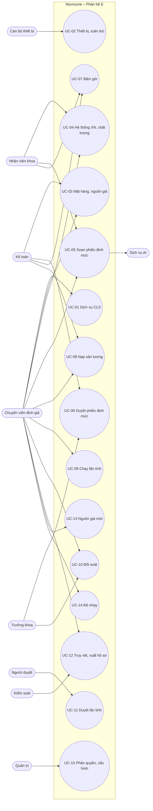

# Đặc tả Use Case – Normcore Phân hệ E

> Phiên bản 1.0 · 13/11/2026 · Dẫn xuất từ docs/srs.md. Mỗi use case ghi các FR nó hiện thực ở dòng Truy vết.

## 1. Tác nhân và sơ đồ

| Tác nhân | Vai trò trên hệ thống | Use case chính |
| :-- | :-- | :-- |
| Chuyên viên định giá | NC Pricing Officer | UC-01, 03, 04, 05, 08, 09, 10, 12, 13, 14 |
| Nhân viên khoa | NC Department User | UC-04, 05, 07 |
| Trưởng khoa | NC Department Head | UC-06, 10 |
| Cán bộ thiết bị | NC Equipment Officer | UC-02 |
| Kế toán | NC Accountant | UC-03, 06, 07, 08 |
| Người duyệt | NC Approver | UC-11 |
| Kiểm soát | NC Auditor | UC-12 |
| Quản trị | NC Administrator | UC-15 |
| Dịch vụ AI | Hệ thống ngoài | UC-05 |

## 2. Đặc tả

### UC-01: Thiết lập dịch vụ CLS và ánh xạ mã
- **Tác nhân:** Chuyên viên định giá
- **Mô tả:** Tạo danh mục dịch vụ cần định giá và gắn mã TT 23, mã HIS, LIS, RIS.
- **Tiền điều kiện:** Danh mục kỹ thuật TT 23 và danh mục khoa đã nạp.
- **Hậu điều kiện:** Dịch vụ ở trạng thái Hoạt động, sẵn sàng gắn hệ thống xét nghiệm.
- **Truy vết:** FR-SVC-001, FR-SVC-002, FR-SVC-003, FR-SVC-004, FR-SVC-005, FR-SVC-006, FR-SVC-007, FR-AUD-001

**Luồng chính**
1. Tác nhân tạo dịch vụ, nhập mã, tên, nhóm chuyên ngành, khoa, đơn vị kết quả.
2. Tác nhân chọn mã TT 23; hệ thống kiểm tra mã có trong danh mục.
3. Tác nhân thêm các mã HIS, LIS, RIS tương ứng.
4. Hệ thống kiểm tra trùng và lưu, ghi nhật ký thay đổi.

**Luồng thay thế**
- 1a. Dịch vụ bộ: tác nhân bật cờ, chọn thông số thành phần và cách tính.
- 1b. Dịch vụ gửi ngoài: tác nhân bật cờ, nhập giá hợp đồng; dịch vụ không vào tính định mức.
- 4a. Ngừng dùng: tác nhân chuyển trạng thái Ngừng; lịch sử giữ nguyên.

**Luồng ngoại lệ**
- 2a. Mã TT 23 không tồn tại: hệ thống báo lỗi, không lưu mã.
- 4b. Trùng mã nội bộ hoặc trùng mã TT 23 cùng khoa: hệ thống từ chối và chỉ ra bản ghi trùng.

### UC-02: Khai báo thiết bị và hồ sơ tuân thủ
- **Tác nhân:** Cán bộ thiết bị
- **Mô tả:** Lập hồ sơ thiết bị, hình thức có máy, linh kiện lớn, phân bổ theo khoa và các hồ sơ kiểm định, hiệu chuẩn, bảo trì.
- **Tiền điều kiện:** Có loại thiết bị và danh mục khoa.
- **Hậu điều kiện:** Thiết bị đủ dữ liệu để tính chi phí máy; hồ sơ tuân thủ có ngày hết hạn.
- **Truy vết:** FR-EQP-001, FR-EQP-002, FR-EQP-003, FR-EQP-004, FR-EQP-005, FR-EQP-006, FR-EQP-007, FR-EQP-008, FR-EQP-009, FR-CMP-001, FR-CMP-003, FR-RPT-007

**Luồng chính**
1. Tác nhân tạo thiết bị, chọn loại và hình thức có máy.
2. Hệ thống hiện các trường bắt buộc theo hình thức: Mua cần nguyên giá, ngày sử dụng, thời gian khấu hao; Thuê cần tiền thuê kỳ.
3. Tác nhân chọn tiêu chí chia chi phí máy, khai công suất điện và giờ chạy.
4. Tác nhân khai linh kiện lớn với giá thay thế và tuổi thọ.
5. Tác nhân tạo các hồ sơ tuân thủ với chu kỳ, chi phí, ngày thực hiện và chứng từ.
6. Hệ thống tính ngày hết hạn và lên lịch nhắc.

**Luồng thay thế**
- 2a. Đặt theo hóa chất: hệ thống đặt khấu hao bằng 0; tác nhân đánh dấu các khoản nhà cung cấp chịu.
- 3a. Thiết bị dùng chung: tác nhân khai tỷ lệ phân bổ theo khoa.
- 1a. Cùng site có ERPNext: tác nhân nhập mã Asset để lấy nguyên giá, ngày sử dụng.

**Luồng ngoại lệ**
- 3b. Tổng tỷ lệ phân bổ khác 100%: hệ thống từ chối lưu.
- 2b. Thiết bị Mua thiếu dữ liệu khấu hao: lưu được nhưng bị chặn khi vào lần tính.
- 6a. Hồ sơ sắp hết hạn: hệ thống gửi thông báo; báo cáo hạn hồ sơ liệt kê theo khoa.

### UC-03: Quản lý mặt hàng và nguồn giá
- **Tác nhân:** Chuyên viên định giá, Kế toán
- **Mô tả:** Lập mặt hàng và các nguồn giá có chứng từ, xác minh nguồn giá.
- **Tiền điều kiện:** Có bảng giá trúng thầu, hợp đồng hoặc hóa đơn.
- **Hậu điều kiện:** Mỗi mặt hàng có ít nhất một nguồn giá Đã xác minh còn hiệu lực.
- **Truy vết:** FR-PRC-001, FR-PRC-002, FR-PRC-005, FR-PRC-007, FR-PRC-008, FR-AUD-003

**Luồng chính**
1. Tác nhân tạo mặt hàng với loại, đơn vị mua, đơn vị định mức, số đơn vị định mức mỗi đơn vị mua.
2. Tác nhân tạo nguồn giá: loại nguồn, đơn giá, VAT, hiệu lực, số chứng từ, tệp đính kèm.
3. Kế toán kiểm tra chứng từ và chuyển nguồn giá sang Đã xác minh.
4. Hệ thống ghi người và thời điểm xác minh.

**Luồng thay thế**
- 1a. Nhập hàng loạt bằng tệp (UC-08).
- 1b. Cùng site có ERPNext: nhập mã Item và tên Supplier để liên kết.

**Luồng ngoại lệ**
- 3a. Không có tệp chứng từ: hệ thống từ chối xác minh.
- 3b. Thay tệp của nguồn giá đã dùng trong lần tính đã duyệt: hệ thống từ chối, đề nghị tạo nguồn giá mới.

### UC-04: Cấu hình hệ thống xét nghiệm và kế hoạch chất lượng
- **Tác nhân:** Chuyên viên định giá, Nhân viên khoa
- **Mô tả:** Ghép dịch vụ với thiết bị, khai tỷ trọng, phút chiếm máy, kế hoạch nội kiểm, chuẩn máy và chương trình ngoại kiểm.
- **Tiền điều kiện:** Dịch vụ và thiết bị đã có.
- **Hậu điều kiện:** Mỗi dịch vụ có các hệ thống xét nghiệm với tổng tỷ trọng 100%.
- **Truy vết:** FR-SYS-001, FR-SYS-002, FR-SYS-003, FR-SYS-005, FR-SYS-006, FR-QC-001, FR-QC-002, FR-QC-003, FR-QC-006

**Luồng chính**
1. Tác nhân tạo hệ thống xét nghiệm cho dịch vụ và thiết bị chính, nhập tỷ trọng.
2. Tác nhân nhập phút chiếm máy nếu thiết bị chia theo phút.
3. Tác nhân tạo kế hoạch nội kiểm và chuẩn máy, gắn vào hệ thống.
4. Tác nhân tạo chương trình ngoại kiểm và chọn các dịch vụ tham gia.

**Luồng thay thế**
- 1a. Dịch vụ chạy trên hai máy: tạo hai hệ thống, mỗi hệ thống một tỷ trọng.
- 3a. Nhiều hệ thống cùng máy dùng chung một kế hoạch chất lượng.

**Luồng ngoại lệ**
- 1b. Tổng tỷ trọng khác 100%: dịch vụ bị chặn khi vào lần tính.
- 3b. Hệ thống nhóm xét nghiệm không có kế hoạch nội kiểm: cảnh báo trên phiếu định mức.

### UC-05: Soạn phiếu định mức có AI hỗ trợ
- **Tác nhân:** Chuyên viên định giá, Nhân viên khoa; Dịch vụ AI
- **Mô tả:** Lập các dòng định mức của một hệ thống xét nghiệm từ mẫu, từ đề xuất của AI hoặc nhập tay.
- **Tiền điều kiện:** Hệ thống xét nghiệm, mặt hàng, khoản mục đã có.
- **Hậu điều kiện:** Phiếu ở trạng thái Nháp với các dòng Đề xuất hoặc Đã xác nhận.
- **Truy vết:** FR-NRM-001, FR-NRM-002, FR-NRM-004, FR-NRM-005, FR-NRM-009, FR-NRM-011, FR-AI-001, FR-AI-002, FR-AI-003, FR-AI-006, FR-AI-007, FR-AI-008

**Luồng chính**
1. Tác nhân tạo phiếu cho một hệ thống xét nghiệm từ mẫu của nhóm chuyên ngành.
2. Hệ thống chép các khoản mục bắt buộc vào phiếu.
3. Tác nhân đính kèm tài liệu hãng, quy trình kỹ thuật và yêu cầu AI soạn dự thảo.
4. Hệ thống gọi AI, tạo các dòng Đề xuất kèm tên tài liệu và số trang, ghi nhật ký.
5. Tác nhân sửa định lượng, chọn mặt hàng, đánh dấu Thanh toán riêng nếu có.
6. Tác nhân nhập số xét nghiệm bình quân mỗi ống và lưu phiếu.

**Luồng thay thế**
- 3a. Không dùng AI: tác nhân nhập tay từng dòng.
- 1a. Sao chép từ phiếu của hệ thống khác: mọi dòng về trạng thái Đề xuất.

**Luồng ngoại lệ**
- 4a. AI không chỉ ra nguồn: dòng mang nhãn Không có nguồn.
- 4b. AI đề xuất mặt hàng ngoài danh mục: dòng mang nhãn Chưa ánh xạ, không tạo mặt hàng mới.
- 4c. AI quá thời gian chờ: hệ thống báo lỗi, phiếu giữ nguyên.
- 5a. Đưa hóa chất chính vào khoản mục vật liệu nội kiểm: hệ thống từ chối lưu dòng.

### UC-06: Xác nhận và duyệt phiếu định mức
- **Tác nhân:** Trưởng khoa, Kế toán
- **Mô tả:** Khoa xác nhận từng dòng, kế toán thẩm định, phiếu thành Đã duyệt.
- **Tiền điều kiện:** Phiếu ở trạng thái Nháp, đủ dữ liệu.
- **Hậu điều kiện:** Phiếu Đã duyệt là đầu vào hợp lệ của lần tính.
- **Truy vết:** FR-NRM-003, FR-NRM-006, FR-NRM-007, FR-NRM-008, FR-NRM-010, FR-LAB-004, FR-APR-001, FR-APR-003, FR-APR-006, FR-AI-004, FR-INT-003

**Luồng chính**
1. Người soạn gửi phiếu cho khoa xác nhận; hệ thống chạy các quy tắc chặn.
2. Trưởng khoa xem từng dòng với nguồn chứng cứ, chọn Đã xác nhận hoặc Từ chối.
3. Trưởng khoa chuyển phiếu sang Chờ thẩm định.
4. Kế toán thẩm định và duyệt.
5. Hệ thống ghi người, thời điểm, ý kiến ở mỗi bước.

**Luồng thay thế**
- 4a. Sửa phiếu đã duyệt: hệ thống tạo phiên bản mới, bản cũ chỉ đọc; tác nhân xem so sánh hai phiên bản.
- 1a. Quy trình kỹ thuật đổi phiên bản: phiếu mang nhãn Cần rà soát.

**Luồng ngoại lệ**
- 1b. Thiếu khoản mục bắt buộc, thiếu bấm giờ hoặc thiếu số xét nghiệm mỗi ống: hệ thống chặn và liệt kê.
- 3a. Còn dòng Đề xuất: không chuyển được; dòng Đề xuất không bao giờ vào phép tính.
- 2a, 4b. Trả lại hoặc từ chối không có lý do: hệ thống từ chối thao tác.

### UC-07: Ghi nhận bấm giờ và chi phí nhân lực
- **Tác nhân:** Nhân viên khoa, Kế toán
- **Mô tả:** Khoa nhập phiếu bấm giờ theo công đoạn; kế toán nhập chi phí năm của chức danh.
- **Tiền điều kiện:** Có danh mục chức danh.
- **Hậu điều kiện:** Dòng nhân lực của phiếu định mức có số phút và đơn giá phút.
- **Truy vết:** FR-LAB-001, FR-LAB-002, FR-LAB-003, FR-SEC-003

**Luồng chính**
1. Kế toán nhập chi phí năm và giờ chuẩn năm cho từng chức danh.
2. Nhân viên khoa đo và nhập phiếu bấm giờ: dịch vụ, công đoạn, chức danh, phút mỗi mẫu, phút mỗi mẻ.
3. Hệ thống lấy trung bình các phiếu còn hiệu lực và điền vào dòng nhân lực.

**Luồng ngoại lệ**
- 1a. Người không có quyền mở chi phí chức danh: trường chi phí năm bị ẩn.
- 2a. Phiếu bấm giờ bị đánh dấu không hợp lệ: không vào trung bình.

### UC-08: Nạp sản lượng và số liệu đối soát
- **Tác nhân:** Chuyên viên định giá, Kế toán
- **Mô tả:** Nhập sản lượng kỳ, xuất kho thực tế, chi phí khoa và số dịch vụ HIS bằng tệp.
- **Tiền điều kiện:** Có mẫu tệp; mã ngoài của dịch vụ đã ánh xạ.
- **Hậu điều kiện:** Kỳ tính có sản lượng cho ba kịch bản và số liệu đối soát.
- **Truy vết:** FR-VOL-001, FR-VOL-002, FR-VOL-005, FR-VOL-006, FR-VOL-007, FR-VOL-008, FR-IMP-001, FR-IMP-002, FR-IMP-003, FR-IMP-004, FR-IMP-005, FR-QC-005

**Luồng chính**
1. Tác nhân tải mẫu, điền số liệu và chọn nhập thử.
2. Hệ thống kiểm tra từng dòng, trả lỗi theo số dòng và tên cột.
3. Tác nhân sửa tệp và nhập chính thức.
4. Hệ thống ghi các dòng hợp lệ và lưu nhật ký lần nhập.

**Luồng thay thế**
- 1a. Không có số test nội kiểm, chuẩn máy: hệ thống ước tính từ kế hoạch chất lượng và gắn nhãn.
- 1b. Có kết nối LIS hoặc RIS: sản lượng về qua API, nguồn ghi Tự động.

**Luồng ngoại lệ**
- 2a. Mã ngoài không ánh xạ được dịch vụ: dòng bị bỏ, báo lỗi.
- 4a. Trùng hệ thống, kỳ và kịch bản: hệ thống hỏi cập nhật hay bỏ qua.

### UC-09: Chạy lần tính giá thành
- **Tác nhân:** Chuyên viên định giá
- **Mô tả:** Tính giá thành 1 kết quả cho các dịch vụ trong phạm vi và kỳ đã chọn.
- **Tiền điều kiện:** Phiếu định mức Đã duyệt, nguồn giá, sản lượng kỳ đã có.
- **Hậu điều kiện:** Lần tính ở trạng thái Đã tính, có kết quả theo dòng, theo cấu phần, cho ba kịch bản, kèm ảnh chụp tham số.
- **Truy vết:** FR-CST-001, FR-CST-002, FR-CST-003, FR-CST-004, FR-CST-005, FR-CST-006, FR-CST-007, FR-CST-008, FR-CST-009, FR-CST-010, FR-CST-012, FR-CST-013, FR-CST-014, FR-PRC-003, FR-PRC-004, FR-SYS-004, FR-QC-004, FR-CMP-002, FR-CMP-004, FR-CMP-005, FR-VOL-003, FR-VOL-004, FR-AI-005, FR-INT-002

**Luồng chính**
1. Tác nhân tạo lần tính: kỳ, ngày tính, phạm vi, kịch bản chính, cách phân bổ kiểm định hiệu chuẩn.
2. Tác nhân bấm Chạy tính; hơn 20 dịch vụ thì chạy nền.
3. Hệ thống chọn đơn giá theo thứ tự ưu tiên, tính k, tính chi phí từng cấp theo QT-01 đến QT-15.
4. Hệ thống lấy bình quân gia quyền cho dịch vụ nhiều hệ thống và tổng hợp theo cấu phần TT 21.
5. Hệ thống lưu kết quả từng dòng, ảnh chụp tham số, danh sách cảnh báo và thông báo cho tác nhân.

**Luồng thay thế**
- 3a. Hệ số cấp 5 lấy từ Phân hệ C nếu đã công bố, nếu không lấy số nhập tay.

**Luồng ngoại lệ**
- 3b. Mặt hàng thiếu giá: dòng mang nhãn thiếu giá; lần tính không trình duyệt được.
- 3c. Hệ thống xét nghiệm không có sản lượng: bị loại và liệt kê.
- 3d. Sản lượng thấp, thiết bị thiếu hồ sơ tuân thủ: ghi cảnh báo, vẫn tính.
- 3e. Lỗi ở một dịch vụ: ghi lỗi cho dịch vụ đó, các dịch vụ khác vẫn tính.

### UC-10: Đối soát và giải trình
- **Tác nhân:** Chuyên viên định giá, Trưởng khoa
- **Mô tả:** So kết quả tính với xuất kho, sổ kế toán và HIS; giải trình phần lệch vượt ngưỡng.
- **Tiền điều kiện:** Lần tính ở trạng thái Đã tính.
- **Hậu điều kiện:** Lần tính ở trạng thái Đã đối soát.
- **Truy vết:** FR-REC-001, FR-REC-002, FR-REC-003, FR-REC-004, FR-REC-005, FR-REC-006

**Luồng chính**
1. Hệ thống lập bảng đối soát vật chất, tài chính, sản lượng với tỷ lệ lệch.
2. Tác nhân xem các dòng vượt ngưỡng, sắp theo giá trị lệch.
3. Tác nhân sửa nguyên nhân (định mức, sản lượng, ánh xạ mã) rồi chạy lại, hoặc nhập giải trình kèm tệp.
4. Khi mọi dòng vượt ngưỡng đã có giải trình, tác nhân chuyển sang Đã đối soát.

**Luồng ngoại lệ**
- 1a. Kỳ không có số liệu xuất kho hoặc chi phí khoa: trạng thái Không đủ số liệu; người duyệt phải xác nhận bỏ qua.
- 4a. Còn dòng vượt ngưỡng chưa giải trình: hệ thống chặn.

### UC-11: Trình và duyệt lần tính
- **Tác nhân:** Chuyên viên định giá, Người duyệt
- **Mô tả:** Trình hội đồng, duyệt, khóa tham số và chuyển giá thành sang Phân hệ C.
- **Tiền điều kiện:** Lần tính ở trạng thái Đã đối soát.
- **Hậu điều kiện:** Lần tính Đã duyệt, không sửa được; Phân hệ C nhận giá thành theo cấu phần.
- **Truy vết:** FR-APR-002, FR-APR-003, FR-APR-004, FR-APR-005, FR-APR-006, FR-CST-011, FR-INT-001

**Luồng chính**
1. Chuyên viên định giá bấm Trình hội đồng; hệ thống kiểm tra không còn vi phạm mức Chặn.
2. Người duyệt xem giá thành ba kịch bản, đối soát, cảnh báo.
3. Người duyệt xác nhận tham số, đính kèm biên bản và duyệt.
4. Hệ thống khóa lần tính và tham số, cung cấp giá thành cho Phân hệ C.

**Luồng ngoại lệ**
- 1a. Còn vi phạm mức Chặn: hệ thống từ chối và liệt kê.
- 3a. Trả lại không có lý do hoặc duyệt không có biên bản: hệ thống từ chối.
- 4a. Sửa lần tính Đã duyệt: hệ thống từ chối; phải tạo lần tính mới.

### UC-12: Truy vết “vì sao giá này” và xuất hồ sơ
- **Tác nhân:** Chuyên viên định giá, Kiểm soát
- **Mô tả:** Truy từ giá thành xuống dòng chi phí, công thức, chứng từ; xuất bộ hồ sơ.
- **Tiền điều kiện:** Lần tính đã chạy.
- **Hậu điều kiện:** Có bảng định mức, bảng giá thành, thuyết minh, phụ lục chứng từ.
- **Truy vết:** FR-RPT-001, FR-RPT-002, FR-RPT-003, FR-RPT-004, FR-RPT-005, FR-RPT-008, FR-INT-004

**Luồng chính**
1. Tác nhân mở giá thành một dịch vụ trong lần tính.
2. Hệ thống hiện các cấu phần; tác nhân mở từng cấu phần để xem dòng, lượng, k, đơn giá, quy tắc.
3. Tác nhân mở nguồn giá và tệp chứng từ của một dòng.
4. Tác nhân xuất bảng định mức, bảng giá thành, thuyết minh, phụ lục chứng từ.

**Luồng thay thế**
- 4a. Hệ thống ngoài có quyền gọi API chỉ đọc để lấy giá thành đã duyệt.
- 1a. Tác nhân mở báo cáo thiếu dữ liệu để biết dịch vụ nào chưa tính được và vì sao.

### UC-13: Xử lý nguồn giá mới
- **Tác nhân:** Chuyên viên định giá
- **Mô tả:** Khi có gói thầu mới, xem dịch vụ nào đổi giá thành và quyết định tính lại.
- **Tiền điều kiện:** Có lần tính Đã duyệt; nguồn giá mới vừa được xác minh.
- **Hậu điều kiện:** Có danh sách dịch vụ bị ảnh hưởng; có thể có lần tính mới.
- **Truy vết:** FR-PRC-006, FR-RPT-006

**Luồng chính**
1. Hệ thống liệt kê dịch vụ dùng mặt hàng có giá mới và chênh lệch giá thành ước tính.
2. Tác nhân tạo lần tính mới cho các dịch vụ đó.
3. Tác nhân mở so sánh hai lần tính để xem chênh lệch theo nguyên nhân.

### UC-14: Phân tích độ nhạy
- **Tác nhân:** Chuyên viên định giá
- **Mô tả:** Thử giá thành theo sản lượng, đơn giá hoặc hình thức có máy giả định.
- **Tiền điều kiện:** Dịch vụ có kết quả trong một lần tính.
- **Hậu điều kiện:** Không thay đổi dữ liệu lần tính.
- **Truy vết:** FR-CST-015

**Luồng chính**
1. Tác nhân mở phân tích độ nhạy của một dịch vụ.
2. Tác nhân đổi sản lượng, đơn giá một mặt hàng hoặc hình thức có máy.
3. Hệ thống tính lại và hiện giá thành mới cạnh giá thành gốc.

### UC-15: Quản trị phân quyền và cấu hình
- **Tác nhân:** Quản trị
- **Mô tả:** Gán vai trò, giới hạn theo khoa, đặt ngưỡng, thứ tự nguồn giá, bật tắt quy tắc kiểm tra.
- **Tiền điều kiện:** Người dùng đã có tài khoản.
- **Hậu điều kiện:** Quyền và cấu hình có hiệu lực cho các thao tác sau.
- **Truy vết:** FR-SEC-001, FR-SEC-002, FR-SEC-004, FR-AUD-002

**Luồng chính**
1. Quản trị gán vai trò và khoa cho người dùng.
2. Quản trị đặt ngưỡng đối soát, thứ tự ưu tiên nguồn giá, số ngày nhắc hạn.
3. Quản trị bật, tắt hoặc đổi mức của quy tắc kiểm tra.

**Luồng ngoại lệ**
- 1a. Người dùng khoa mở dữ liệu khoa khác: hệ thống không hiển thị.
- 3a. Xóa bản ghi đã tham gia lần tính đã duyệt: hệ thống từ chối, đề nghị chuyển Ngừng.
